## Introduction {.divider background-color="#00395B"}

::: {.secnum}
00
:::

<!-- =========================================================================
     RM26 L10 — Regression analysis. On-site lecture, 90 minutes, Mon 23 Nov
     2026. Lab session 10 (Fri 27 Nov) rebuilds every model of this deck in R.

     STORY. One question, one data set, all the way through:
       "What determines the weekly earnings of market research analysts —
        and do women earn less?"
     CPS 2014, 252 market research analysts (Békés & Kézdi 2021) — the same
     sample as the hub page "Categorical Variables and Interaction Terms in
     Regression", so students can read the page as a companion to the lecture.
     ONE SEQUENCE: the six steps (tracker top right, data-step) are introduced
     first and then followed in order.
       ch. 1  simple regression, all six steps: explore → specify → estimate
              (OLS, inference) → diagnose (hump in the residuals) → back to
              explore/specify (age², logs) → interpret (slope, R²)
       ch. 2  multiple regression, the same steps more selectively: the gap
              shrinks once hours are held constant → total vs direct
              effect (causal diagrams), diagnostics → model (4) in logs
       ch. 3  groups and interactions: one line misses the groups → parallel
              slopes vs interaction model
       wrap-up: the running example in six steps, researcher degrees of freedom
       optional (after the recap questions): the omitted variable bias formula

     INTERACTIVE: the OLS slide (assets/L10/ols-widget.js) and the groups
     slide (assets/L10/groups-widget.js) are small animations driven by the
     slides' fragments; both are embedded into the self-contained HTML.

     BUILDS ON the hub track "A Recap of Undergraduate Statistics": students
     know the descriptive regression line, residuals, Anscombe's quartet,
     sampling distributions, standard errors, t-tests and CIs. Not known:
     OLS as an optimisation, inference on coefficients, R², MLR. Do not
     re-teach the recap — point back to it.

     LAB ALIGNMENT (s_10_LinearModels): the lab uses the same 252 rows
     (content/material/data/cps-earnings-mra-2014.csv), fits every model of
     this deck with lm(), produces the diagnostics, and then transfers the
     workflow to a second data set. No R code in this deck on purpose.

     FIGURES AND NUMBERS: assets/L10/make-figures.R produces every figure
     and prints every number quoted here. Re-run it after any change.

     Slide conventions as in L08: assertion titles, note-style bullets
     (max. 5), keyword speaker notes with one remark per bullet, British
     spelling, every empirical claim with a source.
     ========================================================================= -->

## Learning goals

- You can estimate and interpret a **simple regression**, including its
  uncertainty

- You understand the **logic behind multiple linear regression** and how to
  interpret it

- You understand the logic behind different **models for interaction effects**

- You can choose the right **functional form** based on the visual analysis of
  the data

- You know the **steps of a regression analysis**

::: {.notes}
- Wording = official competences of the session page
- Simple regression: the line from the recap becomes a model — OLS, SE, CI, R²
- MLR: interpretation is the hard part, not the estimation
- Interactions: "the effect of X depends on Z" — three variants
- Functional form: look first, then choose
- Steps: the thread through the whole lecture — tracker top right
:::

## The recap gives the foundations

::: {.columns .divided .nonincremental}
::: {.column width="50%"}
::: {.colhead}
From the recap track
:::

- Sampling distribution · standard error
- Tests and confidence intervals
- A best-fit line — only as a **description**
- Residuals · Anscombe's quartet [@anscombe1973graphs]
:::

::: {.column width="50%"}
::: {.colhead}
New today
:::

- Regression as a **model**: OLS, inference, R², diagnostics
- Several variables at once
- Groups and interactions
- Functional form · a workflow
:::
:::

::: {.keybox .fragment}
This is **not** new statistics — it is the recap in an applied and slightly extended form.
:::

::: {.notes}
- Recap track on the hub: worked through before L09
- Left: all assumed known — I point back, I do not repeat
- Regression in the recap: one section of "Descriptive statistics" — a best-fit line, residuals, lm(); no inference, no R², no diagnostics
- Right: what changes when the line becomes a model
- Box: SE, CI, t-test of a coefficient = same logic as for a mean
- Questions on the recap: Moodle forum, or L09 slides
:::

## A regression analysis has six steps

```{=html}
<svg viewBox="0 0 1400 385" width="100%" style="display: block; margin: 1.2em auto 0.6em;" role="img"
     aria-label="Six boxes in a row: question, explore, specify, estimate, diagnose, interpret, linked by arrows; one arrow leads from diagnose back to estimate, another from interpret back to explore">
  <defs>
    <marker id="st-arrow" viewBox="0 0 10 10" refX="9" refY="5" markerWidth="6" markerHeight="6" orient="auto-start-reverse">
      <path d="M0,0 L10,5 L0,10 z" fill="#00395B"/>
    </marker>
    <marker id="st-back" viewBox="0 0 10 10" refX="9" refY="5" markerWidth="6" markerHeight="6" orient="auto-start-reverse">
      <path d="M0,0 L10,5 L0,10 z" fill="#1C7F7B"/>
    </marker>
  </defs>
  <g font-family="Inter, sans-serif" text-anchor="middle">
    <!-- step 1: always visible -->
    <rect x="65" y="190" width="170" height="110" fill="#fff" stroke="#00395B" stroke-width="3"/>
    <text x="150" y="230" font-size="17" fill="#6F6F6F">Step 1</text>
    <text x="150" y="270" font-size="27" font-weight="700" fill="#00395B">Question</text>
    <text x="150" y="342" font-size="19" fill="#6F6F6F">What do you want</text>
    <text x="150" y="367" font-size="19" fill="#6F6F6F">to know — and why?</text>
    <g class="fragment">
      <line x1="239" y1="245" x2="279" y2="245" stroke="#00395B" stroke-width="3" marker-end="url(#st-arrow)"/>
      <rect x="285" y="190" width="170" height="110" fill="#fff" stroke="#00395B" stroke-width="3"/>
      <text x="370" y="230" font-size="17" fill="#6F6F6F">Step 2</text>
      <text x="370" y="270" font-size="27" font-weight="700" fill="#00395B">Explore</text>
      <text x="370" y="342" font-size="19" fill="#6F6F6F">Look at the data</text>
      <text x="370" y="367" font-size="19" fill="#6F6F6F">before modelling it</text>
    </g>
    <g class="fragment">
      <line x1="459" y1="245" x2="499" y2="245" stroke="#00395B" stroke-width="3" marker-end="url(#st-arrow)"/>
      <rect x="505" y="190" width="170" height="110" fill="#fff" stroke="#00395B" stroke-width="3"/>
      <text x="590" y="230" font-size="17" fill="#6F6F6F">Step 3</text>
      <text x="590" y="270" font-size="27" font-weight="700" fill="#00395B">Specify</text>
      <text x="590" y="342" font-size="19" fill="#6F6F6F">Model, functional</text>
      <text x="590" y="367" font-size="19" fill="#6F6F6F">form, variables</text>
    </g>
    <g class="fragment">
      <line x1="679" y1="245" x2="719" y2="245" stroke="#00395B" stroke-width="3" marker-end="url(#st-arrow)"/>
      <rect x="725" y="190" width="170" height="110" fill="#fff" stroke="#00395B" stroke-width="3"/>
      <text x="810" y="230" font-size="17" fill="#6F6F6F">Step 4</text>
      <text x="810" y="270" font-size="27" font-weight="700" fill="#00395B">Estimate</text>
      <text x="810" y="342" font-size="19" fill="#6F6F6F">Fit the model,</text>
      <text x="810" y="367" font-size="19" fill="#6F6F6F">quantify uncertainty</text>
    </g>
    <g class="fragment">
      <line x1="899" y1="245" x2="939" y2="245" stroke="#00395B" stroke-width="3" marker-end="url(#st-arrow)"/>
      <rect x="945" y="190" width="170" height="110" fill="#fff" stroke="#00395B" stroke-width="3"/>
      <text x="1030" y="230" font-size="17" fill="#6F6F6F">Step 5</text>
      <text x="1030" y="270" font-size="27" font-weight="700" fill="#00395B">Diagnose</text>
      <text x="1030" y="342" font-size="19" fill="#6F6F6F">What did the</text>
      <text x="1030" y="367" font-size="19" fill="#6F6F6F">model miss?</text>
    </g>
    <!-- diagnose sends you back to estimate -->
    <g class="fragment">
      <path d="M1030,186 C1030,108 810,108 810,182" fill="none" stroke="#1C7F7B" stroke-width="3" marker-end="url(#st-back)"/>
      <text x="920" y="112" font-size="19" font-weight="700" fill="#1C7F7B">back and forth</text>
    </g>
    <g class="fragment">
      <line x1="1119" y1="245" x2="1159" y2="245" stroke="#00395B" stroke-width="3" marker-end="url(#st-arrow)"/>
      <rect x="1165" y="190" width="170" height="110" fill="#fff" stroke="#00395B" stroke-width="3"/>
      <text x="1250" y="230" font-size="17" fill="#6F6F6F">Step 6</text>
      <text x="1250" y="270" font-size="27" font-weight="700" fill="#00395B">Interpret</text>
      <text x="1250" y="342" font-size="19" fill="#6F6F6F">Answer the question</text>
      <text x="1250" y="367" font-size="19" fill="#6F6F6F">— and its limits</text>
    </g>
    <!-- the answer raises new questions: back to explore -->
    <g class="fragment">
      <path d="M1250,186 C1250,0 370,0 370,182" fill="none" stroke="#1C7F7B" stroke-width="3" marker-end="url(#st-back)"/>
      <text x="810" y="34" font-size="19" font-weight="700" fill="#1C7F7B">new insights → a new round</text>
    </g>
  </g>
</svg>
```

::: {.arrow .xl .fragment}
Not a one-way street — iterate, and document every round
:::

::: {.notes}
- Extends last year's four steps by question and diagnosis
- Question: description, prediction or explanation? Decides the rest
- Explore: plots first — Anscombe from the recap
- Specify: family and form chosen before looking at p-values
- Estimate: OLS — the only step the software does for you
- Diagnose: residuals show what the model missed
- Interpret: careful wording · limits
- Built step by step: one click per step
- Back and forth: diagnosis → re-estimate (other SEs, other sample, other form)
- New round: the answer raises new questions → explore again
- Arrow: iterate — but document every round
- Tracker top right from now on
:::

## The guiding question {data-step="1"}

::: {.dek}
What determines the weekly earnings of market research analysts — and do women
earn less?
:::

- **Data:** US Current Population Survey 2014, via @bekes2021data

- **Sample:** 252 market research analysts · aged 24–64 · ≥ 20 hours a week

- **Variables:** weekly earnings · age · usual hours · education · gender

- **Same data in the lab** — every model today is rebuilt in R on Friday

::: {.arrow .xl .fragment}
First with age alone — then gender, hours and more
:::

::: {.source}
Same sample as the hub page on categorical variables and interactions
[@graebner2026-multiple-regression-categorical-interactions]. Gender gap
literature: @blau2017gender.
:::

::: {.notes}
- Real data, one occupation → no occupation differences to worry about
- CPS: monthly US household survey, official labour market statistics
- 252 people: small → uncertainty will matter
- Variables: earnings = outcome; others = candidates for explanation
- Lab: same CSV, same models — the lecture is the "why", the lab the "how"
- Gender gap: large literature — Blau & Kahn as the standard overview
- Arrow: chapter 1 = one variable, all six steps; chapters 2–3 = the same steps with several variables
:::

## Revisit simple regression in six steps {.divider background-color="#00395B"}

::: {.secnum}
01
:::

## Look first: a weak, noisy, positive relationship {data-step="2"}

::: {.columns}
::: {.column width="62%"}
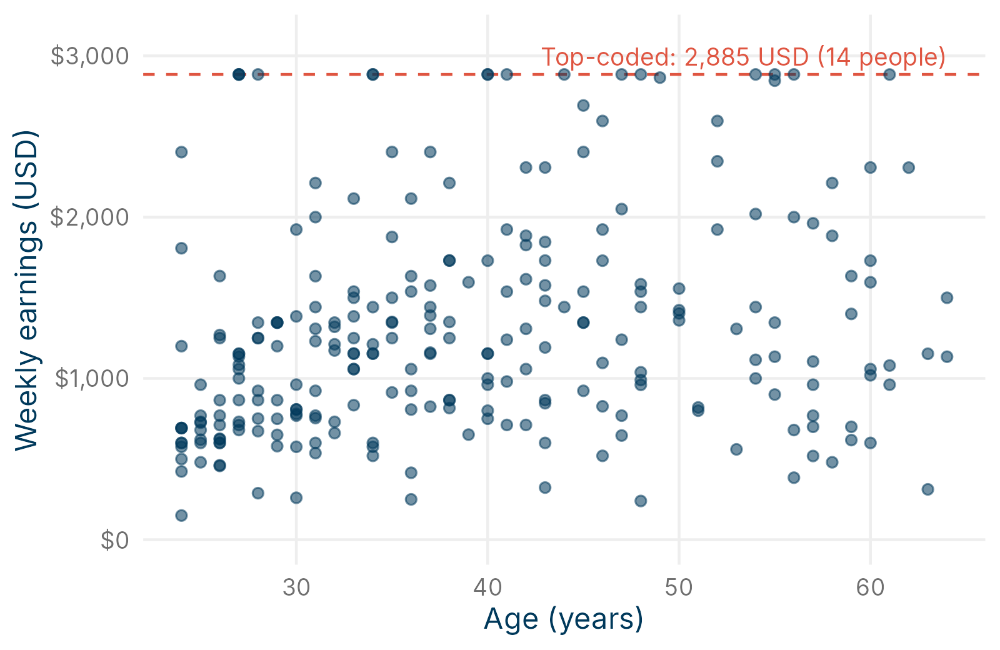
:::

::: {.column width="38%"}
- **Positive** — but weak

- **Large spread** at every age

- **Ceiling:** earnings top-coded at 2,885 USD

- Top-coding = a property of the **data**, not of the analysts
:::
:::

::: {.notes}
- Explore step: always the scatter plot first
- Positive: older analysts tend to earn more
- Spread: age explains little — guess for R²
- Ceiling: CPS caps reported earnings for privacy → 14 people
- Top-coding: their true earnings are higher → underestimates at the top
- Question to the room: what does the ceiling do to a fitted line?
:::

## Earnings are right-skewed — logs make them more symmetric {data-step="2 3"}

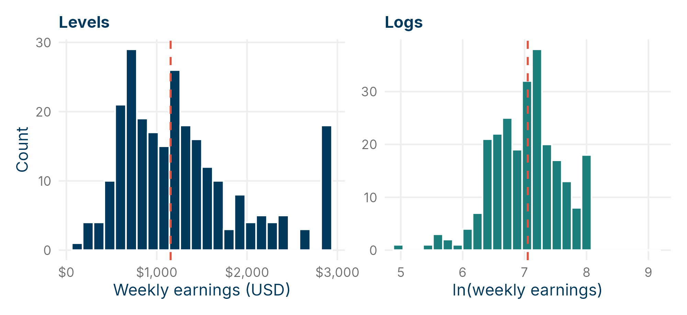{height="430px"}

- **Skew:** a few high earners — typical for money variables

- **Logs:** compress the top · turn proportional changes into additive ones
  - A 10 % raise multiplies earnings by 1.1 → adds $\ln 1.1 \approx 0.095$ to log earnings — at 500 USD as at 2,000 USD

::: {.notes}
- Dashed: median · log axis centred on it, to compare the two tails
- Left: long right tail — and the ceiling
- Right: logs → more symmetric, not perfectly: left tail now longer, ceiling still visible
- Money variables: income, wealth, firm size, GDP — logs common
- Proportional: ln(1.1 · y) = ln y + ln 1.1 — multiplying becomes adding
- Sub-bullet: 500 → 550 and 2,000 → 2,200 are both +0.095 in logs, though +50 vs +200 USD
- Logs introduction on the hub: why this works
:::

## The model separates a systematic part from noise {data-step="3"}

$$
\underbrace{\text{earnings}_i}_{\text{outcome}} =
\underbrace{\beta_0 + \beta_1 \cdot \text{age}_i}_{\text{systematic part } f(X)} +
\underbrace{\varepsilon_i}_{\text{error term}}
$$

- **Population:** $\beta_0, \beta_1$ fixed but unknown · $\varepsilon_i$ never observed

- **Sample:** estimates $\hat{\beta}_0, \hat{\beta}_1$ · residuals $e_i = y_i - \hat{y}_i$

- Residuals = sample counterpart of the error term

- Same logic as mean $\mu$ vs sample mean $\bar x$ in the recap

::: {.notes}
- From description to model: the line now stands for a population relationship
- Outcome = dependent variable · age = independent variable, predictor
- Population: parameters fixed, unknown — what we want to learn about
- Sample: hats = estimates from these 252 people
- Residuals observable, errors not — hub page on diagnostics
- Recap: μ vs x̄ — identical idea
:::

## OLS picks the line with the smallest squared residuals {data-step="4"}

```{=html}
<div id="ols-widget"></div>
<span class="fragment" id="ols-play"></span>
<script src="assets/L10/L10-ols-data.js"></script>
<script src="assets/L10/ols-widget.js"></script>
```

- **Criterion:** choose the line with the smallest $\sum_i e_i^2$

- **Squared:** large misses count more · signs cannot cancel out

- Same criterion for every linear model today

::: {.notes}
- Twelve analysts from our data — few enough to see every residual
- Opens with a horizontal line · click 1 starts the animation
- Animation: line turns around the point of means; red = residuals
- Right panel: sum of squared residuals for each slope — a parabola
- It settles at the minimum: that slope is the OLS estimate (15.5 here)
- Slider: try a slope by hand · Replay restarts
- Line through the means = best intercept for any slope → only the slope varies
- Squared: positive and negative misses would otherwise cancel
- Same criterion with ten variables — only the geometry gets harder · in R: lm() — lab
:::

## "Linear" means linear in the parameters {data-step="3"}

::: {.columns}
::: {.column width="25%" .fragment}
::: {style="text-align: center;"}
$y = \beta_0 + \beta_1 x$

**Linear**

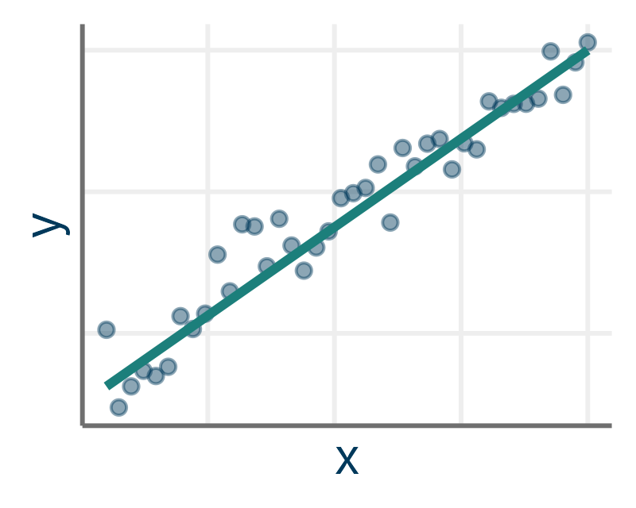{height="300px"}
:::
:::

::: {.column width="25%" .fragment}
::: {style="text-align: center;"}
$y = \beta_0 + \beta_1 x + \beta_2 x^2$

**Linear** — in the $\beta$s

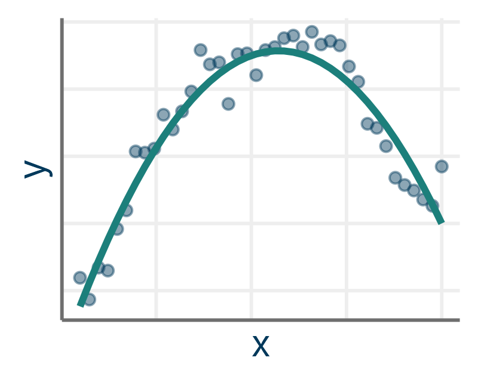{height="300px"}
:::
:::

::: {.column width="25%" .fragment}
::: {style="text-align: center;"}
$\ln y = \beta_0 + \beta_1 x$

**Linear** — after $\ln y$

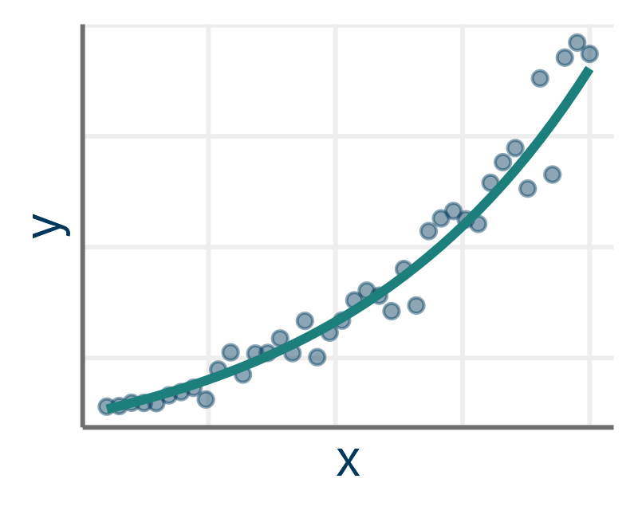{height="300px"}
:::
:::

::: {.column width="25%" .fragment}
::: {style="text-align: center;"}
$y = \beta_0 + x^{\beta_1}$

[**Not linear**]{.red}

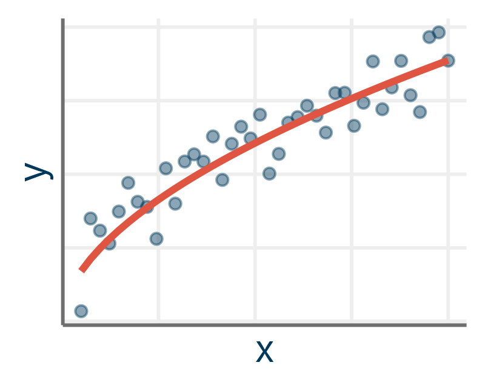{height="300px"}
:::
:::

:::

::: {.arrow .xl .fragment}
OLS can fit curves — if you tell it which
:::

::: {.notes}
- Common misunderstanding: linear regression = straight lines only
- Line: the standard case
- Quadratic: a parabola, still estimated by OLS — new variable x²
- Log: transform first, then a straight line — on the original scale a curve
- Parameter in the exponent: needs other methods (nonlinear least squares) — not today
- Note: the last curve looks no stranger than the others — what matters is where the parameter sits
- After OLS: the same criterion fits all four — the form is a choice we make
- Arrow: the choice of form is yours, not the software's — so far a straight line; the residuals will judge
:::

## A coefficient has a sampling distribution, too {.sync-fragments data-step="4"}

::: {.columns}
::: {.column width="50%"}
::: {.r-stack}
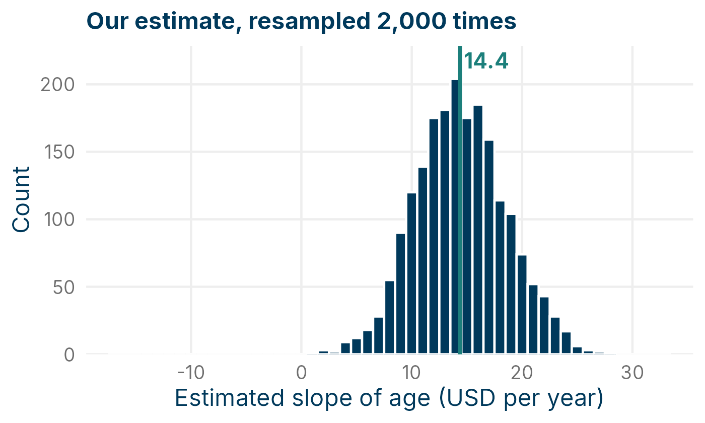{height="390px"}

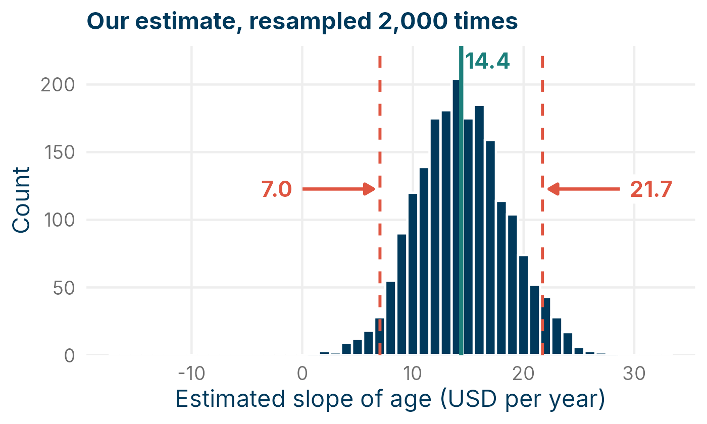{.fragment data-with="2" height="390px"}
:::
:::

::: {.column width="50%"}
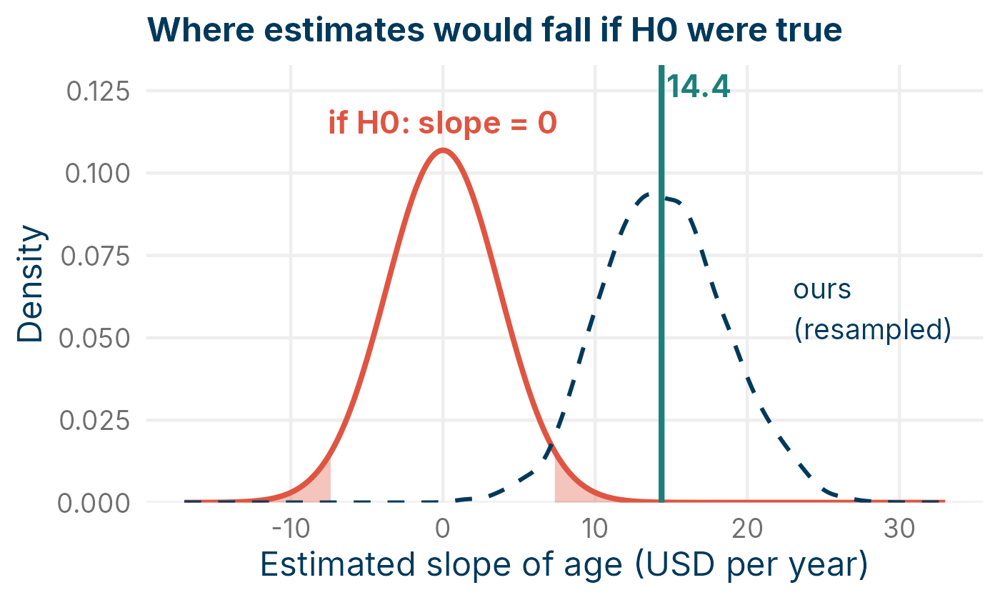{.fragment data-with="3" height="390px"}
:::
:::

- **SE:** 3.7 — spread of $\hat{\beta}_1$ across samples

- **95% CI:** [7.0, 21.7]

- **If $H_0: \beta_1 = 0$:** estimates near 0 · ours lies far out → p < 0.001 → reject

- Exactly the recap — applied to a slope

::: {.notes}
- Another sample of 252 analysts → another slope
- Left: 2,000 bootstrap resamples of our data — SD 4.1, close to the SE
- SE from the regression output: 3.7
- CI: bounds marked with the bullet — zero far outside
- Right: where slopes would fall if the true slope were 0 (red, SE 3.7) vs ours (dashed)
- Shaded tails: beyond ±7.3 we reject at 5% — 14.4 far beyond
- p < 0.001: a slope this far from 0 would almost never turn up if the true slope were 0
- Recap pages 5 and 6 — nothing new, only applied to a slope
:::

## The straight line leaves a hump in the residuals {data-step="5"}

::: {.columns}
::: {.column width="58%"}
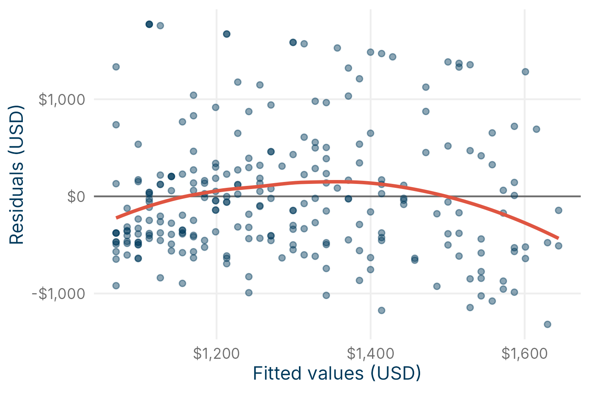{height="450px"}
:::

::: {.column width="42%"}
- **Tukey–Anscombe plot:** residuals vs fitted values

- **Wanted:** no pattern — a flat band around zero

- **Here:** a hump — the line is too low in the middle, too high at both ends

- → back to exploring and specifying
:::
:::

::: {.notes}
- Diagnose step for the straight line
- Residual = what the line got wrong; fitted = what it predicted
- Flat band: the line has captured the systematic part
- Hump: young and old analysts earn less than the line says, mid-career more
- Fitted values rise with age → the hump is a hump in age
- Last bullet: the six-step loop in action — diagnosis sends us back
- Recap: Anscombe's quartet — same lesson, now from the residuals
:::

## Back to the data: a smoother shows the hump {.sync-fragments data-step="2 3"}

::: {.columns}
::: {.column width="62%"}
::: {.r-stack}
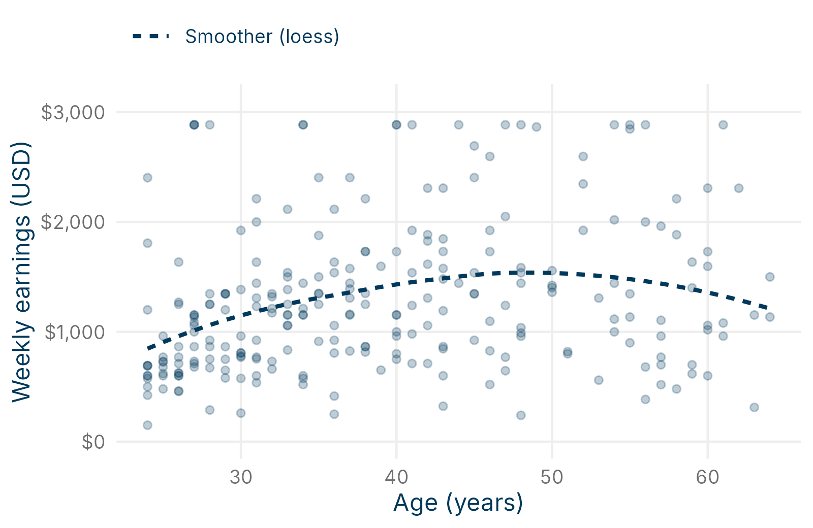{height="555px"}

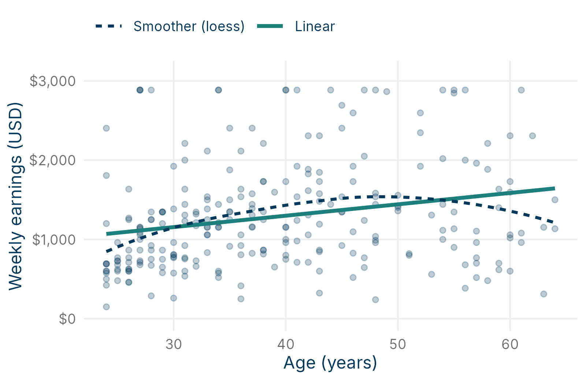{.fragment data-with="2" height="555px"}

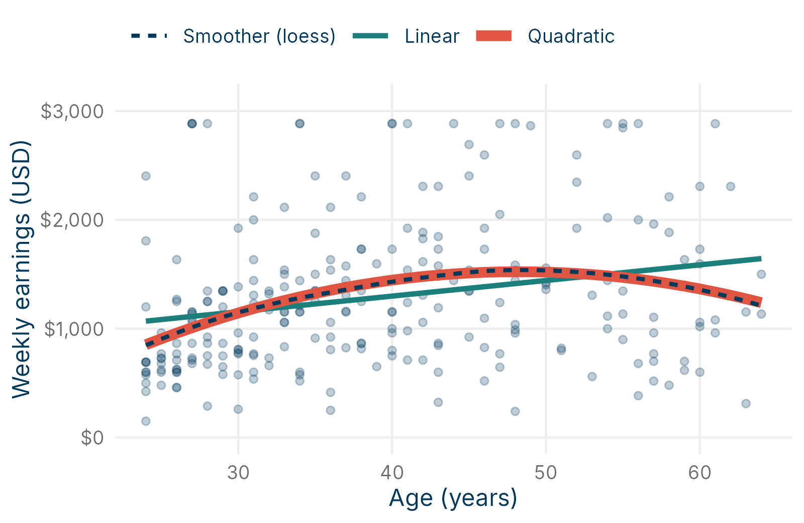{.fragment data-with="3" height="555px"}
:::
:::

::: {.column width="38%"}
- **Smoother:** no form imposed — a guide for the eye

- **Linear:** misses the hump

- **Quadratic:** $\hat{y} = -1133 + 110.2\,\text{age} - 1.14\,\text{age}^2$

- Hump-shaped age profile: classic in labour economics
:::
:::

::: {.notes}
- Back from the diagnosis: explore again, with a smoother
- Loess: local averages — dark dashed line; the figure adds each line with its bullet
- Linear: too high for the young and the old, too low in the middle
- Quadratic: follows the smoother closely — the dashes run inside the red curve
- Theory fits: earnings rise with experience, flatten, fall near retirement
- Data + theory point the same way → good reason for age²
:::

## With age², the hump leaves the residuals {data-step="4 5"}

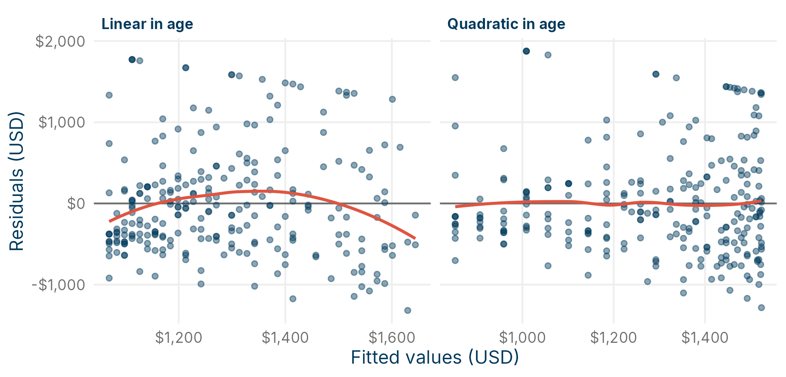{height="440px"}

- **Left:** straight line — the hump

- **Right:** with age² — a flat band · the stripe top right = top-coded earnings

::: {.notes}
- Re-estimate with age², diagnose again
- Left, linear: hump in the residuals → systematic misfit
- Right, quadratic: flatter — remaining pattern from the ceiling
- Diagonal stripe top right: the top-coded analysts
- Recap: Anscombe's quartet — same lesson, from the residuals
:::

## The slope is an average association, not an effect {data-step="6"}

::: {.columns}
::: {.column width="56%"}
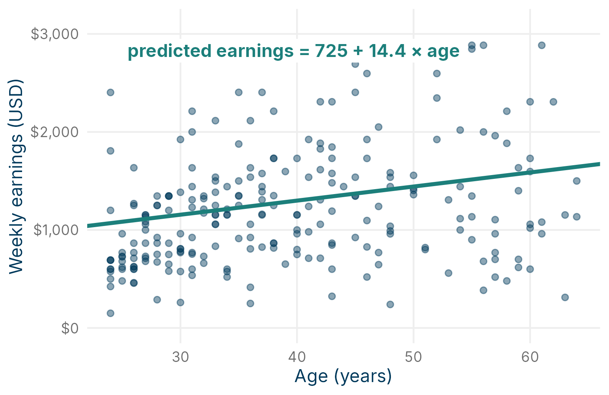{height="450px"}
:::

::: {.column width="44%"}
::: {.dek}
All 252 analysts: $\hat{\beta}_1 = 14.4$
:::

- **Read:** one year older → associated with **on average** 14 USD more per week

- **Not:** "ageing by a year raises pay by 14 USD"

- **Not:** a statement about any individual analyst

- **Intercept:** earnings at age 0 — no meaning here
:::
:::

::: {.arrow .xl .fragment}
Compares people ('cross-section), not changes within a person
:::

::: {.notes}
- Interpret: first the straight line — the standard sentence
- Back to all 252 analysts: OLS line 725 + 14.4 × age
- Standard sentence: analysts who are one year older earn, on average, 14 USD more per week — learn it by heart
- On average: across people of different ages
- Not causal: cohorts differ — older analysts entered the job market earlier
- Not individual: large spread around the line — see the figure
- Intercept: extrapolation to age 0 — mathematically needed, substantively empty
- Arrow: cross-section = comparison between people
:::

## With age², the slope depends on age {data-step="6"}

::: {.columns}
::: {.column width="62%"}
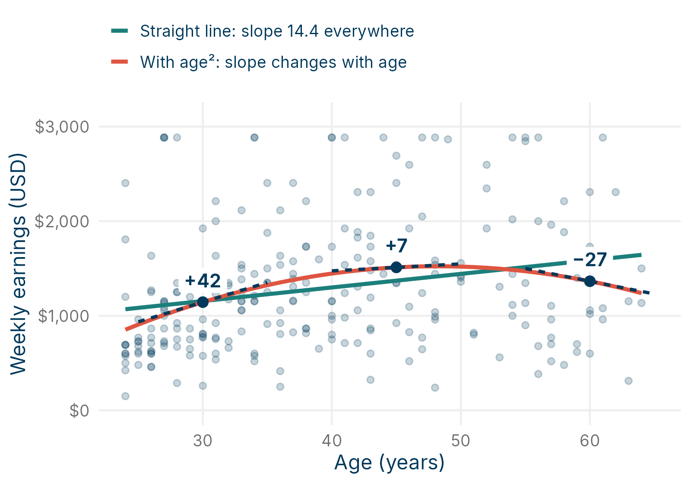{height="595px"}
:::

::: {.column width="38%"}
- **Do not** read 110.2 as "the effect of age"

- **Slope at age a:** $\hat{\beta}_1 + 2\hat{\beta}_2 \cdot a$

- **At 30:** +42 USD per year · **at 45:** +7 · **at 60:** −27

- **Peak:** $-\hat{\beta}_1 / 2\hat{\beta}_2$ ≈ 48 years

::: {.arrow .lg .fragment}
Report slopes at meaningful values — or plot the curve
:::
:::
:::

::: {.notes}
- 110.2 alone = slope at age 0 → meaningless
- Figure: straight line = one slope everywhere; curve = slope of the dashed tangent at each age
- Formula: derivative of the parabola
- Three ages: steep at the start, flat in mid-career, negative near 60
- Peak at 48: within the data → interpretable
- Arrow: plots beat coefficients for nonlinear terms
:::

## Logs change the meaning of the coefficient {data-step="6"}

| Model | Equation | $\hat{\beta}_1$ reads as | Example: our analysts |
|:--|:--|:--|:--|
| Level–level | $y = \beta_0 + \beta_1 x$ | $x$ +1 unit → $y$ + $\beta_1$ units | Earnings on age: **+14.4** → 14 USD more per year |
| Log–level | $\ln y = \beta_0 + \beta_1 x$ | $x$ +1 unit → $y$ + ≈ $100 \cdot \beta_1$ % | Log earnings on age: **+0.0115** → ≈ 1.2 % more per year |
| Level–log | $y = \beta_0 + \beta_1 \ln x$ | $x$ +1 % → $y$ + ≈ $\beta_1 / 100$ units | Earnings on log hours: **+1,574** → 1 % more hours ≈ 16 USD more |
| Log–log | $\ln y = \beta_0 + \beta_1 \ln x$ | $x$ +1 % → $y$ + ≈ $\beta_1$ % (elasticity) | Log earnings on log hours: **+1.47** → 1 % more hours ≈ 1.5 % more |

: {.lg .stepped}

::: {.notes}
- The table to keep — also in the lab cheat sheet
- Log–level: semi-elasticity — most common for wages
- Approximation good for small β; exact: exp(β) − 1
- Log–log: elasticity — e.g. demand and price
- One row per click; examples: simple regressions on our 252 analysts (make-figures.R)
- Log–level: 0.0115 × 100 ≈ 1.2 % per year · level–log: 1,574 / 100 ≈ 16 USD
- We stay in USD for now — logs return in model (4), with an elasticity for hours
:::

## R² measures fit — not quality, not truth {data-step="6"}

- **R²:** share of the variance in earnings that the model explains — in this sample

- **Here:** 0.056 with the straight line · 0.095 with age²

- **Low R²:** the slope can still be precisely estimated

- **High R²:** says nothing about causality

::: {.keybox .fragment}
R² describes the fit to this sample — not whether the coefficient is right, nor how well you predict new data
:::

::: {.notes}
- Definition: 1 − residual variance / total variance
- 5.6 %: as the scatter plot suggested
- Low R²: slope still clearly different from zero — p < 0.001
- High R²: spurious trends have R² close to 1
- Box: description, not truth — and not prediction: in-sample R² flatters
- Prediction quality: judged on new data (out-of-sample, cross-validation)
:::

## Check yourself — chapter 1 {.no-dash .sync-fragments}

::: {.taskbox .nonincremental}
$\hat{\beta}_{\text{age}} = 14.4$ · SE = 3.7 · 95% CI [7.0, 21.7] · R² = 0.056.
Which statements are correct?

- \(a\) "Each additional year of age raises an analyst's pay by 14 USD."
- [(b) "Analysts who are one year older earn on average 14 USD more per week."]{.fragment .highlight-green}
- \(c\) "The true slope lies between 7.0 and 21.7 with 95% probability."
- \(d\) "With R² = 0.056, the model is useless."
:::

::: {.answer .fragment .nonincremental data-with="1"}
[Solution]{.solhead}

- **(b)** the standard sentence: on average, across people
- **(a)** causal and individual — a cross-section shows neither
- **(c)** 95% describes the procedure: it covers the true slope in 95% of samples — not this interval
- **(d)** the slope is precise; R² measures fit, not usefulness
:::

::: {.notes}
- 2 minutes, with your neighbour
- One click: (b) turns green and the whole solution appears
- (a): two errors — causal, individual
- (b): the standard sentence
- (c): classic CI misreading — recap page 6
- (d): fit ≠ usefulness — depends on the question
:::

## Multiple regression {.divider background-color="#00395B"}

::: {.secnum}
02
:::

## Women in the sample earn 218 USD less per week {.sync-fragments data-step="2"}

::: {.columns}
::: {.column width="62%"}
::: {.r-stack}
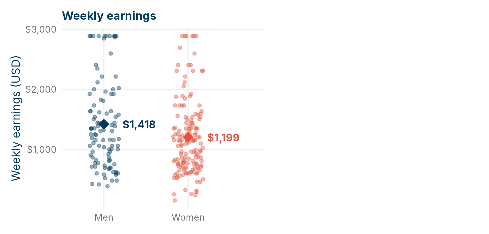

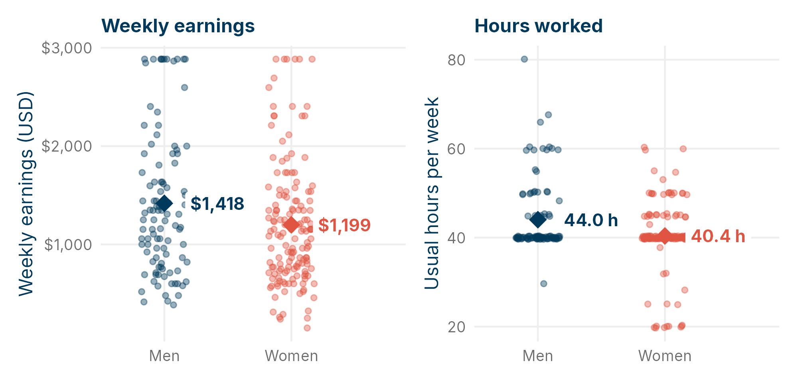{.fragment data-with="4"}
:::
:::

::: {.column width="38%"}
- **Raw gap:** 1,418 vs 1,199 USD

- **Regression:** $\widehat{\text{earn}} = 1418 - 218 \cdot \text{female}$

- Dummy coefficient = **difference in means**

- But: women work **3.7 hours less**
:::
:::

::: {.arrow .xl .fragment}
Is there still a gap if women worked the same hours?
:::

::: {.fragment .muted}
And is that the right question? → total vs direct effect, later in this chapter
:::

::: {.notes}
- Back to the second half of the question
- Left: means per group, diamonds
- Regression on a 0/1 variable: intercept = mean of men, slope = difference
- SE 86 → CI excludes zero
- Hours panel: hours differ too — and hours drive earnings
- Arrow: the question of the next slides — how much of the 218 is about hours?
- Last line: plant the doubt — whether to hold hours constant is a causal question, answered with diagrams after the table
:::

## Multiple regression holds the other variables constant {data-step="3 6"}

$$
\text{earn}_i = \beta_0 + \beta_1 \text{female}_i + \beta_2 \text{hours}_i + \varepsilon_i
$$

- $\beta_1$: gap between women and men **working the same hours**

- $\beta_2$: earnings per extra hour, **for the same gender**

- **Technically:** $\beta_1$ uses only the part of "female" that hours cannot predict

- "Ceteris paribus" — within the model, not in the world

::: {.notes}
- One equation, several variables — OLS as before
- β1: comparison of men and women with equal hours
- β2: comparison of people of the same gender with different hours
- Partialling out (Frisch–Waugh–Lovell): residualise, then regress
- Ceteris paribus: only for the variables in the model — everything else not held constant
:::

## Adding hours shrinks the gap from −218 to −69 {data-step="4"}

::: {style="width: 72%;"}
| | (1) | (2) | (3) |
|:--|--:|--:|--:|
| Female | **−218** (86) | **−69** (79) | **−83** (74) |
| Hours per week | | 40.9 (5.0) | 36.3 (4.8) |
| Age, age², college | | | yes |
| R² | 0.025 | 0.233 | 0.330 |

: {.lg}
:::

::: {.arrow .fragment}
Hours do most of the work · gap no longer distinguishable from zero
:::

::: {.source}
OLS, n = 252, standard errors in parentheses. Dependent variable: weekly
earnings in USD. CPS 2014 via @bekes2021data.
:::

::: {.notes}
- Read across: same coefficient, different controls
- (1): raw gap
- (2): +hours → gap shrinks by two thirds
- (3): + age profile and college → little change
- SEs: −69 ± 2·79 includes zero → n = 252 too small for a precise answer
- R²: hours explain a lot of the variance — age and college add little
:::

## Total or direct effect? The question decides whether to control {.sync-fragments data-step="1 3"}

```{=html}
<svg viewBox="0 0 1400 250" width="100%" style="display: block; margin: 0.3em auto 0.6em;" role="img"
     aria-label="Diagram, built step by step: Female points to Earnings; Hours appears, Female points to Hours, Hours points to Earnings">
  <g font-family="Inter, sans-serif" text-anchor="middle">
    <!-- highlights (under the arrows): both paths with the total effect, the direct path with the direct effect -->
    <g class="fragment fade-out" data-with="8"><g class="fragment" data-with="4" stroke="#1C7F7B" stroke-opacity="0.3" stroke-width="18" stroke-linecap="round" fill="none">
      <line x1="310" y1="168" x2="600" y2="82"/>
      <line x1="800" y1="82" x2="1090" y2="168"/>
      <line x1="330" y1="200" x2="1070" y2="200"/>
    </g></g>
    <g class="fragment" data-with="8" stroke="#DF5541" stroke-opacity="0.3" stroke-width="18" stroke-linecap="round" fill="none">
      <line x1="330" y1="200" x2="1070" y2="200"/>
    </g>
    <rect x="130" y="168" width="200" height="64" fill="#fff" stroke="#00395B" stroke-width="3"/>
    <text x="230" y="209" font-size="26" font-weight="700" fill="#00395B">Female</text>
    <rect x="1070" y="168" width="200" height="64" fill="#fff" stroke="#00395B" stroke-width="3"/>
    <text x="1170" y="209" font-size="26" font-weight="700" fill="#00395B">Earnings</text>
    <!-- click 1: the direct arrow is drawn, with the raw gap -->
    <g class="fragment">
      <line class="draw-line" style="--len: 740" x1="330" y1="200" x2="1064" y2="200" stroke="#00395B" stroke-width="3"/>
      <polygon class="draw-head" points="1068,200 1048,191 1048,209" fill="#00395B"/>
    </g>
    <g class="fragment fade-out" data-with="3"><text class="fragment" data-with="1" x="700" y="236" font-size="21" font-weight="700" fill="#00395B">raw gap: −218</text></g>
    <!-- click 2: hours appear, women work fewer hours -->
    <g class="fragment">
      <rect x="600" y="28" width="200" height="64" fill="#fff" stroke="#00395B" stroke-width="3"/>
      <text x="700" y="69" font-size="26" font-weight="700" fill="#00395B">Hours</text>
      <line class="draw-line" style="--len: 300" x1="310" y1="168" x2="593" y2="85" stroke="#00395B" stroke-width="3"/>
      <polygon class="draw-head" points="598,84 581,97 576,80" fill="#00395B"/>
      <text x="430" y="110" font-size="21" fill="#6F6F6F" text-anchor="end">women: −3.66 h</text>
    </g>
    <!-- click 3: hours raise earnings — direct and indirect path -->
    <g class="fragment">
      <line class="draw-line" style="--len: 300" x1="800" y1="82" x2="1083" y2="165" stroke="#00395B" stroke-width="3"/>
      <polygon class="draw-head" points="1088,166 1066,170 1071,152" fill="#00395B"/>
      <text x="970" y="110" font-size="21" fill="#6F6F6F" text-anchor="start">+40.9 USD per hour</text>
      <text x="700" y="148" font-size="21" font-weight="700" fill="#1C7F7B">indirect, via hours: 40.9 × (−3.66) ≈ −150</text>
      <text x="700" y="236" font-size="21" font-weight="700" fill="#DF5541">direct: −69</text>
    </g>
  </g>
</svg>
```

::: {.columns .divided}
::: {.column width="50%"}
::: {.colhead .fragment}
Total effect: −218 = −69 + (−150)
:::

- ***Do women earn less?***
- Both paths, including the one via hours
- → do **not** control for hours
:::

::: {.column width="50%"}
::: {.colhead .fragment}
Direct effect: −69
:::

- ***Do women earn less for the same hours?***
- Only the direct arrow
- → **control** for hours
:::
:::

::: {.keybox .fragment}
Both are legitimate — the question decides, not the fit [@cinelli2024crash]
:::

::: {.source}
Hours and the gender gap: @goldin2014grand.
:::

::: {.notes}
- The doubt from the gap slide: should we hold hours constant at all?
- Click 1: gender → earnings, the raw gap of −218
- Click 2: hours enter — women work 3.7 hours less
- Click 3: hours raise earnings → the −218 splits: direct −69, indirect −150
- Numbers: total = direct + indirect — the omitted variable bias formula (optional slide at the end)
- Total effect: what a woman in this job earns less, whatever the reason — incl. fewer hours
- Direct effect: the gap that remains at equal hours — e.g. pay per hour
- If fewer hours are themselves a result of norms or penalties: the direct effect understates the disadvantage
- Caveat: direct effect only if nothing unobserved drives both hours and earnings (ambition, childcare) — next slide
- Goldin 2014: long-hours jobs paid disproportionately — hours central to the gap
:::

## Draw the causal diagram before you choose controls {data-step="3"}

::: {.columns .nonincremental}
::: {.column width="33%" .fragment .nonincremental}
::: {.colhead}
Confounder
:::

```{=html}
<svg viewBox="0 0 400 220" width="78%" style="display: block; margin: 0 auto 0.4em;" role="img" aria-label="confounder: X, Y and a third variable Z">
  <defs><marker id="dg-confounder" viewBox="0 0 10 10" refX="9" refY="5" markerWidth="6" markerHeight="6" orient="auto-start-reverse"><path d="M0,0 L10,5 L0,10 z" fill="#00395B"/></marker></defs>
  <g font-family="Inter, sans-serif" text-anchor="middle">
    <g stroke="#00395B" stroke-width="3" fill="none" marker-end="url(#dg-confounder)">
        <line x1="173" y1="77" x2="95" y2="155"/>
        <line x1="225" y1="75" x2="303" y2="153"/>
        <line x1="106" y1="180" x2="292" y2="180"/>
    </g>
      <circle cx="70" cy="180" r="34" fill="#fff" stroke="#00395B" stroke-width="3"/>
      <text x="70" y="190" font-size="28" font-weight="700" fill="#00395B">X</text>
      <circle cx="330" cy="180" r="34" fill="#fff" stroke="#00395B" stroke-width="3"/>
      <text x="330" y="190" font-size="28" font-weight="700" fill="#00395B">Y</text>
      <circle cx="200" cy="50" r="34" fill="#1C7F7B" stroke="#00395B" stroke-width="3"/>
      <text x="200" y="60" font-size="28" font-weight="700" fill="#fff">Z</text>
  </g>
</svg>
```

- Z causes X **and** Y
- e.g. ability → education, earnings
- → **control** for Z
:::

::: {.column width="34%" .fragment .nonincremental}
::: {.colhead}
Mediator
:::

```{=html}
<svg viewBox="0 0 400 220" width="78%" style="display: block; margin: 0 auto 0.4em;" role="img" aria-label="mediator: X, Y and a third variable Z">
  <defs><marker id="dg-mediator" viewBox="0 0 10 10" refX="9" refY="5" markerWidth="6" markerHeight="6" orient="auto-start-reverse"><path d="M0,0 L10,5 L0,10 z" fill="#00395B"/></marker></defs>
  <g font-family="Inter, sans-serif" text-anchor="middle">
    <g stroke="#00395B" stroke-width="3" fill="none" marker-end="url(#dg-mediator)">
        <line x1="95" y1="155" x2="173" y2="77"/>
        <line x1="225" y1="75" x2="303" y2="153"/>
        <line x1="106" y1="180" x2="292" y2="180"/>
    </g>
      <circle cx="70" cy="180" r="34" fill="#fff" stroke="#00395B" stroke-width="3"/>
      <text x="70" y="190" font-size="28" font-weight="700" fill="#00395B">X</text>
      <circle cx="330" cy="180" r="34" fill="#fff" stroke="#00395B" stroke-width="3"/>
      <text x="330" y="190" font-size="28" font-weight="700" fill="#00395B">Y</text>
      <circle cx="200" cy="50" r="34" fill="#1C7F7B" stroke="#00395B" stroke-width="3"/>
      <text x="200" y="60" font-size="28" font-weight="700" fill="#fff">Z</text>
  </g>
</svg>
```

- Z lies on the path from X to Y
- e.g. gender → hours → earnings
- → control only for the **direct** effect
:::

::: {.column width="33%" .fragment .nonincremental}
::: {.colhead}
Collider
:::

```{=html}
<svg viewBox="0 0 400 220" width="78%" style="display: block; margin: 0 auto 0.4em;" role="img" aria-label="collider: X, Y and a third variable Z">
  <defs><marker id="dg-collider" viewBox="0 0 10 10" refX="9" refY="5" markerWidth="6" markerHeight="6" orient="auto-start-reverse"><path d="M0,0 L10,5 L0,10 z" fill="#00395B"/></marker></defs>
  <g font-family="Inter, sans-serif" text-anchor="middle">
    <g stroke="#00395B" stroke-width="3" fill="none" marker-end="url(#dg-collider)">
        <line x1="95" y1="155" x2="173" y2="77"/>
        <line x1="303" y1="153" x2="225" y2="75"/>
        <line x1="106" y1="180" x2="292" y2="180"/>
    </g>
      <circle cx="70" cy="180" r="34" fill="#fff" stroke="#00395B" stroke-width="3"/>
      <text x="70" y="190" font-size="28" font-weight="700" fill="#00395B">X</text>
      <circle cx="330" cy="180" r="34" fill="#fff" stroke="#00395B" stroke-width="3"/>
      <text x="330" y="190" font-size="28" font-weight="700" fill="#00395B">Y</text>
      <circle cx="200" cy="50" r="34" fill="#1C7F7B" stroke="#00395B" stroke-width="3"/>
      <text x="200" y="60" font-size="28" font-weight="700" fill="#fff">Z</text>
  </g>
</svg>
```

- X **and** Y cause Z
- e.g. keep only analysts with ≥ 20 hours
- → **never** control or select on Z
:::
:::

::: {.keybox .fragment}
More controls ≠ better model — "bad controls" bias the estimate [@cinelli2024crash]
:::

::: {.source}
Causal diagrams on *Method and Inquiry*: @graebner2026-reasoning-with-dags.
:::

::: {.notes}
- X = what we are interested in, Y = outcome, Z = the candidate control
- Confounder: common cause → without control, X takes credit for Z
- Mediator: part of the mechanism → previous slide: total vs direct
- Collider: common effect → controlling or selecting on it creates a link that is not there
- Our sample: ≥ 20 hours a week — selection on a variable affected by gender and by pay
- Mediator caveat: if ambition drives hours and earnings, hours is also a collider → direct effect biased
- Not decidable from the data — from theory and the diagram
- Hub page on DAGs: worked examples
:::

## Adjusted R² penalises additional variables {data-step="5"}

- **R² never falls** when you add a variable — even pure noise

- **Adjusted R²:** corrects for the number of variables

- **Here:** 0.056 → 0.330, adjusted 0.317

- Model comparison by R² alone → **overfitting**

::: {.notes}
- Mechanical: more variables → more flexibility → R² rises
- Adjusted: penalty per parameter
- Our sequence: age 0.056 · +age² 0.095 · +hours 0.298 · +college 0.327 · +female 0.330
- Small gap between R² and adjusted → few variables relative to n
- Overfitting: fits this sample, predicts the next one badly
:::

## Diagnostics show what model (3) missed {data-step="5"}

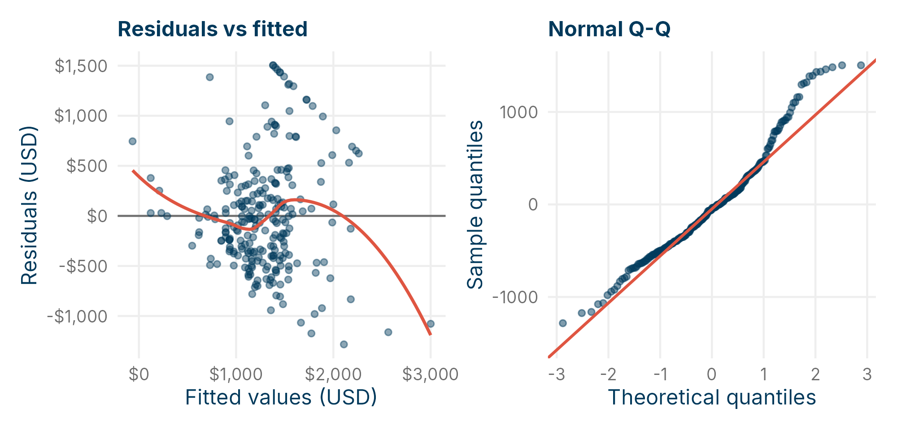{height="430px"}

- **Left:** diagonal stripe = top-coded earnings · few points drive the curve

- **Right:** heavy right tail → logs or robust standard errors

::: {.notes}
- Final model (3): female, age, age², hours, college
- Residuals vs fitted: no strong hump — form ok in the middle
- Diagonal: residual = 2,885 − fitted → line with slope −1
- Smoother at the edges: a handful of part-timers and long-hours workers
- Q-Q: tails above the line → errors not normal; with n = 252, inference still roughly ok
- Next options: log earnings, robust SEs — hub diagnostics page; lab
:::

## Logs fix most of what model (3) missed {data-step="3 4 5"}

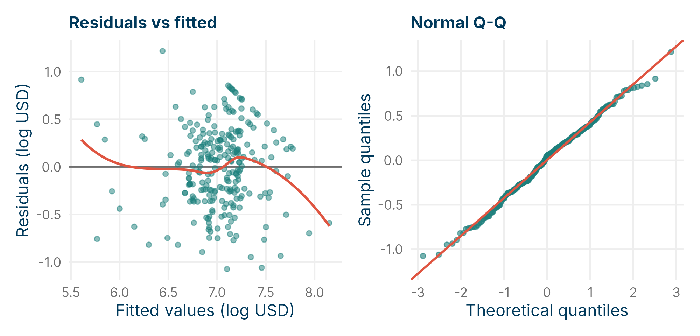{height="405px"}

- **Model (4):** log earnings · log hours · age, age² · college

- **Residuals:** close to normal · R² 0.40 instead of 0.33

- **Gap:** −0.051 → ≈ **−5 %** (SE 5.7 %) — still not distinguishable from zero

- **Hours:** log–log → elasticity 1.3 — 1 % more hours, 1.3 % more pay

::: {.notes}
- Answer to the diagnosis: change the specification — back to step 3
- Logs: skew gone (residual skewness 0.66 → −0.07), Q-Q on the line
- Remaining stripe: still the top-coded analysts
- Gap: −5 % ≈ −69 USD / 1,418 USD — same story as the level model with hours
- Robust SE 5.4 % · censored (Tobit) model for the top-coding: −5.7 % — robust result
- Hours elasticity > 1: long hours paid disproportionately — Goldin again
- Lab: fit (3) and (4), compare diagnostics
:::

## Check yourself — chapter 2 {.no-dash}

::: {.taskbox .nonincremental}
A colleague reads the table: "Controlling for hours, the gap is only 69 USD —
so discrimination explains at most 69 USD."

- Name **two** problems with this conclusion
:::

::: {.answer .fragment .nonincremental}
[Solution]{.solhead}

- **Bad control:** if hours are themselves shaped by norms or penalties, the
  69 USD understate the gap
- **Not causal:** unobserved differences — experience, firm, specialisation —
  remain in the error term
- **Imprecise:** SE 79 → the data cannot tell 69 from 0 or from 200
:::

::: {.notes}
- 3 minutes, in pairs
- Bad control: previous slide
- Not causal: OVB again — what else is missing?
- Imprecise: n = 252, CI roughly [−224, 86]
- Any two count
:::

## Groups and interactions {.divider background-color="#00395B"}

::: {.secnum}
03
:::

## One line for everyone hides the gap between groups {data-step="2"}

::: {.columns}
::: {.column width="60%"}
```{=html}
<div id="groups-widget"></div>
<script src="assets/L10/L10-groups-data.js"></script>
<script src="assets/L10/groups-widget.js"></script>
```
:::

::: {.column width="40%"}
- **Grey:** one line for all 252 — gender ignored

- **Colours:** men mostly above the line, women below

- **One line per group:** same slope, shifted apart
:::
:::

::: {.arrow .xl .fragment}
The grey line fits neither group — it misses the gap
:::

::: {.notes}
- Motivation for the next model — look before the algebra
- Click 1: one line for everyone — what we did in chapter 1
- Click 2: colour by gender — systematic pattern around the grey line
- Click 3: the line splits — men up, women down, same slope (14.3 vs 14.4)
- Arrow: ignoring the groups puts everybody in between → we miss a variable
- Next slide: the model behind the two lines
:::

## A dummy shifts the line — the parallel slopes model {data-step="3"}

$$
\text{earn}_i = \beta_0 + \beta_1 \text{age}_i + \beta_2 \text{female}_i + \varepsilon_i
$$

- **Men:** intercept $\beta_0$ · slope $\beta_1$

- **Women:** intercept $\beta_0 + \beta_2$ · **same** slope $\beta_1$

- **Estimates:** age +14.3 · female −215

- Assumption: the gap is the **same at every age**

::: {.notes}
- Terminology from ModernDive ch. 6: "parallel slopes model"
- Dummy = 0/1 variable, switches the intercept
- Men: reference group
- Women: line shifted down by 215
- Assumption built in — the model cannot show anything else
- Next slide: relax it
:::

## Categories with more levels need a reference group {data-step="3 6"}

::: {style="width: 80%;"}
| Education | n | Coefficient | Reads as |
|:--|--:|--:|:--|
| No degree | 43 | — | reference |
| Bachelor | 151 | +236 (98) | vs no degree, ceteris paribus |
| Graduate | 58 | +521 (114) | vs no degree, ceteris paribus |

: {.lg}
:::

- **k categories → k − 1 dummies** — one is left out

- **Choose the reference** deliberately: large, meaningful group

::: {.source}
Model with female, age, age², hours. OLS, n = 252, SE in parentheses.
:::

::: {.notes}
- Three levels, two dummies
- All coefficients relative to the reference
- Bachelor: +236 more than no degree, same gender, age, hours
- Graduate vs Bachelor: 521 − 236 = 285 — not in the table directly
- k − 1: otherwise the dummies add up to the intercept (dummy trap)
- R: first factor level = reference → set it explicitly (lab)
:::

## An interaction lets the slope differ between groups {data-step="3"}

$$
\text{earn}_i = \beta_0 + \beta_1 \text{age}_i + \beta_2 \text{female}_i
+ \beta_3 (\text{age}_i \times \text{female}_i) + \varepsilon_i
$$

- **Men:** slope $\beta_1$

- **Women:** slope $\beta_1 + \beta_3$

- $\beta_3$: **difference in slopes** — the interaction

- $\beta_2$: gap at age **0** — no longer "the" gap

::: {.notes}
- New variable: product of age and female
- Men: female = 0 → product drops out
- Women: slope shifted by β3
- β3: does earnings growth with age differ by gender?
- β2: gap where age = 0 — main effects change meaning once interacted
- Fix: centre age (e.g. at 40) → β2 = gap at 40
:::

## The interaction model lets the gap widen with age {data-step="4 6"}

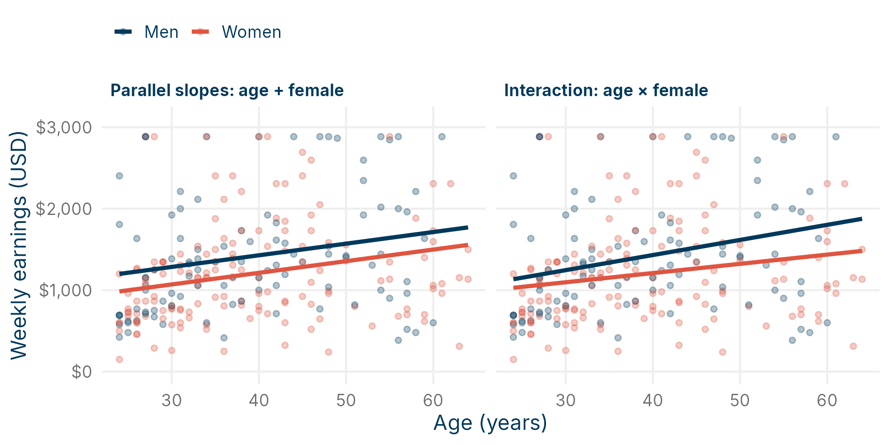{height="470px"}

::: {.nonincremental}
- **Slopes:** men +18.5 USD per year · women +11.3 · difference −7.2 (SE 7.5)
- **Gap:** −149 USD at 30 · −293 at 50 — but the difference in slopes is **not** precisely estimated
:::

::: {.notes}
- Left: parallel — gap constant by construction
- Right: lines diverge — gap grows with age
- Slopes: 18.5 vs 11.3 → β3 = −7.2
- SE 7.5: zero well inside the CI → the data cannot tell
- Consistent with the literature on widening gaps over the career — but not shown by these 252 people
- Interactions need much larger samples than main effects
:::

## Every interaction says: the effect of X depends on Z {data-step="3"}

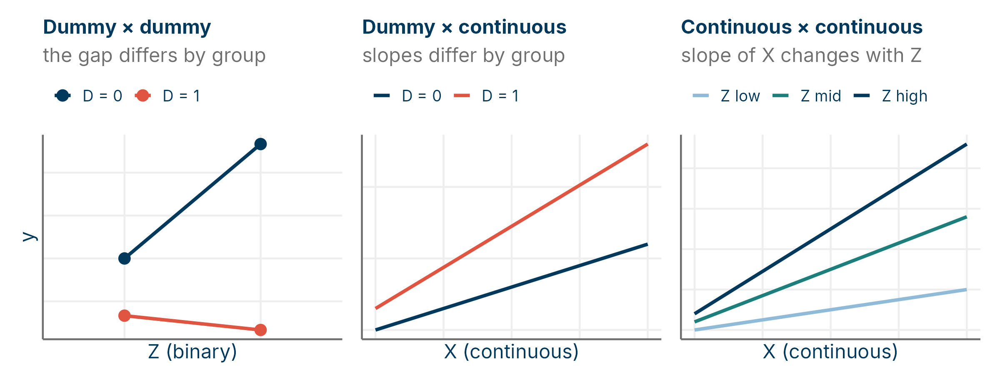{height="410px"}

- **Dummy × dummy:** is the gender gap different for college graduates?

- **Continuous × continuous:** does an extra hour pay more at higher ages?

::: {.notes}
- Left: two groups × two groups — gap differs (2×2 design — experiments, L11)
- Middle: what we just estimated — age × female
- Right: moderation — slope of hours changes with age
- Same algebra each time: product term, slope = β1 + β3·Z
- In our data: neither college × female nor hours × age is significant — lab
:::

## Interactions are easy to fit — and easy to misread {.sync-fragments data-step="6"}

::: {.columns}
::: {.column width="52%"}
- **Never** read a main effect alone once it is interacted — e.g. female = **+68**: the gap at age **0**

- **Centre** age: subtract a typical value, $\text{age} - 40$, and refit → female = gap at **40**: **−221**

- **Plot** the predicted gap instead of reading coefficients

- **Justify** the interaction by theory — and expect wide CIs
:::

::: {.column width="48%"}
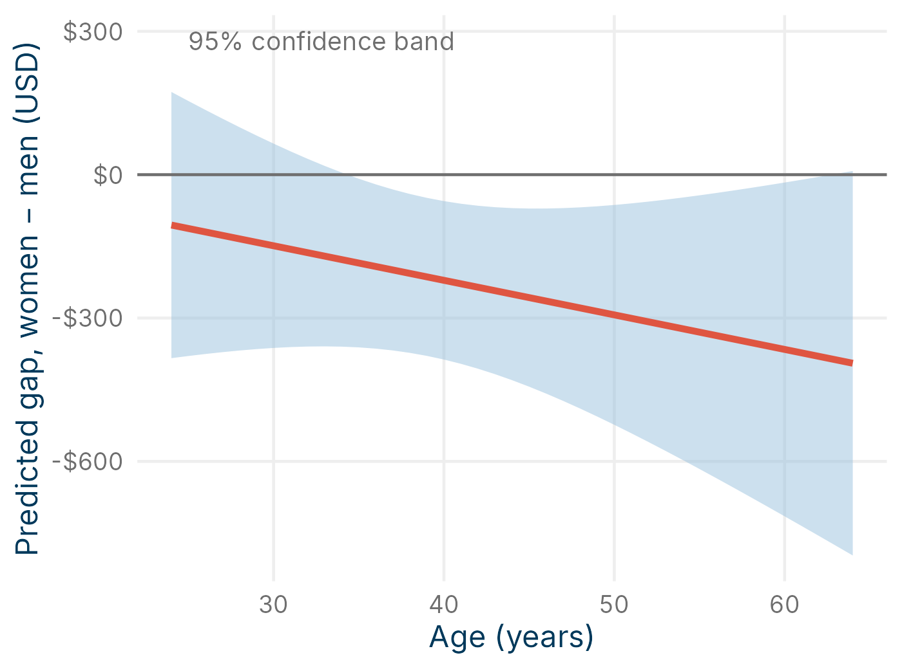{.fragment data-with="3" height="500px"}
:::
:::

::: {.arrow .xl .fragment}
An interaction is a hypothesis about different slopes
:::

::: {.notes}
- Main effect: female = +68 = gap at age 0 — the classic misreading
- +68 = the estimated female coefficient of the interaction model — the gap at age 0, outside the data
- Centring: new variable age − 40 (40 ≈ the mean, 39), refit → same model, same fit; female coefficient now −221 (SE 84) = gap at 40
- Plot: gap = −113 at 25, −221 at 40, −366 at 60, with its 95% band
- Band: includes zero below about 34 and at the oldest ages — few people there
- Theory first: otherwise a search across all possible pairs → false positives
- Wide CIs: an interaction compares two slopes, each estimated with noise
- Arrow: back to step 1 — the question decides
:::

## Check yourself — chapter 3 {.no-dash}

::: {.taskbox .nonincremental}
Interaction model: intercept 689.5 · age 18.5 · female 68.1 (SE 306) ·
age × female −7.2 (SE 7.5)

- "Female is +68 and not significant — so there is no gender gap." Correct?
- What is the predicted gap at age 40?
:::

::: {.answer .fragment .nonincremental}
[Solution]{.solhead}

- **No:** 68.1 is the gap at age 0 — outside the data. Interpret it only
  together with the interaction
- **At 40:** 68.1 + (−7.2) × 40 ≈ **−220 USD**
:::

::: {.notes}
- 2 minutes, alone
- First: classic trap — main effect read as the effect
- Second: β2 + β3 × age
- −220 ≈ raw gap: average age in the sample is 39
- Lesson: centring would have put the gap at 40 directly in the table
:::

## Wrap-up {.divider background-color="#00395B"}

::: {.secnum}
04
:::

## The running example, in six steps

| Step | What we did |
|:--|:--|
| **Question** | Do earnings rise with age? · do women earn less — and why? |
| **Explore** | Weak, hump-shaped age profile · skew · ceiling · women work fewer hours |
| **Specify** | Age² · logs · hours: total or direct effect? · interaction age × female |
| **Estimate** | OLS · slope 14.4 · gap −218 raw, −69 to −83 with controls, ≈ −5 % in logs |
| **Diagnose** | Hump in the residuals → age² · heavy right tail → logs · top-coding |
| **Interpret** | Gap mostly linked to hours · not causal · imprecise with n = 252 |

: {.lg .stepped tbl-colwidths="[18,82]"}

::: {.notes}
- Recap of the lecture — row by row
- Question: two parts — first age, then gender
- Explore: everything we saw before fitting anything
- Specify: the decisions — and why
- Estimate: the numbers
- Diagnose: what sent us back — twice
- Interpret: careful statement + limits
:::

## Specification choices are researcher degrees of freedom

- **Fix** question, outcome and key controls **before** estimating

- **Report** all models you ran — not only the one that "worked"

- **Show** the sensitivity: how much does the key coefficient move?

- **Separate** exploration from confirmation

::: {.keybox .fragment}
A table of models (1)–(3) is more honest than one "final" model
:::

::: {.notes}
- Many choices: form, controls, sample, outliers → many possible results
- Fix: as in a review protocol (L08)
- Report all: our table — gap from −218 to −69 depending on controls
- Sensitivity: the movement itself is a finding
- Exploration vs confirmation: hypotheses from the data must be tested on new data
- Box: transparency over a single "best" model
:::

## Next steps

::: {.nonincremental}
- **Lab, Friday 27 Nov:** every model of today rebuilt in R — same data,
  same six steps

- **Readings:** @ismay2025moderndive [chapters 5–6] · further:
  @jamesIntroductionStatisticalLearning2021 [chapter 3]

- **Hub pages:** categorical variables and interactions
  [@graebner2026-multiple-regression-categorical-interactions] · diagnostics
  [@graebner2026-regression-residuals-diagnostics] · DAGs
  [@graebner2026-reasoning-with-dags]

- **Next Monday:** experiments — when the data are designed for causal
  comparisons
:::

::: {.notes}
- Lab: lm(), tables, plots, diagnostics — and a second data set
- ModernDive 5–6: parallel slopes vs interaction models, same terms as today
- ISLR ch. 3: more formal, incl. interactions and nonlinear terms
- Hub: companion to chapters 3–5 · DAGs for the control question
- L11: experiments solve the confounding problem by design
:::

## Recap questions

::: {.nonincremental}
- What distinguishes $\beta_1$ from $\hat{\beta}_1$, and $\varepsilon_i$ from $e_i$?

- How do you interpret a slope coefficient — and what must you not say?

- Why can a linear regression fit a parabola? How do you read the age² model?

- What does a coefficient in a log–level model mean?

- What does "holding the other variables constant" mean — and why can it mislead?

- When does omitting a variable bias a coefficient? Two conditions?

- How does an interaction model differ from a parallel slopes model?

- What are the six steps of a regression analysis?
:::

::: {.notes}
- For revision — answers in the chapters
- β vs β̂, ε vs e: ch. 1
- Slope interpretation: ch. 1
- Parabola, logs: ch. 2
- Ceteris paribus, OVB: ch. 3
- Interactions: ch. 4
- Six steps: ch. 0 and 5
:::

## Optional material {.divider background-color="#00395B"}

::: {.secnum}
\+
:::

## Optional: omitted variable bias has a formula {data-step="3"}

$$
\underbrace{\hat{\beta}_{\text{female}}^{\text{short}}}_{-218}
= \underbrace{\hat{\beta}_{\text{female}}^{\text{long}}}_{-69}
+ \underbrace{\hat{\beta}_{\text{hours}}}_{40.9} \times
\underbrace{\hat{\delta}}_{-3.66}
$$

- $\hat{\delta}$: hours gap between women and men

- **Bias** = effect of the omitted variable × its link with the included one

- **No bias** if either factor is zero

- Sign of the bias: predictable from theory

::: {.notes}
- Optional: shown only if there is time or a question — the main line needs only the total/direct split
- Short regression: without hours · long: with hours
- −69 + 40.9 × (−3.66) = −69 − 150 = −218 — exact in the sample
- δ: from regressing hours on female
- Two conditions: omitted variable matters AND correlates with the included one
- Sign: you can argue about direction without the data — useful in any paper
:::

## References {.smaller .scrollable}

::: {#refs}
:::
