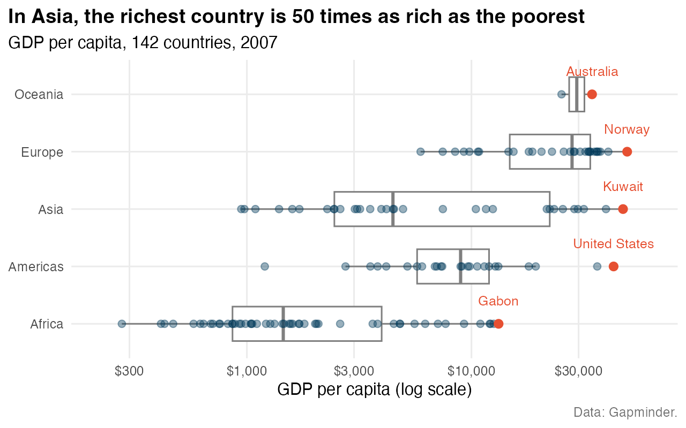

::: {.callout-important collapse="false"}
## Friday, 20 November, on-site — prepare three things
This lab takes place **on-site** in MAD 024, 11:15–12:45. Please **before the
session**:

1. Bring your **laptop**, charged.
2. Download and unzip the [R project for the lab](#in-class-exercise), open
   `lab09.Rproj` and render `lab09_worksheet.qmd` once. If R complains about a
   missing package: `install.packages(c("ggplot2", "dplyr"))`.
3. Open a **free AI chat assistant** in your browser — any one you like
   (ChatGPT, Claude, Gemini, Copilot, …). You need it in the exercise.
:::

An AI assistant is good at the part of R you probably still find hardest:
remembering the syntax. It is no good at the parts you learned in sessions 4 to
8: which rows belong in the analysis, which summary is right, and what a chart
should show. It has not seen your data, it does not run its own code, and it
sounds just as confident when it is wrong as when it is right.

This session follows four competencies from the *AI Fluency* framework
[@anthropic2025aifluency]:

- **Delegation** — what to hand over to the AI, and what to keep. Using AI well
  costs time and needs knowledge: before you write a long prompt, ask yourself
  whether you could have written the code yourself.
- **Description** — writing a prompt that carries what you know about your data
  and your question — and why a good template of your own often beats a prompt.
- **Discernment** — how AI-written code can make your results worse: code that
  runs and is still wrong, and numbers the AI never computed. Four steps to
  catch it.
- **Diligence** — what not to paste, and how to declare your AI use (see
  [lecture 2](/content/lecture/ai-disclosure/index.qmd)).

Most of the session is an **exercise** (about 45 minutes): in pairs, you make
the same chart three times — with a quick prompt, then with a careful prompt or
a ready-made chart template, and then you check the result and make it your
own. We compare the experiences at the end.

## 👨‍🏫 Lecture Slides

The slides are made available here after the session.

<!---
```{=html}
<div class="container" style="position: relative;overflow: hidden;width: 100%;padding-top: 56.25%;">
<iframe src="slides/E9-AICoding.html" style="position: absolute;top: 0;left: 0;bottom: 0;right: 0;width: 100%;height: 100%;" allowfullscreen loading="lazy"></iframe>
</div>
```

[Open the slides in a separate tab](slides/E9-AICoding.html){.btn .btn-primary}

::: {.callout-tip collapse="true"}
## Would you rather have a PDF?
Open the slides, click the ☰ button in the **bottom left** corner, and choose
**Tools → PDF Export Mode**. Then print the page (<kbd>Cmd</kbd>/<kbd>Ctrl</kbd> + <kbd>P</kbd>)
and save it as a PDF.
:::
--->

## In-class exercise

Download and unzip this R project, open `lab09.Rproj` and then
`lab09_worksheet.qmd`. Everything is in place, nothing else to download:

- [R project for the lab (zip)](/content/material/session09/lab09.zip){download="lab09.zip"}

| File | What it is |
|---|---|
| `lab09_worksheet.qmd` | the worksheet: three rounds, a log table and tasks for fast pairs |
| `data/gdplifexp2007.csv` | the data: 142 countries in 2007, as in session 8 |
| `chart_template.R` | a template for a good chart (see below) |
| `lab09.Rproj` | the R project — always open this first |

You work **in pairs** on one question: *In 2007, how much does life expectancy
vary within each continent — and which country has the lowest life expectancy
in each?*

1. **Just ask** (10 min): one quick sentence to the AI, run what you get
2. **Two routes** (15 min): half of the pairs write a careful prompt, the
   other half adapt the chart template themselves, asking the AI small
   questions at most
3. **Check and own** (10 min): count the countries, recompute one number,
   write your own title, declare your AI use

Write down how many **minutes** each round took: the comparison is part of the
result.

## 📊 A template for a good chart

The project contains `chart_template.R`: a complete chart, with a comment on
every line that explains what it does and why. It shows how much GDP per capita
varies within each continent and marks the richest country:

{fig-alt="Box plots of GDP per capita for each continent in 2007, on a log scale, with every country as a point and the richest country per continent highlighted in red and labelled." width="100%"}

What makes it a good chart — and what you can reuse in every chart you make:

- the **title states the finding**, with a number computed in R, not typed
- axes with **units**, the **source** in the caption, no unnecessary lines
- every observation is visible; the one that matters is **highlighted**
- a log axis and a linear axis, one line each: switch with a `#`
- saved at a **fixed size** with `ggsave()`

The lines you change for another variable are marked `# <- CHANGE`. You can
also [download the template on its own](/content/material/session09/chart_template.R){download="chart_template.R"}
(it expects the data in `data/gdplifexp2007.csv`).

::: {.callout-tip collapse="true"}
## Insert your template with two keystrokes: RStudio snippets
A snippet is a piece of code that RStudio inserts when you type its name. Save
your template once, and you never have to search old projects for it again.

1. In RStudio: *Tools → Edit Code Snippets…*, then choose **R**.
2. At the end, add a line `snippet gggood` (any name you like) and below it
   your code. **Every line of code must start with a Tab.**
3. In a script or a code chunk, type `gggood` and press
   <kbd>Shift</kbd> + <kbd>Tab</kbd>.

Write `${1:data}`, `${2:x}`, … where the code should change each time: after
inserting, <kbd>Tab</kbd> jumps from one of these fields to the next. More in
the [RStudio documentation](https://docs.posit.co/ide/user/ide/guide/productivity/snippets.html).
:::

## 📚 Suggested Reading

- [AI Fluency: Framework & Foundations](https://anthropic.skilljar.com/ai-fluency-framework-foundations)
  on Anthropic Academy [@anthropic2025aifluency] — free, about three to four
  hours; it takes each of the four competencies further than we can today
- @metr2025measuring, the study in which experienced developers were slower
  with AI tools while believing they were faster
- [Anthropic's Prompt Engineering Interactive Tutorial](https://github.com/anthropics/prompt-eng-interactive-tutorial):
  a more extensive course on writing good prompts
- How to use [GitHub Copilot in RStudio](https://docs.posit.co/ide/user/ide/guide/tools/copilot.html),
  and how to get free student access [through GitHub Education](https://github.com/education/students)

## ✍️ Coursework

- Finish the rounds of the worksheet you did not complete in class
- Build yourself a **template** for the chart type you use most often
  (`chart_template.R` from the lab project is a good start) and save it as an
  [RStudio snippet](https://docs.posit.co/ide/user/ide/guide/productivity/snippets.html)

## References {.unnumbered}

::: {#refs}
:::
