# Part I: Organization & outlook {.divider background-color="#EAF0F4"}

## The goal of the implementation lab

::: {.boxed}
Prepare, analyse and present quantitative data with **R** — implementing the
tools of the main lecture in practice
:::

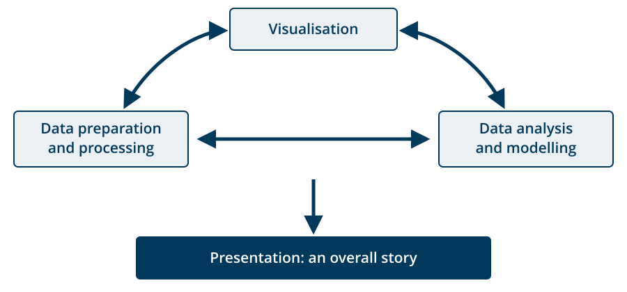{width="68%" fig-align="center"}

## Why R?

::: {.columns}
::: {.column width="44%"}
::: {.small}
- Among the **most widely used** languages for statistical analysis
- Demanded in **almost every industry**
- The **whole pipeline** in one consistent, reproducible framework
- **Free, open source, OS-independent** → inclusive and transparent
- A gateway to **other programming languages**
- A large and **friendly community**
:::
:::

::: {.column width="56%"}
::: {.pullquote .small}
The days of commercial statistical languages and packages such as SAS, Stata and
SPSS are over
[Paul Jansen, CEO of Tiobe Software]{.source}
:::

```{=html}
<table class="rank-table">
<thead><tr><th>#</th>
<th>TIOBE <span class="hdr-date">Sep&nbsp;&rsquo;26</span></th>
<th>PYPL <span class="hdr-date">Aug&nbsp;&rsquo;26</span></th>
<th>RedMonk <span class="hdr-date">Q1&nbsp;&rsquo;26</span></th></tr></thead>
<tbody>
<tr><td>1</td><td>Python</td><td>Python</td><td>JavaScript</td></tr>
<tr><td>2</td><td>C</td><td>Java</td><td>Python</td></tr>
<tr><td>3</td><td>C++</td><td>C/C++</td><td>Java</td></tr>
<tr><td>4</td><td>Java</td><td class="r-rank">R</td><td>PHP &middot; C#</td></tr>
<tr><td>5</td><td>C#</td><td>JavaScript</td><td class="na">&ndash;</td></tr>
<tr><td>6</td><td>JavaScript</td><td>Objective&#8209;C</td><td>TypeScript</td></tr>
<tr><td>7</td><td>Visual Basic</td><td>PHP</td><td class="na">&hellip;</td></tr>
<tr><td>8</td><td>SQL</td><td class="na">&hellip;</td><td class="na">&hellip;</td></tr>
<tr><td>9</td><td class="r-rank">R</td><td class="na">&hellip;</td><td class="na">&hellip;</td></tr>
<tr><td>10</td><td>Rust</td><td class="na">&hellip;</td><td class="na">&hellip;</td></tr>
<tr><td>13</td><td class="na"></td><td class="na"></td><td class="r-rank">R</td></tr>
</tbody></table>
<p class="tiny muted" style="margin-top:0.35em">TIOBE: search results &middot; PYPL: tutorial searches &middot; RedMonk: GitHub&nbsp;+&nbsp;Stack&nbsp;Overflow</p>
<p class="tiny accent" style="margin-top:0.15em">TIOBE: R climbed #15 &rarr; #9 within a year</p>
```
:::
:::

## What you will be able to do

::: {.columns}
::: {.column width="52%"}
- **Read in** data from many sources
- **Prepare** messy data → produce *tidy* data

::: {.fragment .smaller}
```
country,1952,1957,1962,1967,1972,1977,...
Afghanistan,Asia|28.801|8425333|779.445,...
Albania,Europe|55.23|1282697|1601.056,...
```
:::

::: {.fragment}
::: {.step-arrow}
↓
:::

::: {.smaller}
```
# A tibble: 142 × 5
   country       continent lifeExp     pop gdpPercap
   <fct>         <fct>       <dbl>   <int>     <dbl>
 1 China         Asia         73.0  1.32e9     4959.
 2 India         Asia         64.7  1.11e9     2452.
 3 United States Americas     78.2  3.01e8    42952.
 # … with 139 more rows
```
:::
:::
:::

::: {.column width="48%"}
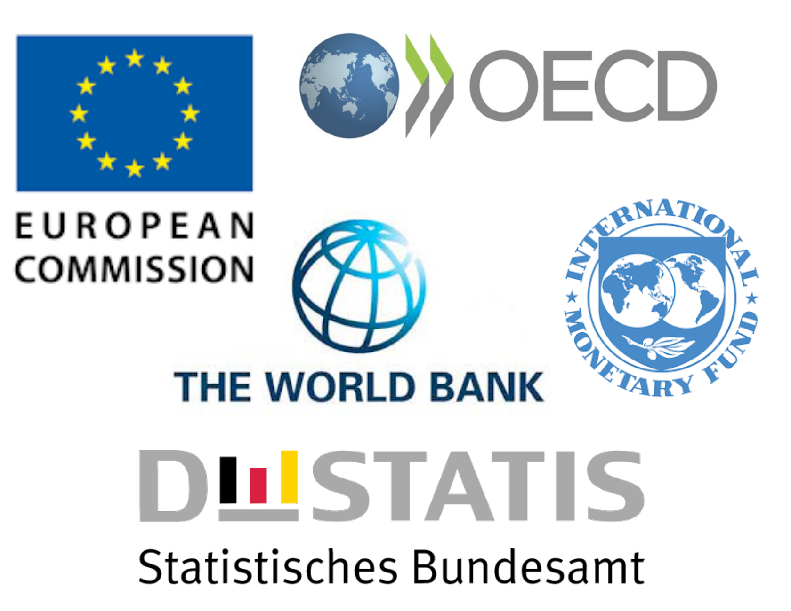{width="88%" fig-align="center"}
:::
:::

## What you will be able to do

::: {.columns}
::: {.column width="42%"}
- Create **publication-ready visualisations**
- **Identify hidden patterns** in data and make predictions using models
:::

::: {.column width="58%"}
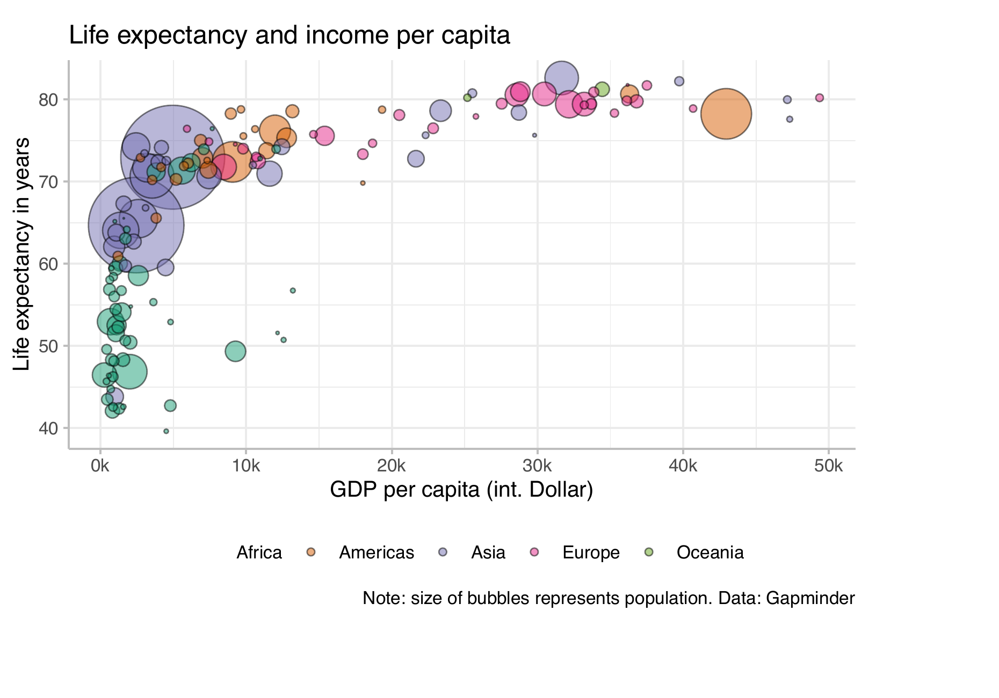{width="100%"}
:::
:::

## What you will be able to do

::: {.columns}
::: {.column width="36%"}
- Write **reproducible reports** in Quarto
- **Publish** them on the web via Netlify
- Acquire tools that **later seminars build on**
:::

::: {.column width="64%"}
::: {.img-row}
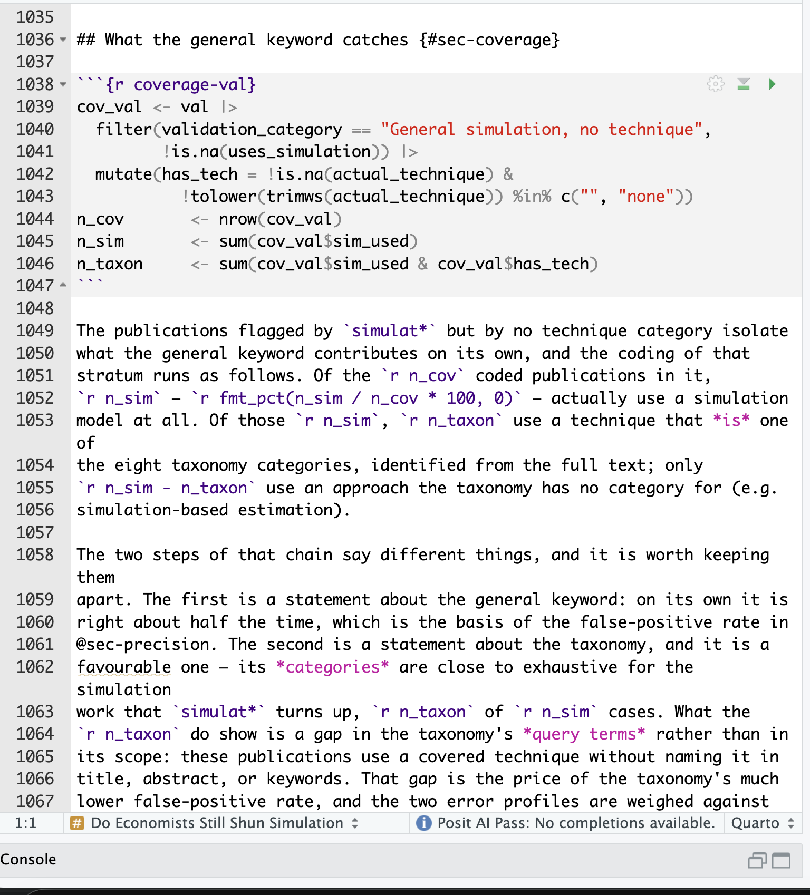{.shadow}

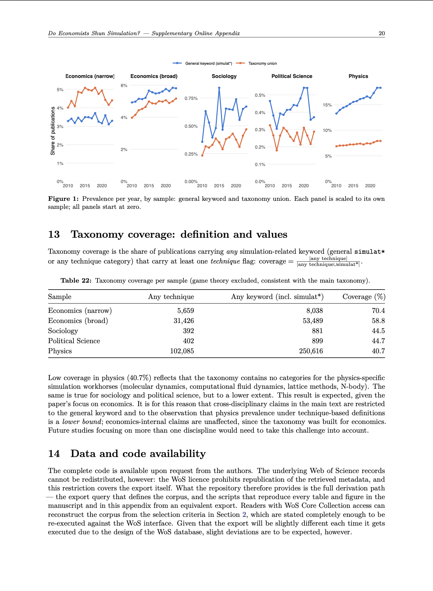{.shadow}
:::

::: {.center .tiny .muted}
one source file → a finished paper
:::

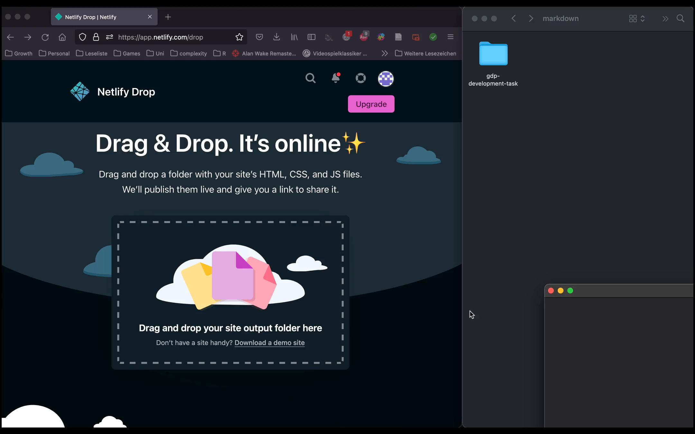{.shadow width="40%" fig-align="center"}
:::
:::

## But can't ChatGPT just do this for us…?

- Yes and no 😇
- LLMs are genuinely useful **when developing** code
- You **know** the language → LLMs boost your productivity
- You **don't** know the language → LLMs confuse you
  - Slightly misbehaving code you cannot spot
  - Blind to the most recent developments in the language
  - Output is not always easy to read

::: {.takeaway .center .fragment}
We will learn to use LLMs for coding — they are allowed throughout, including in
the exam — but be wary of their limitations 🤓
:::

## Organization of the lab sessions

- Every on-site session = **theory + practice** → always bring your laptop 👩‍💻
  - Some topics work better as **videos** → watch, do the exercises, bring your questions
- Questions belong in the **Moodle forum**, not in emails
  - **Try to answer each other** — explaining is how you learn
  - Recorded once, available to everybody
  - The best questions open the next session

## A short tour through the website

::: {.hero-link}
[researchmethodology-fall26.netlify.app](https://researchmethodology-fall26.netlify.app/)
:::

- Always **reload** the page — you want the most recent version

## Our 'learning agreement'

Why do I expect regular activity from you?

- Learning to program is **consecutive** → miss the basics, get lost later
- This is a **demanding** course → catching up later is hard
- It works through **practice** → the exercises carry a huge benefit
- It is at times **frustrating** → we need an amicable environment
- Few things teach you more than **helping someone else**

::: {.takeaway .center .fragment}
Learning a programming language can be a lot of fun and really brings you
forward — if we do it together as a team 💪
:::

## Open questions? {.divider background-color="#EAF0F4"}

# Part II: Installing R and R Studio {.divider background-color="#EAF0F4"}

## R and R-Studio

::: {.columns}
::: {.column width="48%"}
### R — the programming language

Issues commands your computer understands

::: {.code-center}
::: {.small}
```r
> fib_n(4)
```
:::

::: {.step-arrow}
↓
:::

::: {.tiny}
```
8B542408 83FA0077 06B80000 0000C383
FA027706 B8010000 00C353BB 01000000
B9010000 008D0419 83FA0376 078BD989
C14AEBF1 5BC3
```
:::

::: {.step-arrow}
↓
:::

::: {.small}
```
[1] 3
```
:::
:::
:::

::: {.column width="52%"}
::: {.fragment}
### R Studio — the IDE

A fancy text editor with features that make programming easy

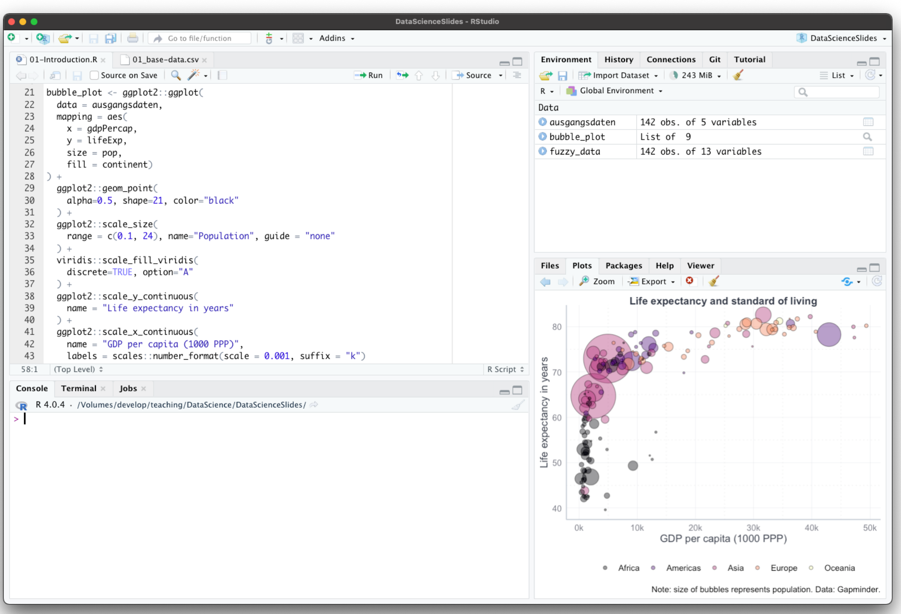{.shadow width="100%"}
:::
:::
:::

## R and R-Studio

::: {.columns}
::: {.column width="50%"}
**R** = the engine
:::
::: {.column width="50%"}
**R Studio** = the dashboard
:::
:::

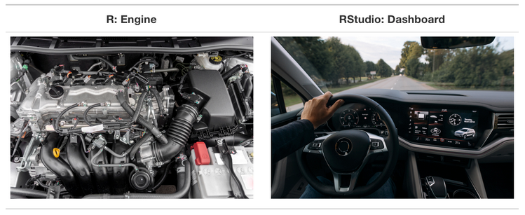{width="56%" fig-align="center"}

::: {.tiny .muted style="text-align:right"}
Figure: Ismay & Kim (2022)
:::

- Install **R first**, then R Studio
- Afterwards you only ever open **R Studio** → it calls R when needed

## R and R packages

- Base R understands a lot of commands — but not everything
- You can **teach** R new routines by defining functions
- You can **save** those functions and pass them on to others

::: {.takeaway .fragment}
An R package = a collection of functions and data written by others, installed
once and then usable like anything built into R
:::

## R and R packages

::: {.columns}
::: {.column width="50%"}
**R** = a new phone
:::
::: {.column width="50%"}
**Packages** = the apps you download
:::
:::

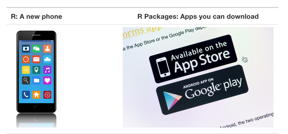{width="46%" fig-align="center"}

::: {.tiny .muted style="text-align:right"}
Figure: Ismay & Kim (2022)
:::

::: {.takeaway .center .fragment}
A script installs every package we need this semester — so we can resolve all
installation issues right now
:::

## And what about LaTeX?

- In Quarto: R code and text in **one file** → HTML page *or* polished PDF
- HTML is easy — a PDF is not: it is produced by **LaTeX**, a typesetting
  system that turns plain text into properly set text

::: {.fragment}
::: {.columns}
::: {.column width="33%"}
::: {.figcell}
::: {.smaller}
````markdown
---
title: "R Markdown and PDF"
author: "Claudius"
format: pdf
---

Here I write text. And add code:

```{{r}}
sqrt(1:5)
```
````
:::
:::
::: {.center .tiny .muted}
Quarto source …
:::
:::

::: {.column width="33%"}
::: {.figcell}
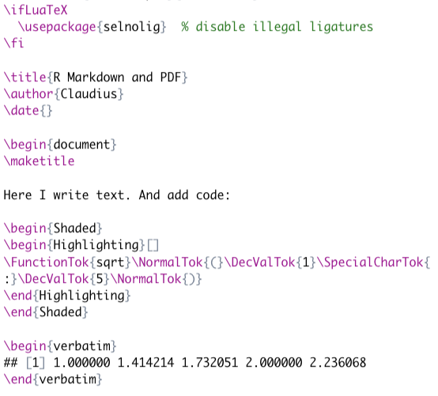
:::

::: {.center .tiny .muted}
… becomes LaTeX …
:::
:::

::: {.column width="34%"}
::: {.figcell}
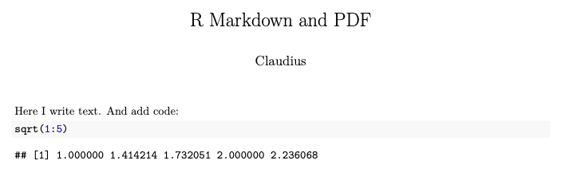
:::

::: {.center .tiny .muted}
… becomes a PDF
:::
:::
:::
:::

## Installation procedure

::: {.callout-warning appearance="default"}
## Start today, not the night before
Trying to install R just before the next session is a guaranteed way to lose it.
:::

- Until next session, you should have…
  - …tried to install **R**, **R Studio** and **Git** → follow the tutorials
  - …posted every problem **with a screenshot** in the Moodle forum
- All installation problems must be solved **by the end of next week**

## Problems with the installation? {.divider background-color="#EAF0F4"}

::: {.nonincremental .center-block .big}
1. Check the **tutorials** again
2. Post your problem in **Moodle**
3. Always attach a **screenshot**
:::
