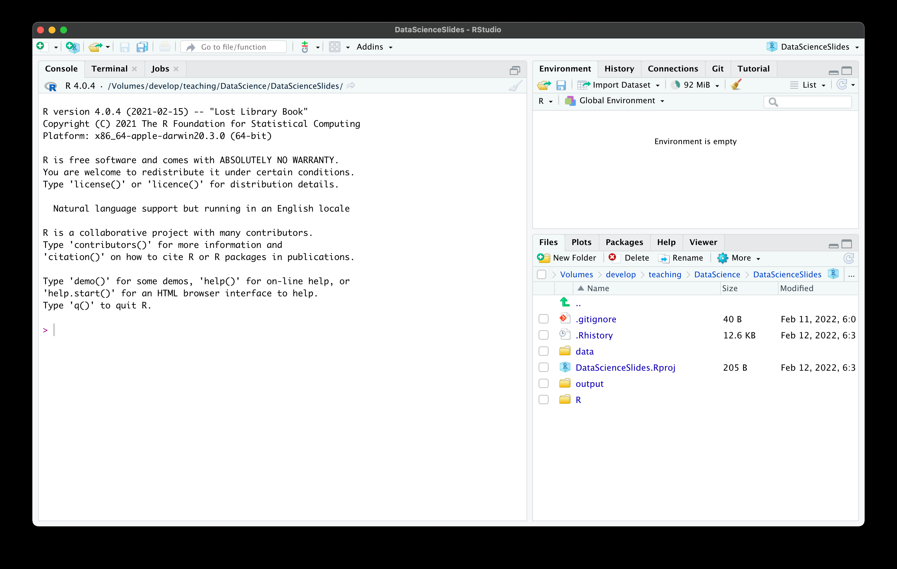
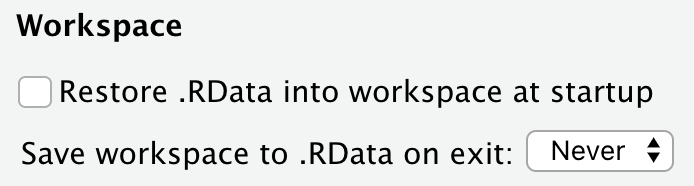
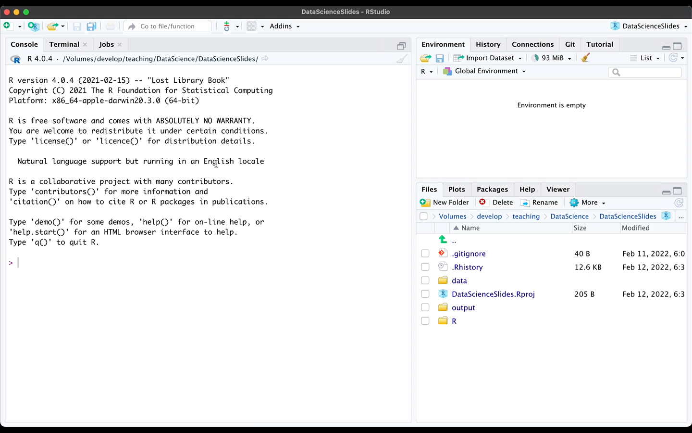
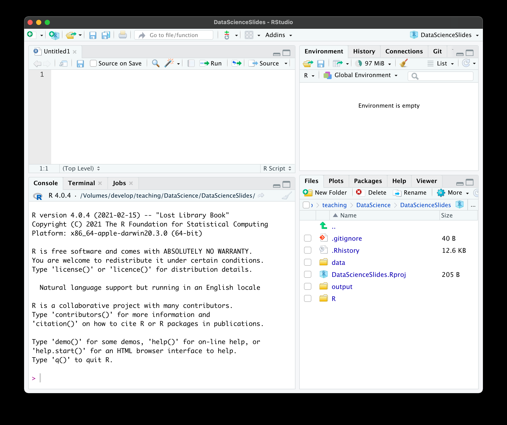
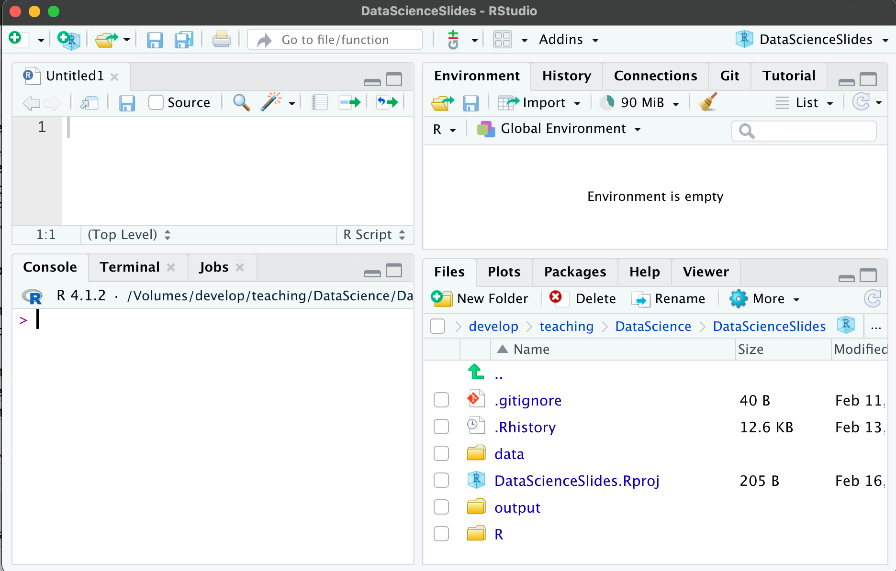
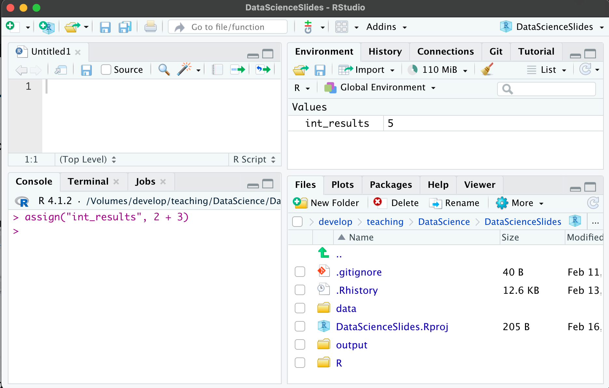
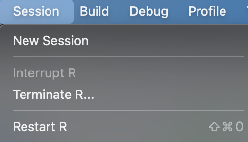
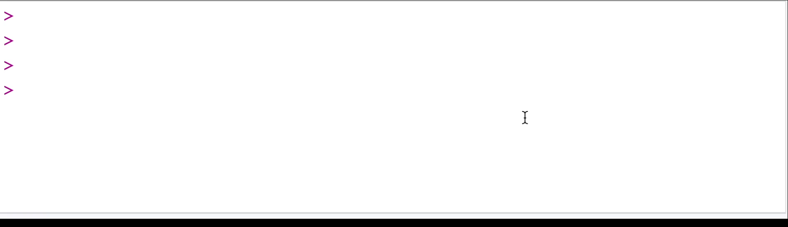

## Goals for today

::: {.nonincremental}
1. Learn how to **navigate the R Studio interface** and how to issue basic R commands
2. Explore the concepts of **objects, functions, and assignments**
3. Learn how to **use and define functions**
:::

# Part I: The R Studio interface {.divider background-color="#EAF0F4"}

## After starting R Studio

{.shadow width="80%" fig-align="center"}

## Some general settings

::: {.columns}
::: {.column width="46%"}
Before anything else, adjust two settings:

**R Studio → Settings → General**

- Do **not** restore `.RData` at startup
- **Never** save the workspace on exit
:::

::: {.column width="54%"}
{.shadow width="100%"}
:::
:::

::: {.takeaway .fragment}
Your script must reproduce your results from scratch — a restored workspace
hides exactly the mistakes you want to find
:::

## Working with a script

{.shadow width="80%" fig-align="center"}

## The most important elements

{width="72%" fig-align="center"}

# Part II: Basic commands in R {.divider background-color="#EAF0F4"}

## Issuing commands

- Let's practise issuing commands to R
- R works as a calculator out of the box

::: {.small}
```r
> 5 + 12
[1] 17
```
:::

::: {.callout-tip appearance="default"}
## Where to read this up
All the practical steps, and some additional information, are summarised in the
section **"Issue commands to your computer"** of the tutorial `First Steps in R`.
:::

## Intermediate task {.divider background-color="#EAF0F4"}

::: {.nonincremental}
- Sit together in **groups of 2–3**
- Execute the following computations via the console:
:::

$$5 + 12 \qquad (2 \cdot 3)^2 \qquad 2 \cdot 5.8 \qquad \frac{8^2 + 5^4}{3}$$

# Part III: Objects, functions, and assignments {.divider background-color="#EAF0F4"}

## Two slogans

::: {.pullquote}
To understand computations in R, two slogans are helpful:
Everything that exists is an object.
Everything that happens is a function call.
[John Chambers]{.source}
:::

- Every number, function, letter — whatever there is — is an **object** stored
  somewhere in the physical memory of your computer
- Whenever we tell the computer to do something via R, we are calling a
  **function**

## `2 + 3` refers to three objects

::: {.small}
```r
> 2 + 3
[1] 5
```
:::

- The numbers `2` and `3` …
- … as well as the function `+` (addition)
- It executes the addition and produces a **further object**: the number `5`

::: {.takeaway .center .fragment}
Even the plus sign is a function, and even the result is an object
:::

## Assignments

What if we want to **keep** the result of a computation for further use?

::: {.small}
```r
> 2 + 3
[1] 5
```
:::

- The result is created and stored somewhere in memory — but we cannot remember
  its precise location
- So we give it a **name** and call it by that name later
- Binding an object to a name is called an **assignment**, done by `assign()`:

::: {.small}
```r
> assign("int_results", 2 + 3)
```
:::

## The environment shows your names

::: {.small}
```r
> assign("int_results", 2 + 3)
> int_results
[1] 5
```
:::

::: {.columns}
::: {.column width="50%"}
{.shadow width="100%"}

::: {.center .tiny .muted}
before the assignment …
:::
:::

::: {.column width="50%"}
{.shadow width="100%"}

::: {.center .tiny .muted}
… and after it
:::
:::
:::

## Shortcuts, names, and removal

- Assignments happen constantly, so there is a shortcut for `assign()`:

::: {.small}
```r
assign("int_result", 2 + 3)   # does the same as:
int_result <- 2 + 3
```
:::

- Tip: learn the keyboard shortcut for your OS (Mac: `⌥ -`)
- Not all names are allowed → see the tutorial reading
- `rm()` removes an assignment again:

::: {.small}
```r
> x <- 2 + 2
> x
[1] 4
> rm(x)
> x
Error: object 'x' not found
```
:::

## What about many assignments?

- One object can have **many names** …
- … but each name points to **one single object**:

::: {.small}
```r
> a <- 2
> a <- 4
> a
[1] 4
```
:::

- Be careful not to overwrite important pre-defined assignments
- Worst case: remove all assignments and restart R (Mac: `⇧⌘0`)

{.shadow width="26%" fig-align="center"}

## Tasks {.divider background-color="#EAF0F4"}

::: {.nonincremental}
- Get together in **groups of 2–3**
- Compute the following chain and **assign a name to each intermediate result**:
:::

$$a = 2 + 3 \qquad b = \frac{5 \cdot a}{2} \qquad c = (b + 1)^2 \qquad d = \sqrt{c}$$

- What happens if you call a name that has **not** been assigned before?

# Part IV: Functions {.divider background-color="#EAF0F4"}

## What a function is

A function is an **algorithm**: it takes an **input**, applies a **routine**,
and returns an **output**

::: {.boxed}
Input → **function routine** → Output
:::

- The function `log()`, for instance, computes the logarithm of a number:

::: {.boxed}
`2` → **`log()`** → `0.6931472`
:::

- Functions usually have **names** we use to call them

## Calling functions: prefix and infix

::: {.columns}
::: {.column width="52%"}
The most common form is the **prefix** form:

::: {.small}
```r
assign("test", 2)
```
:::

::: {.smaller}
- `assign` — the **name** of the function
- `(` … `)` — open and closed **brackets**
- `"test", 2` — the **arguments**, separated by commas (usually include the input)
:::
:::

::: {.column width="48%"}
Alternatively, the **infix** form:

::: {.small}
```r
2 + 3
```
:::

::: {.smaller}
- The function name is written *between* the arguments
- Most common for mathematical operations → further readings
:::
:::
:::

## Two types of arguments

- **Mandatory** arguments and **optional** arguments
- Mandatory arguments usually represent the function **input**
- Optional arguments specify **how** the routine should be executed

::: {.takeaway .fragment}
Mandatory arguments *can* be specified via their name — optional arguments
usually *must* be
:::

- Let's look at `mean()`, a function that computes the mean

## Mandatory arguments

- First we use `c()` — for *concatenate* — to create a vector of numbers:

::: {.small}
```r
t_vec <- c(1, 2, 3, 4)
```
:::

- Then we compute the mean of this set of numbers:

::: {.small}
```r
mean(t_vec)
```
:::

- The first (mandatory) argument of `mean()` is called `x`
- Being mandatory, we *can* but need not specify it:

::: {.small}
```r
mean(x = t_vec)
```
:::

## Optional arguments

- `mean()` also accepts an optional argument called `na.rm`
  - It specifies how `mean()` deals with **missing values** in the input
  - `TRUE` → missing values (`NA`) are removed before computing; `FALSE` → they
    are not
- Set it by writing the argument name, `=`, and the value
- Add a missing value to the vector and compare:

::: {.small}
```r
t_vec <- c(1, 2, 3, 4, NA)

mean(t_vec)                  # vs.
mean(t_vec, na.rm = TRUE)    # vs.
mean(t_vec, na.rm = FALSE)
```
:::

## Defaults, Tab, and `help()`

- Like all optional arguments, `na.rm` has a **default value**, chosen if you do
  not set another one
- How to know which optional arguments exist, and what their defaults are?
  - Press the **Tab key** after the open bracket:

{.shadow width="62%" fig-align="center"}

  - Or call `help(mean)`

## Function calls — practice {.divider background-color="#EAF0F4"}

::: {.nonincremental}
- Define a vector with the elements `-2, 2, 4, 6, 9` and `NA`
- Apply the following functions and work out what they do:

::: {.small}
```r
median()    is.na()    anyNA()    sum()
```
:::

- There are two ways to compute the variance of a vector: the **population**
  variance and the **sample** variance. What does `var()` do? How do you compute
  the other version in R?
:::

## Defining your own functions

Knowing how to define functions matters for two reasons:

- Defining your own functions is **genuinely useful**
- It lets you **understand how functions work** in general

We define a new function via the function `function()` 🙈

## The anatomy of a function

::: {.columns}
::: {.column width="56%"}
::: {.small}
```r
pythagoras <- function(cathetus_1, cathetus_2){
  hypo_squared <- cathetus_1**2 + cathetus_2**2
  hypotenuse <- sqrt(hypo_squared)
  return(hypotenuse)
}
```
:::
:::

::: {.column width="44%"}
::: {.smaller}
- `pythagoras <-` — the **name** of the new function and the assignment operator
- `(cathetus_1, cathetus_2)` — the **arguments**
- the block in braces — the **function body**: the routine applied to the input
- `return(...)` — what the function gives back as its **output**
:::
:::
:::

::: {.takeaway .center .fragment}
All assignments inside the body exist **only within** the function
:::

## Short practice {.divider background-color="#EAF0F4"}

Write a function that takes two mandatory arguments, `x1` and `x2`, and returns

$$x_1^2 + 2 \cdot x_1 \cdot x_2 + x_2^2$$

## Final remarks about functions

There are many reasons to use functions:

::: {.nonincremental}
1. Code becomes more **concise and transparent**
2. Functions help to **structure** your code
3. Functions **facilitate debugging** and help avoid incidental mistakes
:::

- Before writing a function, check whether it has not already been written 😉
- For more complicated functions: sketch the idea on paper first, then implement
- Always **document** your functions → see the readings for a manual

## Let's practice! {.divider background-color="#EAF0F4"}

::: {.nonincremental}
- Go together in **pairs**: one is the *driver*, the other the *navigator*
  - Only the driver writes code, the navigator says what to do
- After 15 minutes, sit together with another team, explain your solutions and
  discuss common problems → then short feedback in the plenum
:::

Write a function that takes a set of numbers $x$ and normalises them into the
range between zero and one:

$$z_i = \frac{x_i - \min(x)}{\max(x) - \min(x)}$$

::: {.smaller}
Two R functions that might come in handy: `min()` and `max()`
:::

## Summary

You made your first big steps into the R programming world 💪🥳

::: {.nonincremental}
- We checked out the main elements of the **R Studio interface**
- We learned how to **issue commands** to the computer
- We learned that everything that exists is an **object**, and everything that
  happens is a **function call**
- We learned how to **associate objects with names**
- We learned how to **call and define functions**
:::

::: {.takeaway .center .fragment}
This was a lot — take your time to digest and repeat these topics
:::

## Outlook {.divider background-color="#EAF0F4"}

Next session we will…

::: {.nonincremental}
- …learn about the different **types of objects** you can encounter in R
- …learn how to **automate tasks** with loops and conditionals
:::

::: {.callout-note appearance="default"}
## Tasks until next week
1. Fill in the **quick feedback survey** on Moodle
2. Read the **tutorials** posted on the course page
3. Do the **exercises** provided on the course page and discuss problems and
   difficulties via the Moodle forum
:::
