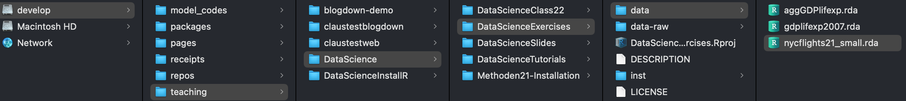

## Goals for today

::: {.nonincremental}
1. Learn how to **set up an R project**
2. Learn about the difference between **absolute and relative paths**
3. Learn how to use the **`here` package**
:::

# Part I: Why project management matters {.divider background-color="#EAF0F4"}

## Our goal

- Learn a **default directory structure** 
  - → Facilitates the collaboration with **future-you** considerably
- A general **workflow** that avoids the classic project-management problems

::: {.takeaway .fragment}
Central idea: all results are **reproducible from the raw data** — and the
raw data must never be manipulated
:::

- **Raw data** = what you download from the internet, gather through an experiment,
  or code yourself

## How to keep your work transparent

Raw data must not be changed — but it is usually not in a state we can work with

::: {.incremental}
1. **Gather** data, save it on your computer
2. **Import** this data into R
3. Write a **script that transforms** raw data into *tidy* data
4. Use the tidy data for further **analysis**: visualisation, modelling, …
:::

::: {.takeaway .center .fragment}
Saving the scripts in steps 2 & 3 makes your work fully reproducible — they
always tell you what you did to your raw data
:::

## Where we are heading {auto-animate=true}

::: {.boxed data-id="box-setup"}
**Set up your project environment** · *done only once per project*
:::

::: {.boxed data-id="box-loop"}
**Import data** → **transform raw data into tidy data** → **save data**
· *may be done several times*
:::

<!-- Same slide once more: reveal.js matches the two boxes by `data-id` and
     tweens them into the emphasised state. `visibility="uncounted"` keeps the
     slide numbering of the deck unchanged. -->

## Where we are heading {auto-animate=true visibility="uncounted"}

::: {.boxed .box-focus data-id="box-setup"}
**Set up your project environment** · *done only once per project*
:::

::: {.boxed .box-dimmed data-id="box-loop"}
**Import data** → **transform raw data into tidy data** → **save data**
· *may be done several times*
:::

# Part II: Setting up your R project {.divider background-color="#EAF0F4"}

## Setting up your working environment

::: {.columns}
::: {.column width="58%"}
- **Where** you save your data and files matters
- Right **directory structure** as prerequisite for a transparent and
  reproducible project
- For **every** task in R you should set up your project like this →
- All relevant steps and the rationale described in @graebner2026-setting-up-an-r-project
:::

::: {.column width="42%"}
<div class="filetree">
<ul>
 <li class="dir root"><span class="nm">ProjectName</span>
  <ul>
   <li class="file rproj"><span class="nm">ProjectName.Rproj</span></li>
   <li class="dir"><span class="nm">data</span>
    <ul>
     <li class="dir"><span class="nm">raw</span><span class="note">never changed</span></li>
     <li class="dir"><span class="nm">tidy</span><span class="note">script output</span></li>
    </ul>
   </li>
   <li class="dir"><span class="nm">R</span><span class="note">your scripts</span></li>
   <li class="dir"><span class="nm">output</span><span class="note">figures, tables</span></li>
   <li class="dir"><span class="nm">misc</span><span class="note">everything else</span></li>
  </ul>
 </li>
</ul>
</div>
:::
:::

## Creating an R project {.divider background-color="#EAF0F4"}

::: {.center-block .big}
See the **tutorial and the video** for the documentation of the concrete steps
:::

::: {.center .muted}
The slides focus on selected background concepts only
:::

# Part III: Paths and the `here` package {.divider background-color="#EAF0F4"}

## Absolute and relative paths

Two ways to tell your computer where a file is located:

- Via an **absolute path**: the description starts at the root directory 🌲
- Via a **relative path**: the description starts at your current position in
  the file system

{width="90%" fig-align="center"}

## The same file, two descriptions

{.shadow width="100%" fig-align="center"}

Assuming we are located in `DataScienceExercises` and want to point to
`nycflights21_small.rda`:

::: {.smaller}
```r
# absolute
"/Volumes/develop/teaching/DataScience/DataScienceExercises/data/nycflights21_small.rda"

# relative
"data/nycflights21_small.rda"
```
:::

- The relative path is **shorter** …
- … and you can **share code** without forcing others to adjust the path

## Relative paths and `setwd()`

::: {.columns}
::: {.column width="62%"}
<!-- The bullets are written out in HTML so that each one can carry its own
     `data-fragment-index`: reveal.js plays *all* indexed fragments before the
     unindexed ones, so the picture and the blue box (both on index 5) can only
     come last if everything before them is indexed too. -->

<ul>
<li class="fragment" data-fragment-index="1">Problem: how do we set our location to `DataScienceExercises`?</li>
<li class="fragment" data-fragment-index="2">One option: give `setwd()` the absolute path:</li>
</ul>

::: {.fragment fragment-index=3}
```r
setwd("/Volumes/develop/teaching/DataScience/DataScienceExercises")
```
:::

<ul>
<li class="fragment" data-fragment-index="3">Then we can use `"data/nycflights21_small.rda"`</li>
<li class="fragment" data-fragment-index="4">Many people put `setwd()` at the top of their scripts</li>
</ul>
:::

::: {.column width="38%"}
<!-- Picture and blue box share index 5: they come in together, on the click
     after the last bullet. -->
::: {.fragment fragment-index=5}
{width="86%" fig-align="center"}
:::
:::
:::

::: {.takeaway .center .fragment fragment-index=5}
**But you must never ever do this!**
:::

## Why `setwd()` is evil

- It does not avoid absolute paths — you still have to *provide*
  an absolute path to `setwd()` 🤯
- It makes others hate you
  - Abby writes `amazing_script.R`

::: {.fragment}
```r
setwd("/Volumes/Macintosh HD/Users/AbbysUserName/PathToFolderThatOnlyExistsHere/ProjectName")
data_file <- data.table::fread("data/file.csv")
```
:::

  - Sends it to Ellie who gets:

::: {.fragment}
```r
Error in setwd("/Volumes/Macintosh HD/Users/AbbysUserName/PathToFolderThatOnlyExistsHere/ProjectName") :
  cannot change working directory
```
:::

## The better alternative: `here`

::: {.columns}
::: {.column width="58%"}
- A simple solution: the package **`here`**
- It sets an **anchor** ⚓ in your project directory
- You then create paths relative to that anchor via `here::here()`
  - Works on **every machine**
- Always put `here::i_am()` into the **first line** of your scripts:

::: {.fragment}
<!-- `code-line-numbers="|1"` adds one more click at the end of the slide:
     it dims the other lines and marks line 1, which `.code-circle` then
     draws a red ring around. -->

::: {.smaller .code-circle}
```{.r code-line-numbers="|1"}
here::i_am("R/my_script.R")
library(here)
library(ggplot2)
# Script content
```
:::
:::
:::
::: {.column width="42%"}
<div class="filetree">
<ul>
 <li class="dir root"><span class="nm">ProjectName</span>
  <ul>
   <li class="file rproj"><span class="nm">ProjectName.Rproj</span><span class="note">the anchor ⚓</span></li>
   <li class="dir"><span class="nm">data</span></li>
   <li class="dir"><span class="nm">R</span>
    <ul>
     <li class="file hl"><span class="nm">my_script.R</span></li>
    </ul>
   </li>
   <li class="dir"><span class="nm">output</span></li>
   <li class="dir"><span class="nm">misc</span></li>
  </ul>
 </li>
</ul>
</div>
:::
:::

## Your turn {.divider background-color="#EAF0F4"}

::: {.columns}
::: {.column width="58%"}
::: {.nonincremental}
- Create a **new R project** on your computer
- Create all the **required folders**
- Write an **R script**, put it into the right directory, and make it usable for
  the `here` package
- Check out what `here::here()` returns and experiment with it
:::
:::

::: {.column width="42%"}
<div class="filetree compact">
<ul>
 <li class="dir root"><span class="nm">ProjectName</span>
  <ul>
   <li class="file rproj"><span class="nm">ProjectName.Rproj</span></li>
   <li class="dir"><span class="nm">data</span>
    <ul>
     <li class="dir"><span class="nm">raw</span></li>
     <li class="dir"><span class="nm">tidy</span></li>
    </ul>
   </li>
   <li class="dir"><span class="nm">R</span></li>
   <li class="dir"><span class="nm">output</span></li>
   <li class="dir"><span class="nm">misc</span></li>
  </ul>
 </li>
</ul>
</div>
:::
:::
## Summary and outlook

::: {.columns}
::: {.column width="62%"}
- We now know how to organise our **working directory**
- Important difference between **absolute and relative paths**
- The **`here` package** makes code transferable across machines
  — The better alternative to `setwd()`
:::

::: {.column width="38%"}
<div class="filetree compact">
<ul>
 <li class="dir root"><span class="nm">ProjectName</span>
  <ul>
   <li class="file rproj"><span class="nm">ProjectName.Rproj</span></li>
   <li class="dir"><span class="nm">data</span>
    <ul>
     <li class="dir"><span class="nm">raw</span></li>
     <li class="dir"><span class="nm">tidy</span></li>
    </ul>
   </li>
   <li class="dir"><span class="nm">R</span></li>
   <li class="dir"><span class="nm">output</span></li>
   <li class="dir"><span class="nm">misc</span></li>
  </ul>
 </li>
</ul>
</div>
:::
:::

::: {.takeaway .fragment}
Project management is essential, and chronically under-appreciated
:::

::: {.fragment}
**Further topics**: version control (**Git**) · virtual environments
(**`renv`**)
:::

## References {.smaller}

::: {#refs}
:::
