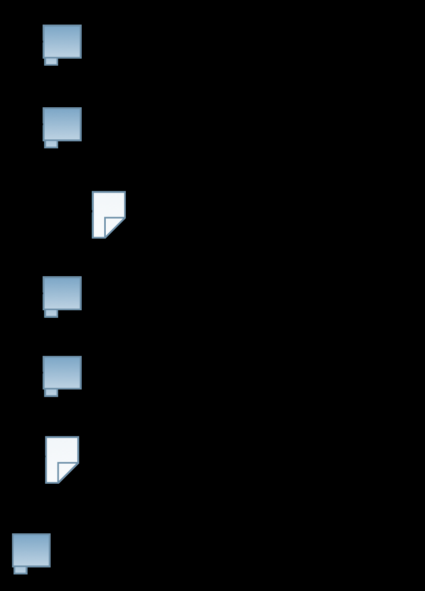

## Goals for today

::: {.nonincremental}
1. Learn how to **set up an R project**
2. Learn about the difference between **absolute and relative paths**
3. Learn how to use the **`here` package**
:::

# Part I: Why project management matters {.divider background-color="#EAF0F4"}

## Our goal

- Learn a **default directory structure** and a general way to **document
  everything** you do in a project
  - → Facilitates the collaboration with **future-you** considerably
- A general **workflow** that avoids the classic project-management problems

::: {.takeaway .fragment}
Central idea: all results must be **reproducible from the raw data** — and the
raw data must never be manipulated
:::

- Raw data = what you download from the internet, gather through an experiment,
  or code yourself

## How to keep your work transparent

Raw data must not be changed — but it is usually not in a state we can work with

::: {.nonincremental}
1. **Gather** data, save it on your computer
2. **Import** this data into R
3. Write a **script that transforms** raw data into *tidy* data
4. Use the tidy data for further **analysis**: visualisation, modelling, …
:::

::: {.takeaway .center .fragment}
Saving the scripts in steps 2 & 3 makes your work fully reproducible — they
always tell you what you did to your raw data
:::

## Where we are heading

::: {.boxed}
**Set up your project environment** · *done only once per project*
:::

::: {.boxed}
**Import data** → **transform raw data into tidy data** → **save data**
· *may be done several times*
:::

Today we deal with the **first** box — the one you only ever do once, and which
determines whether the rest is pleasant or painful

# Part II: Setting up your R project {.divider background-color="#EAF0F4"}

## Setting up your working environment

::: {.columns}
::: {.column width="58%"}
- **Where** you save your data and files matters
- The right **directory structure** is a prerequisite for a transparent,
  reproducible and easy-to-work-with project
- For **every** task in R you should set up your project like this →
- All relevant steps and the rationale are described in the **tutorial**
:::

::: {.column width="42%"}
{width="72%" fig-align="center"}
:::
:::

## Creating an R project {.divider background-color="#EAF0F4"}

::: {.center-block .big}
See the **tutorial and the video** for the documentation of the concrete steps
:::

::: {.center .muted}
The slides focus on selected background concepts only
:::

# Part III: Paths and the `here` package {.divider background-color="#EAF0F4"}

## Absolute and relative paths

Two ways to tell your computer where a file is located:

- Via an **absolute path**: the description starts at the root directory 🌲
- Via a **relative path**: the description starts at your current position in
  the file system

{width="90%" fig-align="center"}

## The same file, two descriptions

Assuming we are located in `DataScienceExercises` and want to point to
`nycflights21_small.rda`:

::: {.smaller}
```r
# absolute
"/Volumes/develop/teaching/DataScience/DataScienceExercises/data/nycflights21_small.rda"

# relative
"data/nycflights21_small.rda"
```
:::

- The relative path is **shorter** …
- … and you can **share code** without forcing others to adjust the path

## Relative paths and `setwd()`

::: {.columns}
::: {.column width="62%"}
- Problem: how do we set our location to `DataScienceExercises`?
- One option: give `setwd()` the absolute path as an argument:

::: {.smaller}
```r
setwd("/Volumes/develop/teaching/DataScience/DataScienceExercises")
```
:::

- Then we can use `"data/nycflights21_small.rda"`
- Many people put `setwd()` at the top of their scripts
:::

::: {.column width="38%"}
{width="86%" fig-align="center"}
:::
:::

::: {.takeaway .center .fragment}
**But you must never ever do this!**
:::

## Why `setwd()` is evil

- **First**: it does not help avoid absolute paths — you still have to *provide*
  an absolute path to `setwd()` 🤯
- **Second**: it makes others hate you

::: {.smaller}
```r
# Abby writes amazing_script.R …
setwd("/Volumes/Macintosh HD/Users/AbbysUserName/PathToFolderThatOnlyExistsHere/ProjectName")
data_file <- data.table::fread("data/file.csv")

# … sends it to Ellie, who executes it:
Error in setwd("/Volumes/Macintosh HD/Users/AbbysUserName/PathToFolderThatOnlyExistsHere/ProjectName") :
  cannot change working directory
```
:::

## The better alternative: `here`

::: {.columns}
::: {.column width="58%"}
- A simple solution: the package **`here`**
- It sets an **anchor** ⚓ in your project directory
- You then create paths relative to that anchor via `here::here()`
  - Works on **every machine**
- Always put `here::i_am()` into the **first line** of your scripts:

::: {.smaller}
```r
here::i_am("R/my_script.R")
library(here)
library(ggplot2)
# Script content
```
:::
:::

::: {.column width="42%"}
{width="70%" fig-align="center"}
:::
:::

## Your turn {.divider background-color="#EAF0F4"}

::: {.columns}
::: {.column width="58%"}
::: {.nonincremental}
- Create a **new R project** on your computer
- Create all the **required folders**
- Write an **R script**, put it into the right directory, and make it usable for
  the `here` package
- Check out what `here::here()` returns and experiment with it
:::
:::

::: {.column width="42%"}
{width="66%" fig-align="center"}
:::
:::

## Summary and outlook

::: {.columns}
::: {.column width="62%"}
- We now know how to organise our **working directory**
- Important difference between **absolute and relative paths**
- Using code on different machines is solved by the **`here` package** — the
  better alternative to `setwd()`

::: {.takeaway .fragment}
Project management is essential, and chronically under-appreciated
:::
:::

::: {.column width="38%"}
{width="64%" fig-align="center"}
:::
:::

Further topics: version control (**Git**) · virtual environments (**`renv`**)
