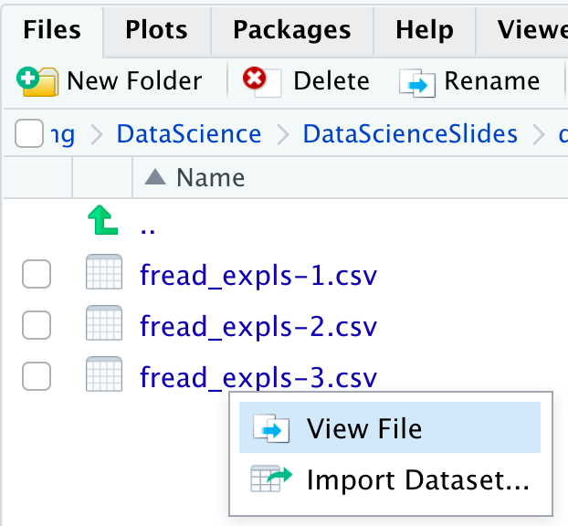

## Goals for today

::: {.nonincremental}
1. Learn how to handle **raw and tidy data** in R
2. Learn how to **import data** into R using `data.table::fread()`
3. Learn how to **save data**
:::

::: {.callout-note appearance="default"}
## Note
Importing data is an area in which AI tools become particularly helpful — **once
you understand the basics** of how importing works and what to keep in mind.
:::

# Part I: Raw data and tidy data {.divider background-color="#EAF0F4"}

## The role of data preparation

::: {.takeaway}
Importing and preparing data is the **most fundamental** task in data science —
and largely under-appreciated 🙄
:::

- **Data preparation and processing** ⇄ visualisation ⇄ analysis and modelling
- All of it funnels into the presentation of the insights as one overall story
- Today we deal with the very first step: getting raw data **into R**, and the
  result **back out into the file system**

## Focus of this session

- We use the **directory structure** introduced in the session on project
  management
- We learn how to import data using the most widely used file formats, especially
  **csv**

::: {.takeaway .fragment}
Goal: all results must be **reproducible from the raw data** at any time — so you
must not manipulate your raw data, at any cost
:::

::: {.smaller}
Builds on the session on **project management** · precedes the session on **data
preparation**
:::

## Recap: how to keep your work transparent

Raw data must not be changed — but it is usually not in a state we can work with

::: {.nonincremental}
1. **Gather** data, save it on your computer
2. **Import** this data into R
3. Write a **script that transforms** raw data into tidy data
4. Use the tidy data for further **analysis**
:::

::: {.takeaway .center .fragment}
By looking into the script you always know what you did to your raw data → you
can heal basically every mistake, no harm done
:::

# Part II: Importing data {.divider background-color="#EAF0F4"}

## Preparation: set up your working environment

::: {.columns}
::: {.column width="58%"}
- Raw data should be saved in **`data/raw`**
  - With very few data sets you might also use only `data`
- Tidied-up data should be saved in **`data/tidy`** → keep it separate

::: {.smaller}
See the separate sessions on **project management** and on **data preparation**
:::
:::

::: {.column width="42%"}
{width="68%" fig-align="center"}
:::
:::

## Import functions

Now that the project environment is set up, we can import data. Which function
you use depends on the **file type**:

::: {.columns .smaller}
::: {.column width="33%"}
**csv / tsv files**

```r
data.table::fread()
```
:::

::: {.column width="33%"}
**.Rds / RData files**

```r
readRDS()
load()
```
:::

::: {.column width="34%"}
**Specific formats**

```r
haven::read_dta()
haven::read_sas()
haven::read_spss()
```
:::
:::

::: {.takeaway .fragment}
The basic procedure is the same in all cases → we focus on reading **csv** files
:::

## How to import data

::: {.columns}
::: {.column width="60%"}
Good practice: save the path to the file in a vector first:

::: {.small}
```r
data_path <- here::here("data/raw/wb_data.csv")
```
:::

Since it is a csv file, we use `fread()`:

::: {.small}
```r
data.table::fread(file = data_path)
```
:::

- This uses **default options** — often fine for clean data files
- But data files are often not clean, and for the sake of transparency we should
  specify several optional arguments
:::

::: {.column width="40%"}
{width="72%" fig-align="center"}
:::
:::

## Exercise 1 {.divider background-color="#EAF0F4"}

::: {.nonincremental}
- Download the zip file `fread_expls.zip` from the course homepage
- Extract it within the folder `data/raw/` in your R project
- Write a script that imports the data set saved in the file
  **`fread_expls-1.csv`** into your session
:::

## The four arguments that matter

*See also the tutorial on data import.* We will learn when and how to use these
arguments of `data.table::fread()`:

::: {.nonincremental}
- **`file`**: the relative path to the csv file → use `here::here()`
- **`sep`**: the symbol that separates columns
- **`dec`**: the symbol used as decimal sign
- **`colClasses`**: what object type should be used for the columns?
:::

::: {.smaller}
For other widely used arguments check the tutorial and do the exercises — and
note there are even more options → `help(fread)`
:::

## `sep`: the column separator

::: {.small}
```
c_code; year; exports; unemployment
AT; 2013; 53.44; 5.34
AT; 2014; 53.39; 5.62
DE; 2013; 45.4; 5.23
DE; 2014; 45.64; 4.98
```
:::

- Especially in Germany, columns are often separated via `;` instead of `,`
- Pass a string to `sep` indicating how the columns are separated:

::: {.small}
```r
data.table::fread(file = data_path, sep = ";")
```
:::

## `dec`: the decimal sign

::: {.small}
```
c_code; year; exports; unemployment
AT; 2013; 53,44; 5,34
AT; 2014; 53,39; 5,62
DE; 2013; 45,4; 5,23
DE; 2014; 45,64; 4,98
```
:::

- Again in Germany, decimal places are often separated via `,` instead of `.`
- Pass a string to `dec`:

::: {.small}
```r
data.table::fread(file = data_path, sep = ";", dec = ",")
```
:::

## Exercise 2 {.divider background-color="#EAF0F4"}

Write a script that imports the data set **`fread_expls-2.csv`** into your session
such that the following tibble results:

::: {.small}
```
# A tibble: 4 × 4
  c_code  year exports unemployment
  <chr>  <int>   <dbl>        <dbl>
1 AT      2013    53.4         5.34
2 AT      2014    53.4         5.62
3 DE      2013    45.4         5.23
4 DE      2014    45.6         4.98
```
:::

## `colClasses`: the column types

Whenever numbers should be saved as **character**, the guessing algorithm of
`fread()` often fails:

::: {.columns .small}
::: {.column width="46%"}
```
c_code,year,exports,PROD_CODE
AT, 2013, 53.44, 0011
AT, 2014, 53.39, 0011
DE, 2013, 45.4, 0011
DE, 2014, 45.64, 0011
```
:::

::: {.column width="54%"}
```
  c_code  year exports PROD_CODE
  <chr>  <int>   <dbl>     <int>
1 AT      2013    53.4        11
```
:::
:::

- Specify the types explicitly by passing a vector to `colClasses`:

::: {.small}
```r
colClasses = c("character", rep("double", 2), "character")
```
:::

## Exercise 3 {.divider background-color="#EAF0F4"}

::: {.columns}
::: {.column width="58%"}
::: {.nonincremental}
- Read in the file **`fread_expls-3.csv`** and use all the arguments you consider
  necessary
- Make sure that the column `cgroup` is stored as a **factor**
:::

::: {.smaller}
Hint: to get an idea about the raw data, click on the file and select **View
File** to see it in its raw form. Infeasible for very large files → use `nrows`
and `select` to read a representative subset.
:::
:::

::: {.column width="42%"}
{.shadow width="94%"}
:::
:::

# Part III: Saving data {.divider background-color="#EAF0F4"}

## And what about saving data?

- Saving data is **much easier** than reading data
- The only relevant question is the **format**
  - If there are no good arguments for a different format, go for **csv**
- Use `data.table::fwrite()` with two main arguments:
  - `x`: the name of the object to be saved
  - `file`: the file name under which it should be saved

::: {.small}
```r
data.table::fwrite(
  x = exp_tab,
  file = here::here("data/tidy/exp_tab.csv")
)
```
:::

## The general idea

::: {.takeaway .center}
Make yourself comfortable before reading in data — expect frustration!
:::

- You import the data and bind it to an R object — usually a `data.frame`, or
  whatever aligns with your preferred dialect
- Then you transform this object until it satisfies the demands for **tidy data**
- Then you save the data under a **new name**, save the script, and celebrate
  yourself 🎉

::: {.smaller}
We cover the transformation steps in the next session
:::

## Summary and conclusion

- You learned how to **import data** into R
- Main focus: importing **csv** files using `data.table::fread()`
  - Other functions for csv exist, e.g. via the **tidyverse** packages
  - Other formats: specialised functions, especially in the **haven** package
- Importing standard data often works with **default options** — in other cases,
  optional arguments must be used → check the function documentation
- If **speed or memory** are an issue, comparing import functions is advisable

::: {.takeaway .center .fragment}
Once you understand the basics, using **AI** to assist with coding becomes very
useful in the context of data import
:::
