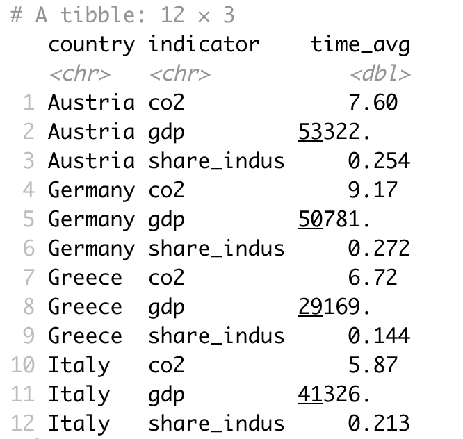

## Goals for today

::: {.nonincremental}
1. Understand the concept of **tidy data**
2. Get an overview over the most common **transformation routines**
3. Master a number of functions from the **`tidyr`** and **`dplyr`** packages to
   address some of these challenges
:::

# Part I: What is tidy data? {.divider background-color="#EAF0F4"}

## The role of data preparation

::: {.takeaway}
Importing and preparing data is the **most fundamental** task in data science —
and largely under-appreciated 🙄
:::

- **Data preparation and processing** ⇄ visualisation ⇄ analysis and modelling
- Everything funnels into the presentation of the insights as one overall story
- Last time we dealt with importing — today with everything that comes after

## The goal: tidy data

::: {.pullquote}
Tidy datasets are all alike, but every messy dataset is messy in its own way.
[Hadley Wickham]{.source}
:::

Translation into plain English:

- We find data sets in all kinds of messed-up forms in the world
- We must turn them into a form that is a good starting point for any further task

::: {.takeaway .center .fragment}
Good thing: this form is **unique** — and it is called **tidy**
:::

## Three demands

::: {.small}
```
# A tibble: 4 × 4
  c_code  year exports unemployment
  <chr>  <int>   <dbl>        <dbl>
1 AT      2013    53.4         5.34
2 AT      2014    53.4         5.62
3 DE      2013    45.4         5.23
4 DE      2014    45.6         4.98
```
:::

::: {.columns .smaller}
::: {.column width="33%"}
Every **row** corresponds to one and only one **observation**
:::
::: {.column width="33%"}
Every **column** corresponds to one and only one **variable**
:::
::: {.column width="34%"}
Every **cell** corresponds to one and only one **value**
:::
:::

::: {.smaller}
An excellent start for basically every further task — but maybe not the best way
to represent data **to humans**
:::

## Three ways to be untidy

::: {.columns .smaller}
::: {.column width="33%"}
**Row ≠ observation**

```
  c_code variable     `2013` `2014`
1 AT     unemployment   5.34   5.62
2 DE     unemployment   5.23   4.98
```

Two observations per row
:::

::: {.column width="33%"}
**Column ≠ variable**

```
  c_code  year exports variable
1 AT      2013    53.4 exports
2 AT      2014    53.4 exports
```

`variable` is not a variable
:::

::: {.column width="34%"}
**Cell ≠ value**

```
  country important_industries
1 DE      Cars (25%) and meat (10%)
2 AT      Wine (5%) and milk (2%)
```

Several values in one cell
:::
:::

::: {.takeaway .center .fragment}
The goal of **data wrangling** is to turn such untidy data into tidy data
:::

## Recap questions {.divider background-color="#EAF0F4"}

::: {.nonincremental}
- What are the three demands a data set needs to fulfil to count as *tidy*?
- Why do we care about tidy data at all?
- Are there plausible reasons for transforming a tidy data set into a
  **non-tidy** data set?
- Consider the data sets you have worked with so far. Are they tidy? If not, what
  would you need to change?
:::

# Part II: The six routines {.divider background-color="#EAF0F4"}

## The way to tidy data

- The starting point is **always different**
- The goal is always the same → and so are the steps: **six main routines**
- Two main packages are relevant:
  - **`tidyr`** provides functions for **reshaping** data into tidy format
    ('wrangling')
  - **`dplyr`** provides functions for **manipulating** data to extract desired
    information

## 1. Reshaping: long ⇄ wide

::: {.columns .smaller}
::: {.column width="48%"}
```
# A tibble: 4 × 4
  c_code  year exports unemployment
1 AT      2013    53.4         5.34
2 AT      2014    53.4         5.62
3 DE      2013    45.4         5.23
4 DE      2014    45.6         4.98
```
:::

::: {.column width="52%"}
```
# A tibble: 8 × 4
  c_code  year variable     value
1 AT      2013 exports      53.4
2 AT      2013 unemployment  5.34
3 AT      2014 exports      53.4
4 AT      2014 unemployment  5.62
…
```
:::
:::

::: {.small}
`tidyr::pivot_longer()` · `tidyr::pivot_wider()`
:::

## 2. Filter rows · 3. Select columns

::: {.columns .smaller}
::: {.column width="50%"}
**Filter** rows according to conditions

```r
dplyr::filter(data, c_code == "DE")
```

```
  c_code  year exports unemployment
1 DE      2013    45.4         5.23
2 DE      2014    45.6         4.98
```
:::

::: {.column width="50%"}
**Select** columns/variables

```r
dplyr::select(data, c_code, year, exports)
```

```
  c_code  year exports
1 AT      2013    53.4
2 AT      2014    53.4
3 DE      2013    45.4
4 DE      2014    45.6
```
:::
:::

::: {.takeaway .fragment}
`filter()` works on **rows**, `select()` works on **columns** — a distinction
worth over-learning
:::

## 4. Mutate · 5. Group and summarise

::: {.columns .smaller}
::: {.column width="50%"}
**Mutate** or create variables

```r
dplyr::mutate(data, change = `2014` - `2013`)
```

```
  c_code variable     `2013` `2014` change
1 AT     unemployment   5.34   5.62  0.285
2 DE     unemployment   5.23   4.98 -0.25
```
:::

::: {.column width="50%"}
**Group** and **summarise** data

```r
data %>%
  dplyr::group_by(c_code) %>%
  dplyr::summarise(exports_avg = mean(exports))
```

```
  c_code exports_avg unemployment_avg
1 AT            53.4             5.48
2 DE            45.5             5.11
```
:::
:::

## 6. Merge several data sets

::: {.columns .smaller}
::: {.column width="50%"}
```
  c_code  year exports
1 AT      2013    53.4
2 DE      2013    45.4
```

```
  c_code  year unemployment
1 AT      2013         5.34
2 DE      2013         5.23
```
:::

::: {.column width="50%"}
```r
dplyr::full_join(x, y, by = c("c_code", "year"))
```

```
  c_code  year exports unemployment
1 AT      2013    53.4         5.34
2 DE      2013    45.4         5.23
```
:::
:::

::: {.smaller}
`left_join()` · `right_join()` · `full_join()` · `inner_join()` — they differ in
**which rows survive** when the two sets do not match perfectly
:::

## The six routines at a glance

::: {.columns .smaller}
::: {.column width="50%"}
::: {.boxed}
**Reshaping** data from long to wide format (and vice versa)
:::

::: {.boxed}
**Filter** rows according to conditions
:::

::: {.boxed}
**Select** columns/variables
:::
:::

::: {.column width="50%"}
::: {.boxed}
**Mutate** or create variables
:::

::: {.boxed}
**Group** and **summarise** data
:::

::: {.boxed}
**Merge** several data sets
:::
:::
:::

::: {.takeaway .center .fragment}
With these six routines you can prepare **almost any** messy data set
:::

## Recap questions {.divider background-color="#EAF0F4"}

::: {.nonincremental}
- What is the relation between **long** and **wide** data sets?
- Name the **six main routines** of data preparation and explain what they are
  used for
- What does *data wrangling* mean?
- Which **two packages** are used most frequently in the context of data
  preparation? What are their respective areas of application?
:::

# Part III: Practice {.divider background-color="#EAF0F4"}

## Short recap on reshaping {.divider background-color="#EAF0F4"}

::: {.nonincremental}
- Take the data set `data_raw_long.csv` and make it **wider**: one column per
  country
- Take the data set `data_raw_wide.csv` and make it **longer**: one column
  `year`, one column `gini`
:::

::: {.smaller}
The data sets used for the following exercises are all contained in
`wrangling_exercises_data.zip` on the course homepage
:::

## Short recap on manipulation basics {.divider background-color="#EAF0F4"}

Consider the data set `wine2dine` from the package `DataScienceExercises`:

::: {.nonincremental .smaller}
1. Filter the data set such that it only contains **white** wines
2. Then remove the column `kind`
3. Change the type of the column `quality` into `double`
4. Divide the values in the columns `alcohol` and `residual sugar` by 100
5. Filter the data such that you only keep the wines with the **highest** quality
   score
:::

## Short recap on summarising and grouping {.divider background-color="#EAF0F4"}

::: {.nonincremental}
- What is the difference between `dplyr::mutate()` and `dplyr::summarise()`?
- Consider again `wine2dine`:
  1. Summarise the data by computing the **mean alcohol, sugar and quality** of
     white and red wines
  2. Compute a variable indicating how the quality of **each wine deviates** from
     the average quality of all wines
:::

## Short recap on joining data sets {.divider background-color="#EAF0F4"}

::: {.nonincremental}
- Consider `join_x.csv` and `join_y.csv` and join them on the columns `time` and
  `id`, using `left_join()`, `right_join()` and `full_join()`
- Try out what `inner_join()` does. How does it differ from the other three?
- What is the difference between joining on `time` **and** `id` versus joining
  only on `id`?
:::

# Part IV: Helpful tools {.divider background-color="#EAF0F4"}

## Pipes

- Not strictly necessary, but they improve the **usability and readability** of
  your code: `%>%`
- Pipes take the result of one line and 'throw' it into the next line
  - The thrown result can be referred to via `.`
  - By default it is used as the **first argument** of the next function

::: {.columns .small}
::: {.column width="50%"}
```r
data_sub <- dplyr::select(
  .data = data_raw,
  country, year, unemp, gdp)
```
:::

::: {.column width="50%"}
```r
data_sub <- data_raw %>%
  dplyr::select(
    country, year, unemp, gdp)
```
:::
:::

## Pipes: a practical example

::: {.columns .smaller}
::: {.column width="50%"}
```r
chain_1 <- tidyr::pivot_longer(
  data = data_raw_wide,
  cols = c("gdp", "gini", "unemp"),
  names_to = "indicator",
  values_to = "val")

chain_2 <- tidyr::pivot_wider(
  data = chain_1,
  names_from = "year",
  values_from = "val")
```
:::

::: {.column width="50%"}
```r
chain_complete <- data_raw_wide %>%
  tidyr::pivot_longer(
    cols = c("gdp", "gini", "unemp"),
    names_to = "indicator",
    values_to = "val") %>%
  tidyr::pivot_wider(
    names_from = "year",
    values_from = "val")
```
:::
:::

::: {.takeaway .fragment}
Pipes almost always make code easier to read — but during **code development** it
is usually easier to make the intermediate steps explicit
:::

## Recap on piping {.divider background-color="#EAF0F4"}

::: {.nonincremental}
- Explain what the pipe `%>%` does. When can it be useful?
- Should you develop code with pipes right from the start? Why, or why not?
- Rewrite a chain of three explicit steps using pipes (data via the course page)
- Look at the introduction to the package `magrittr`, which defines even more
  pipes: [magrittr.tidyverse.org](https://magrittr.tidyverse.org/articles/magrittr.html)
:::

## Tidy selection helpers

- It can become tedious to select many columns by listing their names
- The **tidy selection helpers** select columns based on common criteria:

::: {.columns .small}
::: {.column width="50%"}
```r
data_raw_wide %>%
  dplyr::select(gdp, gini)

data_raw_wide %>%
  dplyr::select(
    tidyr::starts_with("g"))
```
:::

::: {.column width="50%"}
```r
data_raw_wide %>%
  dplyr::select(c(
    tidyr::all_of(c("country", "year")),
    tidyr::starts_with("g")))
```

::: {.center .tiny .muted}
combine multiple selectors with `c()`
:::
:::
:::

## Exercise 1: filtering and reshaping {.divider background-color="#EAF0F4"}

Use the data set `exercise_1.csv` from `wrangling_exercises_data.zip`.

::: {.nonincremental}
Import the data and…

- …only consider data on **Greece and Germany** between **1995 and 2015**
- …make it **wider** (and tidy)
- …save it in the subfolder `data/tidy/`
:::

::: {.small}
```
# A tibble: 42 × 4
  country   year    gdp   co2
1 Germany   1995 39366.  10.7
2 Germany   1996 39569.  11.0
…
```
:::

## Exercise 2: mutating, selecting & summarising {.divider background-color="#EAF0F4"}

::: {.columns}
::: {.column width="58%"}
Use `exercise_2.csv`. Import the data and…

::: {.nonincremental .smaller}
- …only keep the variables `gdp`, `share_indus` and `co2`
- …divide the industry share in GDP by 100
- …only keep data between **2010 and 2018**
- …compute the **averages over time** for all countries
- **Bonus:** visualise the resulting CO2 average via a bar plot
:::
:::

::: {.column width="42%"}
{.shadow width="94%"}
:::
:::

## Summary

- After importing raw data you usually must prepare them → make them **tidy**
- Tidy data is the input to any visualisation or modelling task:
  - Every **column** = one and only one **variable**
  - Every **row** = one and only one **observation**
  - Every **cell** = one and only one **value**
- It is usually a good idea to write **one script that imports raw and saves tidy
  data**
- Such a script usually uses `data.table`, `dplyr`, `tidyr` and `here`

## The functions, and what they are for

::: {.nonincremental .smaller}
- **Reshaping** data: `tidyr::pivot_longer()` and `tidyr::pivot_wider()`
- **Filtering** rows: `dplyr::filter()`
- **Selecting** columns: `dplyr::select()` and the select helpers
- **Mutating** or creating variables: `dplyr::mutate()`
- **Grouping** and **summarising**: `dplyr::group_by()` and `dplyr::summarise()`
- **Merging** data sets: `dplyr::*_join()`
:::

::: {.takeaway .center .fragment}
Data preparation is mainly about **practice** — so the practical exercises are
particularly recommended 👩‍💻👨‍💻
:::
