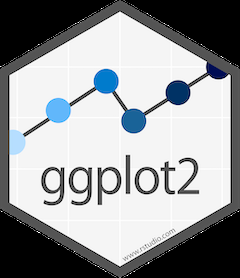
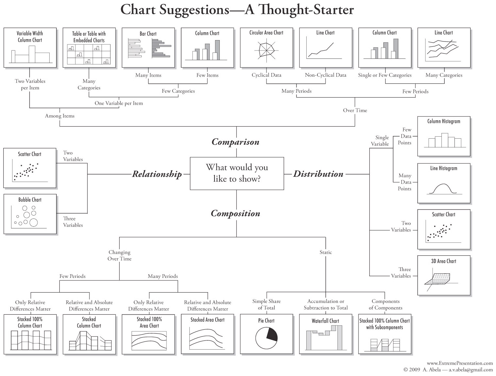
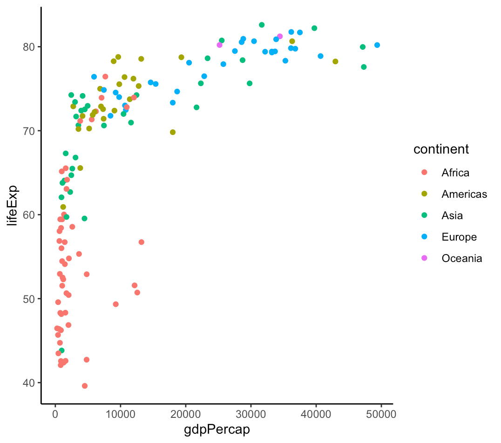

## Goals for today

::: {.columns}
::: {.column width="62%"}
::: {.nonincremental}
1. Understand how plots are created **layer-wise** via the `ggplot2` package
2. Learn how to **map variables** in data frames to visual aspects of a plot
3. Figure out how you can **re-use code** across different visualisation tasks
:::
:::

::: {.column width="38%"}
{width="62%" fig-align="center"}
:::
:::

# Part I: Basics of visualisation {.divider background-color="#EAF0F4"}

## The role of visualisation in data science

- Data preparation ⇄ **visualisation** ⇄ analysis and modelling
- Everything funnels into the presentation of the insights as one overall story

Visualisations can be used for many purposes:

::: {.nonincremental}
- **Exploratory data analysis** → understand your data → prepare/refine models
- **Communication** → inform others about your results
- **Manipulation** → convince others, or recognise others trying to convince you
:::

## Why `ggplot2`

- Here we learn how to create visualisations using the package **`ggplot2`**
- An easy-to-read, widely used and powerful visualisation engine
- Many great extensions, e.g. for animated GIFs, control charts, and many more…

::: {.takeaway .fragment}
The great thing about `ggplot2`: the **syntax is the same for all graphs**
:::

## What kind of plot do you want?

{width="72%" fig-align="center"}

::: {.tiny .muted style="text-align:right"}
Chart Suggestions — A Thought-Starter, © 2009 A. Abela
:::

## A very simple example to begin with

::: {.columns}
::: {.column width="52%"}
{width="98%"}
:::

::: {.column width="48%"}
::: {.small}
```r
gdp_data <- DataScienceExercises::gdplifexp2007

ggplot2::ggplot(
  data = gdp_data,
  mapping = ggplot2::aes(
    x = gdpPercap,
    y = lifeExp,
    color = continent)
) +
  ggplot2::geom_point() +
  ggplot2::theme_classic()
```
:::
:::
:::

## The general idea

Every plot in `ggplot2` is generated in **two major steps**:

::: {.nonincremental}
1. You **describe** the plot in all its details via a list → *this is where all
   the work gets done* 😅
2. You **call** the list and R renders the plot for you → *this is where errors
   become apparent* 😤
:::

- To create the list-like description, `ggplot2` offers you a ton of helper
  functions
- You always start with an **empty plot**, then add **layers** above it, adjust
  details — and that's it

# Part II: The practical workflow {.divider background-color="#EAF0F4"}

## Where we want to go

Today we produce **two plots**:

::: {.nonincremental}
- A **bubble chart**: life expectancy against income per capita, bubble size =
  population, colour = continent
- A **line chart**: the divergence of income per capita over time, one line per
  continent
:::

::: {.takeaway .fragment}
The mechanics are very similar for different plots — based on the readings you
will be able to make many more already now
:::

## Developing a ggplot — the general workflow

::: {.center-block .big}
We develop the graph **interactively**, step by step
:::

::: {.center .muted}
See the **lecture notes** on the course page for the full documentation of every
intermediate step
:::

::: {.smaller}
The data sets come ready-made from the `DataScienceExercises` package:
`gdplifexp2007` for the bubble chart, `aggGDPlifexp` for the line chart
:::

## The anatomy of any ggplot

::: {.small}
```r
ggplot() +
  <GEOM_FUNCTION>(
    data = <DATA>,
    mapping = aes(<MAPPINGS>),
    stat = <STAT>,
    position = <POSITION>
  ) +
  <COORDINATE_FUNCTION> +
  <FACET_FUNCTION> +
  <THEME ADJUSTMENTS>
```
:::

::: {.columns .smaller}
::: {.column width="33%"}
**geom** — the geometric forms used to represent the data (points, lines,
shades, …)
:::
::: {.column width="33%"}
**data** and **mapping** — what to visualise, and how variables map to
aesthetics (axis, size, form, …)
:::
::: {.column width="34%"}
**theme** — adjustments to look, labels, legends, …
:::
:::

::: {.smaller}
`data` and `mapping` may be set as defaults within `ggplot()`, or separately for
each geom
:::

## From the bubble to the line chart

::: {.columns .smaller}
::: {.column width="50%"}
```r
gdp_data <- DataScienceExercises::gdplifexp2007

gdp_plot <- ggplot(
  data = gdp_data,
  mapping = aes(
    y = lifeExp,
    fill = continent,
    size = pop,
    x = gdpPercap)
) +
  geom_point(alpha = 0.65, shape = 21) +
  scale_fill_brewer(palette = "Dark2") +
  scale_size_continuous(
    range = c(0.1, 21), guide = "none") +
  scale_x_continuous(
    labels = scales::label_number(
      scale = 0.001, suffix = "k")) +
  labs(
    x = "GDP per capita",
    y = "Life expectancy in years",
    title = "Life expectancy and income per capita",
    caption = "Data: Gapminder.") +
  theme_bw()
```
:::

::: {.column width="50%"}
```r
gdp_data_time <- DataScienceExercises::aggGDPlifexp

gdp_line_plot <- ggplot(
  data = gdp_data_time,
  mapping = aes(
    y = gdpPercap,
    color = continent,
    x = year)
) +
  geom_point(alpha = 0.65) +
  geom_line() +
  scale_color_brewer(palette = "Dark2") +
  scale_y_continuous(
    labels = scales::label_number(
      scale = 0.001, suffix = "k")) +
  labs(
    y = "GDP per capita",
    title = "Divergences in income",
    caption = "Data: Gapminder.") +
  theme_bw()
```
:::
:::

## Summary

- Visualisations serve many purposes: **exploring** your data and **communicating**
  your results
- We learned how to visualise data stored in data frames via `ggplot2`
- While there are many plot variants, their **syntax is very similar**
- Code for different plots differs mainly by the **aesthetic mappings** and the
  **geoms** used → you can **re-use a lot of code**

## How to get better {.divider background-color="#EAF0F4"}

A great way to learn plotting is to **replicate examples** and adjust them to
your own data:

::: {.nonincremental}
- [From Data to Viz](https://www.data-to-viz.com) — which plot for which data?
- [The R Graph Gallery](https://r-graph-gallery.com) — hundreds of examples with
  full code
:::

::: {.takeaway .center .fragment}
Once you understand the basic functioning, **AI** can be a very effective
assistant for creating visualisations
:::
