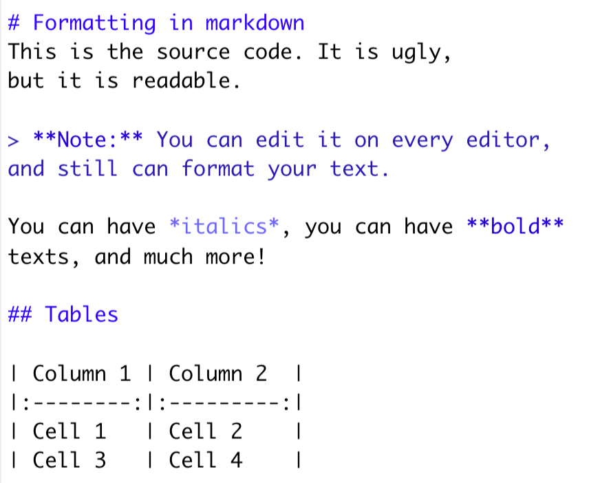
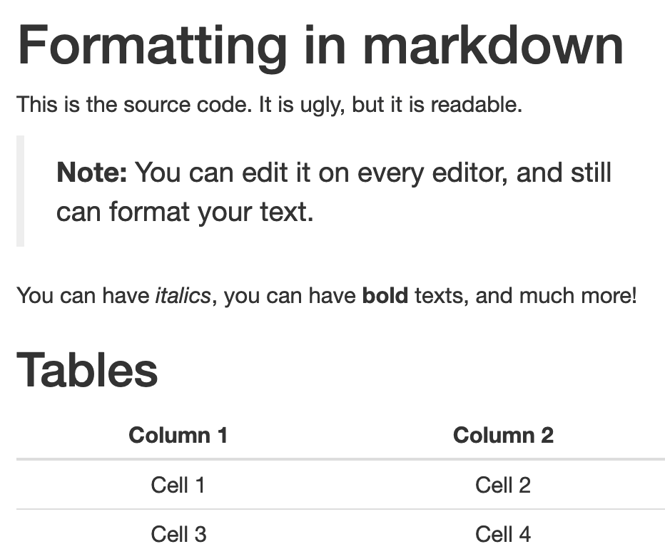
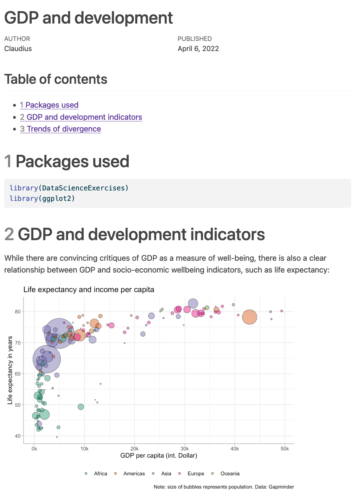
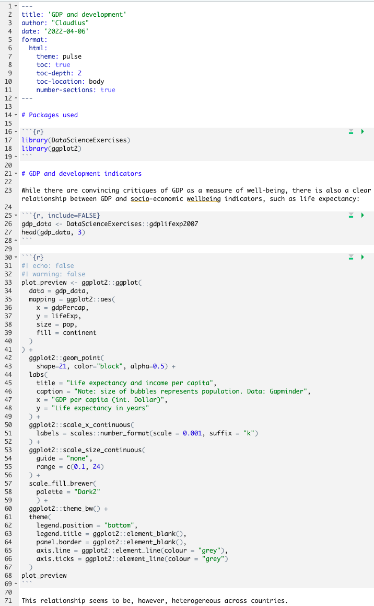
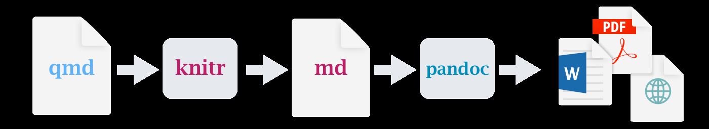
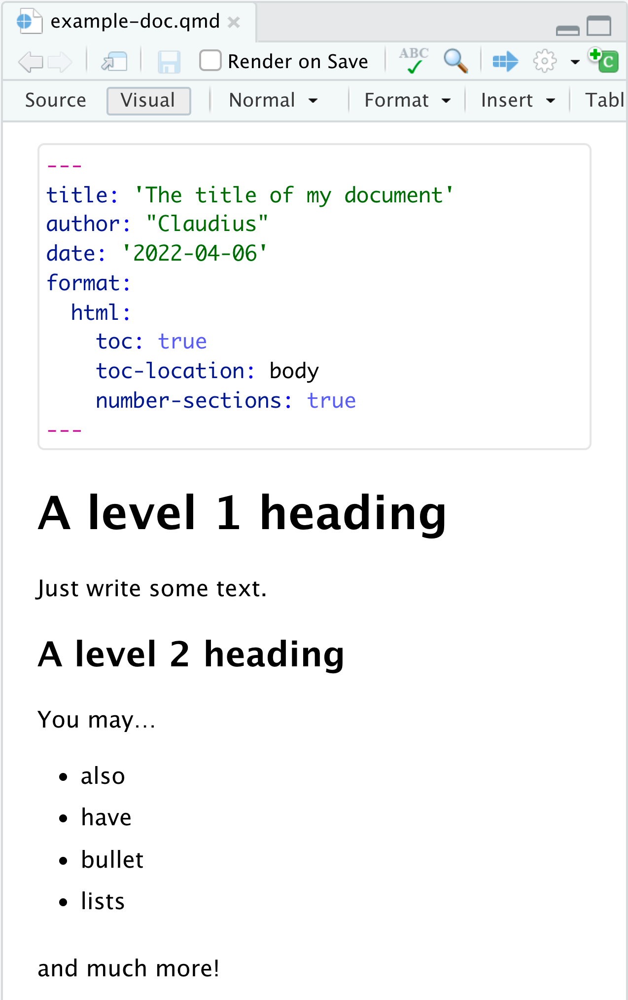
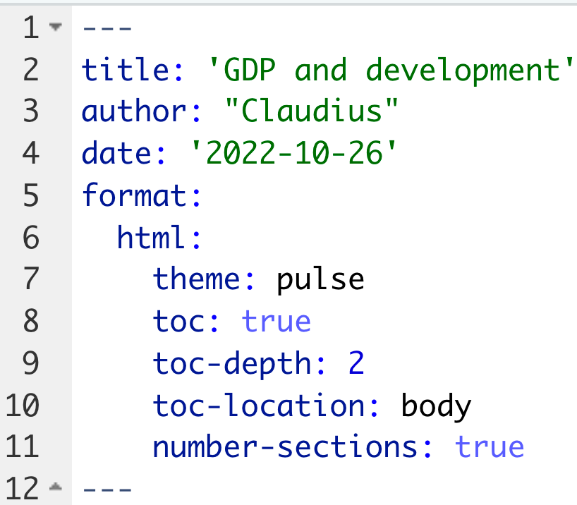

## Goals for today

::: {.columns}
::: {.column width="58%"}
::: {.nonincremental}
1. Understand what **Quarto** is and how it relates to **R Markdown** and
   **knitr**
2. Write your **first Quarto document**
3. Render Quarto documents into **html** and **PDF**
4. Become aware of specific challenges for **project management** when using
   Quarto
:::
:::

::: {.column width="42%"}
{width="86%" fig-align="center"}
:::
:::

# Part I: What is Quarto? {.divider background-color="#EAF0F4"}

## First: what is R Markdown?

R Markdown is a **document format** that lets you write documents containing code
of two languages:

- **R** code to perform statistical analysis → we know this (almost 😉)
- **Markdown** code to create formatted text using a plain text editor

::: {.columns}
::: {.column width="50%"}
{.shadow width="94%"}

::: {.center .tiny .muted}
the source — ugly, but readable
:::
:::

::: {.column width="50%"}
{.shadow width="94%"}

::: {.center .tiny .muted}
… and the rendered result
:::
:::
:::

## We skip the Markdown basics

::: {.callout-important appearance="default"}
## Please do this at home
We will **not** cover the basics of Markdown in class — it is quite boring in a
group. Please work through the **interactive Markdown tutorial** on the course
webpage instead.
:::

Markdown syntax is best learned by example, and the tutorial takes about twenty
minutes

## And what about Quarto?

- Quarto is basically a **next-generation version of R Markdown**
- It allows you to do everything you can do in R Markdown, but…
  - …it works with **more languages**, including Python and Julia
  - …it has some additional features and capabilities
- R Markdown will stay — but there is **no need to learn it any more**

## What is Quarto? The anatomy of a document

::: {.columns}
::: {.column width="52%"}
{.shadow width="94%"}
:::

::: {.column width="48%"}
{.shadow width="94%"}
:::
:::

::: {.smaller}
**header** (meta information) · **markdown** (the prose) · **chunk options** ·
**R chunks** (the code)
:::

## One source, many output formats

{width="88%" fig-align="center"}

::: {.columns .smaller}
::: {.column width="50%"}
- `bookdown` to write books
- `blogdown` to create websites
:::
::: {.column width="50%"}
- `learnr` to create exercises
- …and many more
:::
:::

::: {.takeaway .fragment}
The basic **syntax is the same** for all of these applications — which is why we
focus on it here
:::

# Part II: Quarto step by step {.divider background-color="#EAF0F4"}

## The five steps

::: {.boxed}
**1. Create the document** → **2. Fix the metadata in the header**
:::

::: {.boxed}
↻ **3. Write text in markdown** ⇄ **4. Embed R code in chunks** ⇄
**5. Render your document**
:::

::: {.boxed}
**6. Share your work**
:::

::: {.smaller}
Steps 3 to 5 are a **loop**, not a sequence — you render early and often
:::

## 1. Creating the document

- Create a new Quarto document and choose a template if adequate:
  **New ▸ Quarto document…**
- There are plenty of templates distributed as packages
  - For learning purposes it is best to start with a **blank document**
- After creating the document, **save it immediately**
  - Either in the subdirectory `R`, or in a separate top-level directory
    `quarto`

## 2. Specify the header

- The header contains **meta data**, and starts and ends with `---`
- Usually you should set at least `title`, `author` and `date`
- The header is written in **YAML** — indentation is meaningful

::: {.small}
```yaml
---
title: 'The title of my document'
author: "Claudius"
date: '2026-10-23'
format:
  html:
    toc: true
    toc-location: body
    number-sections: true
---
```
:::

::: {.smaller}
The output arguments are usually set later → a full overview of the keywords is
in the Quarto docs
:::

## 3. Write the main text

::: {.columns}
::: {.column width="52%"}
- Just write the text as you would in any normal text editor
- To format it, follow the **Markdown syntax**
- Syntax is best learned by example → interactive Markdown tutorial
- And: check out the **Visual editor** →
:::

::: {.column width="48%"}
{.shadow width="94%"}
:::
:::

## 4. Embed R code in chunks

- R code is written within **chunks** — shortcut on Mac: `⌘⌥ i`
- Each chunk starts with ` ```{{r}} ` and ends with ` ``` `

````markdown
```{{r}}
# This is a chunk
x <- 5
10 * x
```
````

- Within a chunk you write R code just as you already know it
- You can refer to objects defined in **chunks above** the one you work on
  - Referring to objects defined further down breaks the render

## Chunk options

- How the code is **shown and executed** is controlled via chunk options
- Traditionally they were added to the first line of the chunk; the **modern
  variant** is more consistent with Quarto syntax:

::: {.columns .small}
::: {.column width="50%"}
````markdown
```{{r, echo=FALSE}}

```
````

::: {.center .tiny .muted}
traditional
:::
:::

::: {.column width="50%"}
````markdown
```{{r}}
#| echo: false

```
````

::: {.center .tiny .muted}
modern — use this
:::
:::
:::

::: {.smaller}
`echo: true` shows the code *and* the result · `echo: false` shows only the
result
:::

## Finding and setting chunk options

- You get **suggestions** when pressing the Tab key
- When creating a new chunk, the **point-and-click option menu** is available
- You can set **defaults for the whole document** in the YAML header under
  `execute`:

::: {.small}
```yaml
---
title: 'The title'
author: "Claudius"
date: '2026-10-23'
execute:
  warning: false
  echo: false
---
```
:::

::: {.smaller}
Full list of chunk options:
[quarto.org/docs/reference/cells/cells-knitr.html](https://quarto.org/docs/reference/cells/cells-knitr.html)
:::

## 5. Render the document

- This should in fact be done **regularly** during step 3
  - Otherwise it is hard to identify the source of an error
- The **format** is determined in the header under `format`
- Rendering produces the output file next to your `.qmd`

::: {.columns}
::: {.column width="55%"}
{.shadow width="96%"}
:::

::: {.column width="45%"}
::: {.smaller}
- `html:` — the options below apply only to html output
- `theme:` — general property sets (fonts, paragraphs, …)
- `toc:`, `toc-depth:`, `toc-location:` — the table of contents
- `number-sections:` — numbering of sections
:::
:::
:::

## What the output options do

Adding four lines to the header changes the document considerably:

::: {.columns .small}
::: {.column width="50%"}
```yaml
---
title: 'GDP and development'
author: "Claudius"
date: '2026-10-23'
---
```

::: {.center .tiny .muted}
plain: no toc, unnumbered headings
:::
:::

::: {.column width="50%"}
```yaml
---
title: 'GDP and development'
author: "Claudius"
date: '2026-10-23'
format:
  html:
    theme: pulse
    toc: true
    toc-depth: 2
    number-sections: true
---
```

::: {.center .tiny .muted}
with toc, numbered sections, a theme
:::
:::
:::

## 6. Share your work

::: {.columns}
::: {.column width="52%"}
- Many different possibilities → see the further readings
  - The key question is usually the **format**
- A straightforward solution for html documents: **Netlify Drop**
  - [app.netlify.com/drop](https://app.netlify.com/drop)
- Prerequisites:
  - You create an **html** document
  - All relevant output data is in **one folder**
  - You produce an output called **`index.html`**
:::

::: {.column width="48%"}
{.shadow width="96%"}
:::
:::

## Practice! {.divider background-color="#EAF0F4"}

::: {.nonincremental .smaller}
- Write and render a document. The text should include…
  - …a heading of level 1 and 2 · …a text body · …a plot made with `ggplot2`
- Add meta data on `author`, `title` and `date`
- Render the document into **html**
- Deploy it via Netlify Drop and post the link on Moodle
:::

::: {.small}
```r
library(ggplot2)
ggplot(
  data = DataScienceExercises::aggGDPlifexp,
  mapping = aes(x = gdpPercap, y = lifeExp, color = continent)
) +
  geom_point() +
  theme_bw()
```
:::

::: {.smaller}
Note: the `.html` file must be called **`index.html`**
:::

# Part III: Project management with Quarto {.divider background-color="#EAF0F4"}

## Remarks on project organisation

::: {.takeaway}
The `here` package is **especially** important when writing Quarto documents
:::

- When rendering a qmd document, your computer is **not** using your current
  working directory
- Rather, the working directory is set to the **location of the qmd file**
- This means you **cannot copy-paste** code with relative paths from R scripts —
  unless you use the `here` package
- It is usually a good idea to put qmd files either into the folder `R`, or into
  a separate top-level directory `quarto`

# Part IV: Avoiding common mistakes {.divider background-color="#EAF0F4"}

## Look at the rendered version

- There are some very common mistakes
  - They screw up your document considerably and make it painful to read…
  - …but are actually very easy to avoid
- After completing a document, **always look at the rendered version** and check
  whether any of the problems on the next slide still exist

::: {.callout-tip appearance="default"}
## Task
Download `DesasterMarkdown.pdf` from the course homepage and collect the aspects
that bother you the most!
:::

## The black list of markdown turpitudes

::: {.smaller}
| Problem | Solution |
|:---|:---|
| Overly long or wide tables | Only print what is necessary; check whether `str()` or `dplyr::glimpse()` are more adequate |
| Uninformative warnings or messages | Use the chunk options `warning` and `message` (maybe set the default to `false`) |
| Too many or too few code chunks visible | Make sure you used the chunk options `echo` and `include` correctly |
| Important output is missing | Make sure you used the chunk option `include` correctly |
| Figures in inappropriate sizes | Adjust `out-width` / `out-height` or `fig-width` / `fig-height` |
:::

::: {.smaller}
Upgrade: make tables pretty with `knitr::kable()` and `kableExtra` ·
[full option reference](https://quarto.org/docs/reference/cells/cells-knitr.html)
:::

## Summary and outlook

- Quarto lets you write documents containing **R code** and **Markdown text**
- This allows you to do and describe your analysis within **one consistent
  document** → research becomes fully transparent and reproducible
- We covered the main steps: create the document · set meta data in the header ·
  write text · embed R code · render · share
- To learn markdown, do the **interactive tutorial**

::: {.takeaway .center .fragment}
A few mistakes easily screw up your document 😤 — and are just as easy to avoid 😏
:::
