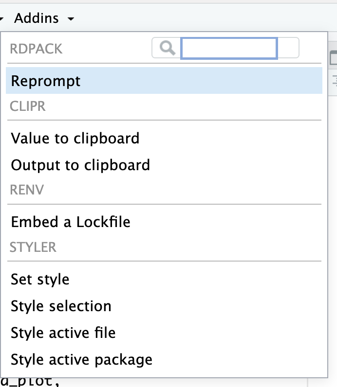
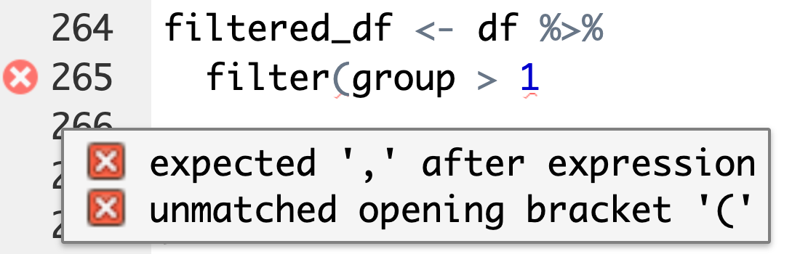
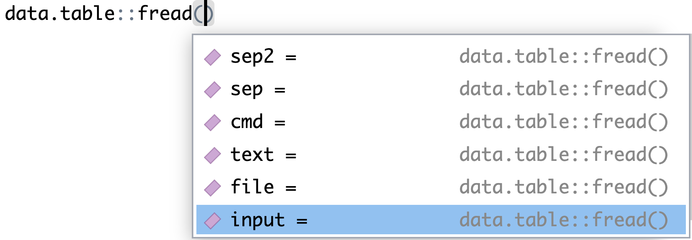

## Goals for today

::: {.nonincremental}
1. Understand **when, how and which** AI tools you can use to assist with coding
2. Know about **AI-like tools** that are useful in practice
3. Know some **tips to avoid typos** in your code, especially when in a hurry
:::

::: {.smaller}
Outline: common AI tools · use cases · style and formatters · avoiding typos
:::

# Part I: Common AI tools {.divider background-color="#EAF0F4"}

## Common AI tools

::: {.columns .smaller}
::: {.column width="50%"}
**General AI tools** that can help you to code:

- Claude
- ChatGPT
- Gemini Code Assist
:::

::: {.column width="50%"}
**Specific coding tools** with advanced code completion and chat interfaces,
usually built on top of the basic models:

- Windsurf
- Cursor
- GitHub Copilot
:::
:::

- **Free plans are usually sufficient** for students
- IDE integration is great — but **R Studio is less supported** than, e.g., VS Code

# Part II: Use cases for AI {.divider background-color="#EAF0F4"}

## 1. Code generation

::: {.boxed}
You know **what** you want to achieve, but you have no clue **how** to program it
:::

::: {.small}
> Help me in writing R code. Stay within the tidyverse dialect and explain your
> code using inline comments. I have a data set on wine: `alcohol`, `quality`,
> `residual sugar`, `kind`. Write code that computes average alcohol for all
> kinds of wine.

:::

::: {.callout-warning appearance="default"}
## Careful
This code might include **(silent) errors** — check carefully! The more details
and context you provide, the better.
:::

## 2. Development & syntax support

::: {.boxed}
You know what to do on the **content level** and which steps to take in R — but
you are unsure about the **implementation**
:::

::: {.small}
> I need to analyse our company's quarterly sales data using R and the tidyverse
> dialect. My background is in management studies, not programming. The csv has
> the columns `quarter_date`, `quarter`, `sales`, `region`, `product_category`.
> Write R code that imports the file, cleans the data, and creates a ggplot2
> figure that highlights trends and seasonality.

:::

::: {.callout-warning appearance="default"}
## Careful
Code is often **out of context** and might lead you down a blind alley. Precise
prompting and reflection on the answer are especially important.
:::

## 3. Code optimisation

::: {.boxed}
You have some code that does what you want — but it is very slow…
:::

::: {.small}
> I have written the following R function to compute the sum of squares from 1 to
> n. Please review my code and suggest changes to optimise this function for
> speed. Do not change the functioning of the code, only improve speed. Mark
> changes using comments and summarise them alongside your code answer.

:::

::: {.smaller}
In the example from the original slides, runtime fell to **0.005 %** and **8 %**
of the original — the loop was replaced by the closed formula $\frac{n(n+1)(2n+1)}{6}$
:::

::: {.callout-warning appearance="default"}
## Careful
Test carefully whether the functioning of the code really did **not** change, and
make sure the code works in **your** context(s)!
:::

## 4. Code explanation

::: {.boxed}
You found code that does what you need — but you do not understand it
:::

::: {.small}
> I am operating in a management context. I use the sales data from above. I want
> to predict future sales using Meta's prophet algorithm. I found the following R
> code that does this. I do not understand this code. Please explain it to me
> step by step.

:::

::: {.takeaway .fragment}
This is the use case with the **lowest risk** and often the highest learning
value — you are not asking for code, you are asking for understanding
:::

## 5. Code documentation

::: {.boxed}
You have written code that works — but you need to document it
:::

::: {.small}
> I have written the following function that computes ROI in R. Please provide a
> full `roxygen2` documentation of the function, including an example.

:::

::: {.callout-warning appearance="default"}
## Careful
Be **specific** regarding the kind of documentation you want — and check it!
:::

## 6. Code debugging

::: {.boxed}
Your code produces a warning or an unexpected result — and you cannot see why
:::

::: {.columns .smaller}
::: {.column width="50%"}
```r
df <- data.frame(
  id = 1:3,
  group = factor(c(1, 2, 3)))

filtered_df <- df %>%
  filter(group > "1")

print(filtered_df)
```
:::

::: {.column width="50%"}
```
Warning message:
There was 1 warning in `filter()`.
i In argument: `group > "1"`.
Caused by warning in `Ops.factor()`:
! '>' not meaningful for factors
```
:::
:::

::: {.smaller}
Paste **the code, the data structure and the exact error message**, and ask for
an explanation *before* asking for a solution
:::

## The six use cases at a glance

::: {.columns .smaller}
::: {.column width="50%"}
::: {.boxed}
**Code generation**
:::
::: {.boxed}
**Development & syntax support**
:::
::: {.boxed}
**Code optimisation**
:::
:::

::: {.column width="50%"}
::: {.boxed}
**Code explanation**
:::
::: {.boxed}
**Code documentation**
:::
::: {.boxed}
**Debugging**
:::
:::
:::

::: {.nonincremental .smaller}
- Always **cross-check** proposed code, beware of blind alleys
- Follow the guidelines for **prompt engineering** (appendix)
- Be cautious with **sensitive data**
- Properly **acknowledge and document** the use of AI tools
:::

## Verification strategies {.divider background-color="#EAF0F4"}

::: {.nonincremental .smaller}
1. **The three-check method**
   - Does it run without errors/warnings?
   - Does it produce sensible output? → dimensions, data types, NAs, viable ranges
   - Does it match your understanding? → can *you* explain the code?
2. **Test with a known example** → AI creates `calculate_roi()`, test it with
   `revenue = 150`, `cost = 100`
3. **Test with trivial data subsets** → reduce the data to 3–10 rows and compare
   with a manual calculation
4. **Add documentation, cross-check with other AIs** → ask for an explanation and
   a code review; paste it into a different tool or a fresh chat
:::

## Application exercise {.divider background-color="#EAF0F4"}

Get together in **groups of 2–3** and choose one task (material on the course
homepage):

::: {.columns .smaller}
::: {.column width="25%"}
::: {.boxed}
**Generate** code to find hidden patterns in sales data
:::
:::
::: {.column width="25%"}
::: {.boxed}
**Debug** an erroneous R function
:::
:::
::: {.column width="25%"}
::: {.boxed}
**Optimise** a slow loop
:::
:::
::: {.column width="25%"}
::: {.boxed}
**Document** an existing function
:::
:::
:::

::: {.nonincremental .smaller}
- Write down your specific prompt (~3 min) · generate a solution (~2 min) ·
  evaluate and improve the result (~10 min)
- What worked well? What needed improvement? How would you modify your prompt?
  Did you need to correct the code?
- After 15 minutes: share your experience in the plenum
:::

# Part III: Style and formatters {.divider background-color="#EAF0F4"}

## Formatter tools

::: {.columns}
::: {.column width="58%"}
Writing code in good style is **more than a matter of style**:

- Easier to **read** → facilitates collaboration, improves transparency
- Easier to **understand** → facilitates debugging and finding mistakes

There are good style guidelines, especially the
[Tidyverse Style Guide](https://style.tidyverse.org)

Re-writing code in good style is time consuming → use **formatters**
:::

::: {.column width="42%"}
::: {.smaller}
**`styler`** — easy to use, established, great R Studio integration → best option
for casual users

**`air`** — a modern formatter, extremely fast and powerful, but harder to set up
→ best option for power users
:::
:::
:::

## Intermediate task {.divider background-color="#EAF0F4"}

::: {.columns}
::: {.column width="58%"}
::: {.nonincremental}
- Take some code that you have produced so far and style it using **`styler`**
- Compare the styled and the original version — do you always like the styled
  version better?
:::

::: {.callout-tip appearance="default"}
## If you have not installed it yet
`install.packages("styler")` — then it also appears in the **Addins** menu of
R Studio
:::
:::

::: {.column width="42%"}
{.shadow width="88%"}
:::
:::

# Part IV: Avoiding typos {.divider background-color="#EAF0F4"}

## Tips to avoid typos

::: {.columns}
::: {.column width="52%"}
::: {.nonincremental}
- Develop code **step by step** and always **test** it regularly
- **Copy-paste** code that has worked
- **Copy-paste variable names**
- Use **auto-completion**
- Make use of the **linting tool** of R Studio
- **Style tools** such as `styler` also help
- If you suspect but cannot find a typo: ask your coding AI of choice
:::
:::

::: {.column width="48%"}
{.shadow width="96%"}

{.shadow width="96%"}
:::
:::

## Summary and outlook

- Use AI for coding assistance **if you feel comfortable using the language on
  your own** — only then can AI boost your productivity enormously
- Many tools exist, and free tiers are often sufficient
  - **Claude**, **ChatGPT**, **Gemini Code Assist** as general tools
  - **GitHub Copilot** as a specific tool with R Studio integration
- Use AI especially for **generation, debugging, optimisation, documentation and
  explanation**
  - Do not expect the final solution, but useful **hints and drafts**
- There are also **non-AI tools** that are very useful in practice, e.g. formatters

# Appendix: Prompt engineering for coding {.divider background-color="#EAF0F4"}

## The SPEC framework

::: {.smaller}
| | ❌ | ✅ |
|:--|:--|:--|
| **S**pecify the context | Create a plot of sales data | I have a tibble called `sales_df` with columns `date` (Date), `revenue` (numeric), `region` (character). Create a `ggplot2` line plot showing revenue over time. |
| **P**rovide constraints | Calculate average by group | Calculate average alcohol content by wine type using `dplyr`. Use pipe operators and keep the result in tidyverse format. |
| **E**xplain the goal | Filter my data | I need to identify outliers in my sales data. Filter for sales values more than 2 standard deviations from the mean. |
| **C**all for explanation | — | Explain your code using inline comments for each step. Include an example showing how to use this function. |
:::

## A general blueprint

::: {.columns .smaller}
::: {.column width="50%"}
```
Help me write R code using [package name].

I have data with these columns:
- [column1]: [type] - [description]
- [column2]: [type] - [description]

I want to [specific goal].

Please use [preferred style, e.g. tidyverse /
base R] and add comments explaining each step.
```
:::

::: {.column width="50%"}
```
Help me write R code using dplyr and ggplot2.

I have data with these columns:
- quarter_date: Date - quarterly dates 2020–2024
- sales: numeric - sales revenue in dollars
- region: character - North, South, East, West

I want to create a faceted line plot showing
sales trends for each region with proper labels
and a title.

Please use tidyverse pipes and add comments.
```
:::
:::

## More specific blueprints

::: {.columns .smaller}
::: {.column width="33%"}
**Debugging**

```
I want to achieve [X].
I'm getting this error:
  [exact error message]
Here's my code:
  [paste your code]
Here's my data structure:
  [paste str(your_data)]
Explain what's wrong and
how to fix it.
```
:::

::: {.column width="33%"}
**Optimisation**

```
I want to achieve [X].
This code works but runs
slowly on my dataset of
[X rows/size]:
  [paste your code]
Please suggest optimisations
for speed. Explain what makes
your version faster, and
ensure the output remains
identical.
```
:::

::: {.column width="34%"}
**Explanation**

```
I found this R code, but
don't fully understand it:
  [paste code]
Please explain:
1. What does each section do?
2. Why is [part] written
   this way?
3. What would happen if I
   changed [element]?
4. Is it a good
   implementation?
```
:::
:::

## What to include, and iterating

::: {.columns .smaller}
::: {.column width="50%"}
**Information to include (at least by default)**

::: {.nonincremental}
- **The overall goal**: context of the code
- **Data structure**: column names, types, sample values
- **Desired output**: what should the result look like?
- **Package preferences**: base R, tidyverse, data.table?
- **Current errors**: paste exact error messages
- **Your skill level**: "I'm new to ggplot2"
:::
:::

::: {.column width="50%"}
**Iteration is normal**

::: {.nonincremental}
- **Start broad**, get initial code
- **Test it**, identify issues
- **Follow up** with specific problems:
  - "This gives a warning about X, how do I fix it?"
  - "The output has unexpected NAs in column Y"
- Don't expect perfection on the first try — and don't accept unsatisfactory
  responses
:::
:::
:::

::: {.takeaway .center .fragment}
Treat it as a **conversation**, not a magic spell 🪄
:::
