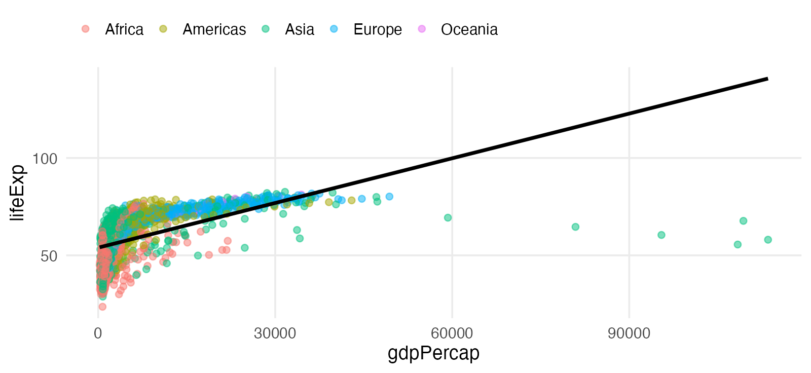
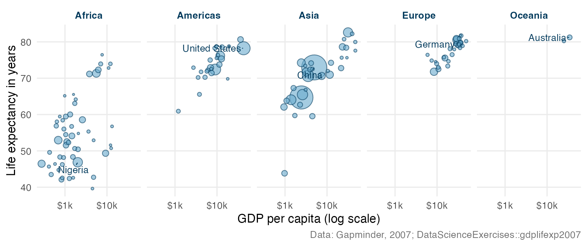
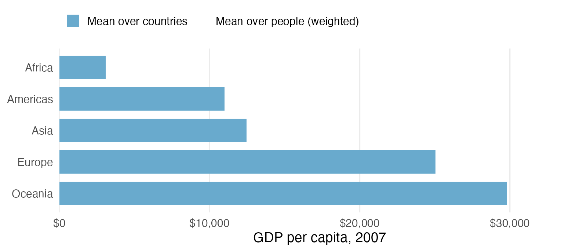
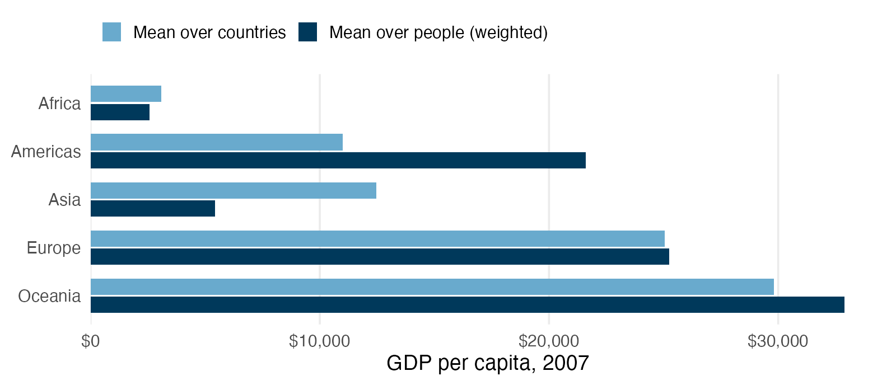
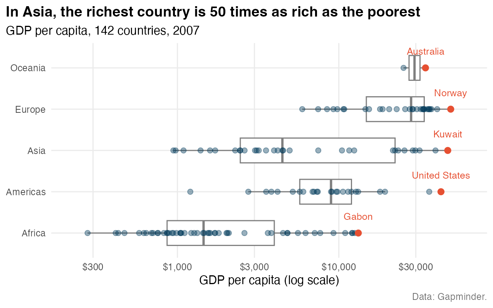

## Goals for today

::: {.nonincremental}
1. Decide **what to hand over** to an AI assistant — and what to keep
2. Know **what it costs** to use AI well — and when a template is faster
3. **Check** AI-written code before you trust it
:::

::: {.notes}
- Lecture 2 was about AI in research in general; today: AI for R code
- Short input, then most of the time for the exercise
:::

## The rule from lecture 2 still holds

- Use AI freely — the take-homes included
- **You own every line** you hand in
- **Declare** what you used it for

::: {.takeaway .fragment}
Today: what that means when an AI writes your R code
:::

::: {.notes}
- Same rule as in lecture 2, no new rules today
- "Own every line" = you must be able to explain it
:::

## Four competencies structure the session

<!-- Raw HTML so that each row can be a fragment (one row per click) -->
```{=html}
<table>
<thead><tr><th></th><th>Question</th><th>Topic today</th></tr></thead>
<tbody>
<tr class="fragment"><td><strong>Delegation</strong></td><td>What does the AI do, what do I do?</td><td>what to hand over · what it costs</td></tr>
<tr class="fragment"><td><strong>Description</strong></td><td>How do I say what I need?</td><td>the prompt · the template</td></tr>
<tr class="fragment"><td><strong>Discernment</strong></td><td>Is the result any good?</td><td>code · numbers · charts</td></tr>
<tr class="fragment"><td><strong>Diligence</strong></td><td>Do I take responsibility?</td><td>what not to paste · declaring it</td></tr>
</tbody>
</table>
```

::: {.smaller .muted}
Source: AI Fluency framework [@anthropic2025aifluency]
:::

::: {.callout-important .fragment}
## The AI answers on these slides
Written **for this course** · mistakes planted on purpose · all of them real ones
:::

::: {.notes}
- The four Ds come from Anthropic's free AI Fluency course
- Assistants answer differently each time → answers on slides are constructed
:::

# Delegation {.divider background-color="#EAF0F4"}

*What does the AI do, what do I do?*

## Hand over the *how*, keep the *what*

::: {.columns}
::: {.column width="50%"}
_How to_: **Hand it over**

- syntax you forgot
- explaining an error message
- explaining code, line by line
- a first draft of a chart
:::

::: {.column width="50%"}
_What to_: **Keep it**

- the **question** the chart answers
- which **rows** count
- which **summary** is right
- what the result **means**
:::
:::

::: {.takeaway .fragment}
A _chat assistant_ has **not seen your data** and **does not run your code**
:::

::: {.notes}
- Left: about how to write it; right: decisions about data and question
- The AI cannot make the right-hand decisions: it does not know your data
- It sounds equally confident when wrong
:::

## Good AI use costs knowledge and time

::: {.columns}
::: {.column width="50%"}
**What a good prompt needs**

::: {.nonincremental}
- the structure of your data
- the rows and the summary you want
- the chart: x, y, colour, facets
- **time**: write · read · check · fix
:::
:::

::: {.column width="50%" .fragment}
**What the evidence says**

::: {.nonincremental}
- Experienced developers were **slower** with AI — and believed they were faster [@metr2025measuring]
- Let the AI do it all → you **learn less** [@darvishi2024impact]
:::
:::
:::

::: {.takeaway .fragment}
Before you prompt: **could I write this myself or use one of my templates?**
:::

::: {.notes}
- The knowledge for a good prompt is the knowledge from sessions 4–8
- Prompting is not free: writing, reading, checking, fixing
- METR: 19% slower, felt 20% faster
- Learning: if the AI writes everything, you cannot check it later
:::

# Description {.divider background-color="#EAF0F4"}

*How do I say what I need?*

## Vague prompt, confident answer

::: {.columns}
::: {.column width="38%"}
**Prompt**

> make a chart of life expectancy and income by continent
:::

::: {.column width="62%" .fragment}
**Answer**

```r
library(gapminder)

ggplot(gapminder, aes(x = gdpPercap,
                      y = lifeExp,
                      color = continent)) +
  geom_point() +
  geom_smooth(method = "lm", color = "black")
```

*"As expected, life expectancy rises steadily with income."*
:::
:::

::: {.notes}
- Typical answer: runs, looks plausible
- Next slide: what is wrong with it
:::

## The answer fits the prompt, not your question

::: {.columns}
::: {.column width="58%"}
{width="100%"}
:::

::: {.column width="42%"}
- Not **your** data: a package you never loaded
- All **12 years** mixed: 1,704 rows
- "Steadily"? The points **flatten out** — the line predicts **140 years**
- "As expected": it has **never seen** your data
:::
:::

::: {.notes}
- gapminder package: 1952–2007; our data from session 8 is 2007 only
- Straight line on a linear axis: wrong shape, runs far beyond any real value
- The sentence describes the line it drew, not the data
:::

## A good prompt carries what you know

```text
I work in R with ggplot2. My data frame gdp_data has one row per country
in 2007. Here is str(gdp_data):  [paste the output]

Question: within each continent, do richer countries live longer?

Chart: x = gdpPercap on a log scale, y = lifeExp, point size = pop,
one panel per continent, label the most populous country per continent.

Style: data = and mapping = aes() written out; theme_minimal().
Do not write a title or any numbers. I will.
```

- **Data** · **question** · **chart** · **style**
- Every line needs what you learned in sessions 4–8

::: {.notes}
- str() output: AI sees column names and types
- Mapping sentence from session 8
- "No title, no numbers": we write those ourselves
:::

## The good prompt gets our chart

{width="84%" fig-align="center"}

::: {.fragment}
Runs at once · our rows · **we** decided, the AI typed
:::

::: {.notes}
- But: writing the prompt took ten minutes
- And every decision came from us
:::

## Often your own template beats a prompt

::: {.columns}
::: {.column width="55%"}
```r
ggplot(
  data = gdp_data,
  mapping = aes(x = gdpPercap, y = lifeExp,
                size = pop)) +
  geom_point(alpha = 0.65, shape = 21) +
  scale_x_log10() +                  # new
  facet_wrap(~ continent) +          # new
  labs(x = "GDP per capita",
       y = "Life expectancy in years") +
  theme_minimal()
```
:::

::: {.column width="45%"}
- The **session 8 code** + two new lines
- Three minutes, **no prompt**
- You understand every line
- Ask the AI one **small** question: *"how do I label only some points?"*
- Save it as an **RStudio snippet**: type its name, press <kbd>Shift</kbd>+<kbd>Tab</kbd> → appendix
:::
:::

::: {.takeaway .fragment}
A good template is a prompt you write **once**
:::

::: {.notes}
- Same chart as before, from our own code
- AI still useful for one small syntax question
- Snippet idea: write the code once, insert it with a short name; no copy-paste from old projects
- Tools → Edit Code Snippets; how-to and a full template in the appendix
- Templates can also go into a prompt: "use this code as the style"
:::

# Discernment {.divider background-color="#EAF0F4"}

*Is the result any good?*

## AI can make your results worse

- **Easy:** code that **crashes** 
- **Dangerous:** Code that **runs and is wrong**
- **Numbers** it never computed — in titles and sentences
- More code than you **understand** — you cannot check it

::: {.notes}
- Crash: e.g. geom_text_repel() without library(ggrepel)
- The other three you only catch if you check
- Next: one example for "runs and is wrong"
:::

## Code that runs — and is wrong

::: {.columns}
::: {.column width="38%"}
**Prompt:** *average GDP per capita by continent, 2007*

```r
gdp_data |>
  group_by(continent) |>
  summarise(
    gdp = mean(gdpPercap))
```

*"On average, Asians are richer than people in the Americas."*
:::

::: {.column width="62%" .fragment}
::: {.r-stack}
{width="100%"}

{.fragment width="100%"}
:::
:::
:::

::: {.notes}
- Every line correct, every number correct
- mean() over countries: Kuwait counts as much as China
- Weighted by population: Asia $5,400, Americas $21,600
- aggGDPlifexp from session 8 is built the same way — fine for some questions, wrong for "the average person"
:::

## Never let it write a number it has not computed

::: {.nonincremental}
**AI:** *"Since 1952, life expectancy in Africa rose by 25 years."*
:::

::: {.columns}
::: {.column width="58%" .fragment}
**Compute it first …**

```r
change <- aggGDPlifexp |>
  filter(continent == "Africa") |>
  summarise(change = lifeExp[year == 2007] -
                     lifeExp[year == 1952]) |>
  pull(change)
```

**… then paste it in**

```r
labs(title = paste(
  "Since 1952, life expectancy in Africa rose by",
  round(change, 1), "years"))
```
:::

::: {.column width="42%" .fragment}
| | 1952 | 2007 | Change |
|---|---|---|---|
| Africa | 39.1 | 54.8 | **+15.7** |

*"Since 1952, life expectancy in Africa rose by **15.7** years"*
:::
:::

::: {.takeaway .fragment}
Every number in a title comes from **your code** — never typed, never from the chat
:::

::: {.notes}
- Numbers: aggGDPlifexp, mean over African countries
- The AI produced a plausible-sounding number
- Fix: compute the number in R, store it, paste() it into the title
- Data change → title changes with it; no typos
:::

## Check AI code in four steps

1. **Run** it — fresh R session, your data
2. Check **`n`** — Oceania has **2** countries
3. **Recompute** one number — in a different way
4. **Read** every line — can you explain it?

::: {.takeaway .fragment}
The mistakes above are caught by steps 2 and 3, not by reading the code
:::

::: {.notes}
- n: count(gdp_data, continent)
- Recompute: e.g. weighted.mean() or filter one continent
- Read: if you cannot explain a line, ask the AI to explain it, then check
:::

# Diligence {.divider background-color="#EAF0F4"}

*Do I take responsibility?*

## Declare what you did — and what you checked

::: {.columns}
::: {.column width="45%"}
**Do not paste**

::: {.nonincremental}
- personal data
- interview transcripts
- anything confidential
:::
:::

::: {.column width="55%"}
**Declare**

::: {.nonincremental}
- **Tool** · **Used for**
- **What I checked** · **What I changed**
- **My own**
- **Personal or confidential data** — if any
- the statement of responsibility
:::
:::
:::

::: {.takeaway .fragment}
"I used ChatGPT" is not a declaration → template in [lecture 2](https://researchmethodology-fall26.netlify.app/content/lecture/ai-disclosure/)
:::

::: {.notes}
- Same as lecture 2; the disclosure page has the template
:::

# Exercise {.divider background-color="#EAF0F4"}

## One chart, three rounds

::: {.boxed}
*In 2007, how much does life expectancy vary within each continent — and which country has the lowest in each?*
:::

::: {.nonincremental}
| Round | Time | What you do |
|---|---|---|
| 1 · Just ask | 10 min | one-sentence prompt · run it · note what is wrong |
| 2 · Two routes | 15 min | **P**: the good prompt · **T**: the chart template |
| 3 · Check and own | 10 min | `n` · recompute one number · your title · declaration |

: {tbl-colwidths="[24,12,64]"}
:::

In pairs · worksheet on the course page · note your **minutes** in each round

::: {.notes}
- Pairs: left side route P, right side route T
- Route T: AI only for one small syntax question
- Log table in the worksheet: minutes, ran first time?, what was wrong
:::

## What did you find?

1. Which route got you **fastest** to a chart you would hand in?
2. What did the AI do that you would **not** have done?
3. Where did you need **your own** knowledge?
4. Your plan for the exam: **prompt**, **template**, or **yourself**?

::: {.notes}
- Collect minutes per route on the board
- Ask for examples of wrong answers
:::

## Summary

- Hand over the **how**, keep the **what** and the **whether**
- Good prompts need **knowledge and time** — compare with doing it yourself
- A good **template** often beats a prompt
- Check **`n`** and **recompute** — runs ≠ right
- Never let it write a **number** it has not computed

::: {.smaller .muted}
More: AI Fluency course on Anthropic Academy — free, 3–4 h [@anthropic2025aifluency]
:::

## References

::: {#refs .smaller}
:::

# Appendix {.divider background-color="#EAF0F4"}

*Prompt blueprints · a chart template · RStudio snippets*

## Blueprints for debugging and explaining

::: {.columns .smaller}
::: {.column width="50%"}
**Debugging**

```
I want to achieve [X].
I get this error:
  [exact error message]
Here is my code:
  [paste your code]
Here is my data:
  [paste str(your_data)]
Explain what is wrong and how to fix it.
```
:::

::: {.column width="50%"}
**Explaining**

```
I found this R code but do not
fully understand it:
  [paste code]
1. What does each line do?
2. Why is [part] written this way?
3. What happens if I change [element]?
```
:::
:::

::: {.takeaway .fragment}
Then explain it back **without** the chat
:::

## A template for a good chart

::: {.columns}
::: {.column width="55%"}
```r
ggplot(data = gdp_data,
       mapping = aes(x = gdpPercap, y = continent)) +
  geom_boxplot(outlier.shape = NA, width = 0.6) +
  geom_point(alpha = 0.4, size = 2.5) +
  geom_point(data = label_data, colour = "red") +
  geom_text(data = label_data, nudge_y = 0.4,
            mapping = aes(label = country)) +
  scale_x_log10(labels = label_dollar()) +
  # scale_x_continuous() +
  labs(title = paste0("In Asia, the richest ...",
                      round(asia_ratio), " ..."),
       x = "GDP per capita (log scale)", y = NULL,
       caption = "Data: Gapminder.") +
  theme_minimal(base_size = base_size) +
  theme(plot.title = element_text(face = "bold"),
        plot.title.position = "plot", ...)
```
:::

::: {.column width="45%"}
{width="100%"}

::: {.nonincremental}
- Title states a **computed** finding
- **Units** on axes · **source** in caption
- Every country visible · one **highlighted**
:::
:::
:::

::: {.notes}
- Shortened here; full version with a comment on every line: chart_template.R in lab09.zip
- Log or linear axis: one line each, switch with a #
- Route T starts from this; marked lines say what to change
:::

## Keep the template as an RStudio snippet

::: {.columns}
::: {.column width="55%"}
```
snippet gggood
	ggplot(
	  data = ${1:data},
	  mapping = aes(x = ${2:x}, y = ${3:y})
	) +
	  geom_point() +
	  labs(title = "${4:the finding}",
	       caption = "Data: ${5:source}.") +
	  theme_minimal()
```
:::

::: {.column width="45%"}
1. *Tools → Edit Code Snippets* → **R**
2. Paste it at the end: every line after `snippet` starts with a **Tab**
3. In a script or chunk: type `gggood`, press <kbd>Shift</kbd>+<kbd>Tab</kbd>
4. <kbd>Tab</kbd> jumps from one `${…}` field to the next
:::
:::

::: {.takeaway .fragment}
Write it **once**, insert it in every project with a few keystrokes
:::

::: {.notes}
- Snippets ship with RStudio (e.g. `fun` for a function); you add your own
- Same idea as the template: decisions taken once, reused
:::
